<h1 align="center">CAN-Sentinel</h1>

<p align="center">
  <b>Virtual CAN Environment &amp; ECU Traffic Simulation</b><br>
  Automotive ECU Intrusion Detection System — normal-traffic generation layer
</p>

<p align="center">
  
  
  
  
  
  
</p>

---

## Contents

- [Project Overview](#project-overview)
- [Objectives](#objectives)
- [System Architecture](#system-architecture)
- [ECU Simulators and CAN Message Configuration](#ecu-simulators-and-can-message-configuration)
- [Why These CAN IDs](#why-these-can-ids)
- [Normal CAN Traffic Generation](#normal-can-traffic-generation)
- [Role in CAN-Sentinel](#role-in-can-sentinel)
- [Implementation Scope](#implementation-scope)
- [Current Status](#current-status)
- [Development Workflow and Repository Layout](#development-workflow-and-repository-layout)
- [Implementation Guide](#implementation-guide)
  - [Step 1: Prepare the Kali Linux Environment](#step-1-prepare-the-kali-linux-environment)
  - [Step 2: Create the vcan0 Interface and Test CAN Communication](#step-2-create-the-vcan0-interface-and-test-can-communication)
  - [Step 3: Build the Baseline Six-ECU Simulator](#step-3-build-the-baseline-six-ecu-simulator)
  - [Step 4: Add the Simulator to the Repository and Validate It in Kali](#step-4-add-the-simulator-to-the-repository-and-validate-it-in-kali)
  - [Step 5: Review the Finalized CAN Protocol](#step-5-review-the-finalized-can-protocol)
  - [Step 6: Implement the Finalized Protocol and Realistic Signals](#step-6-implement-the-finalized-protocol-and-realistic-signals)
  - [Step 7: Verify Frame Format and Signal Variation](#step-7-verify-frame-format-and-signal-variation)
  - [Step 8: Validate and Tune the Transmission Rate](#step-8-validate-and-tune-the-transmission-rate)
  - [Step 9: Commit and Push the Final Source](#step-9-commit-and-push-the-final-source)
  - [Step 10: Improve Signal Realism and Reproducibility](#step-10-improve-signal-realism-and-reproducibility)
  - [Step 11: Record the Three 10-Minute Baseline Datasets](#step-11-record-the-three-10-minute-baseline-datasets)
  - [Step 12: Automated Payload Tests (Week 3)](#step-12-automated-payload-tests-week-3)
    - [Step 12.1: Unified Build Automation (Makefile)](#step-121-unified-build-automation-makefile)
    - [Step 12.2: Periodic Live Telemetry Banner and Execution Summary](#step-122-periodic-live-telemetry-banner-and-execution-summary)
    - [Step 12.3: Industry-Standard CAN Database (can_sentinel.dbc)](#step-123-industry-standard-can-database-can_sentineldbc)
    - [Step 12.4: Multi-Threaded Distributed Architecture (pthreads & C11 Atomics)](#step-124-multi-threaded-distributed-architecture-pthreads--c11-atomics)
    - [Step 12.5: Modern ANSI In-Place Digital Instrument Cluster](#step-125-modern-ansi-in-place-digital-instrument-cluster)
    - [Step 12.6: Real-Time Web-Based EV Sport Dashboard (Porsche Taycan / Audi e-tron Style)](#step-126-real-time-web-based-ev-sport-dashboard-porsche-taycan--audi-e-tron-style)
    - [Step 12.7: Dynamic PRND Transmission & Automatic Gear Indicator](#step-127-dynamic-prnd-transmission--automatic-gear-indicator)
    - [Step 12.8: Simultaneous Live Telemetry Feed & In-Place Diagnostic Logging](#step-128-simultaneous-live-telemetry-feed--in-place-diagnostic-logging)
    - [Step 12.9: Dynamic Color Grading and Multi-Level Threshold Alerts](#step-129-dynamic-color-grading-and-multi-level-threshold-alerts)
- [Step 13: WSL 2 Custom Kernel Environment Setup and Verification](#step-13-wsl-2-custom-kernel-environment-setup-and-verification)
- [Known Limitations](#known-limitations)
- [Expected Outcome](#expected-outcome)
- [Next Steps](#next-steps)

---

## Project Overview

**CAN-Sentinel** is an Automotive ECU Intrusion Detection System designed to simulate and monitor **Controller Area Network (CAN)** communication in a controlled virtual environment.

This implementation establishes a Linux-based virtual CAN environment using **SocketCAN** and the `vcan0` interface, followed by the development of C-based ECU simulators that generate legitimate baseline CAN traffic.

The virtual environment represents six vehicle subsystems: **Brake, Steering, Engine RPM, Vehicle Speed, Engine Temperature, and Infotainment**. Each ECU simulator generates normal vehicle-related data, encapsulates it into an eight-byte CAN frame using a predefined CAN identifier, and periodically transmits the frame through the `vcan0` virtual CAN bus.

The generated normal CAN traffic establishes a legitimate communication baseline for the subsequent CAN-Sentinel modules responsible for traffic monitoring, anomaly detection, and intrusion analysis.

## Objectives

- Configure and validate a virtual CAN network using Linux SocketCAN.
- Create and configure the `vcan0` virtual CAN interface.
- Develop C-based ECU simulators for different vehicle subsystems.
- Generate realistic and continuously changing normal CAN traffic.
- Assign predefined CAN identifiers to individual ECU messages.
- Transmit CAN frames through the `vcan0` interface at the agreed periods.
- Establish a consistent baseline of legitimate CAN communication.
- Provide normal CAN traffic for subsequent monitoring and intrusion detection modules.

## System Architecture

The implementation runs on **Kali Linux inside Oracle VirtualBox** and uses the Linux **SocketCAN** framework. The `vcan0` interface acts as the shared virtual CAN bus through which the simulated ECUs communicate.

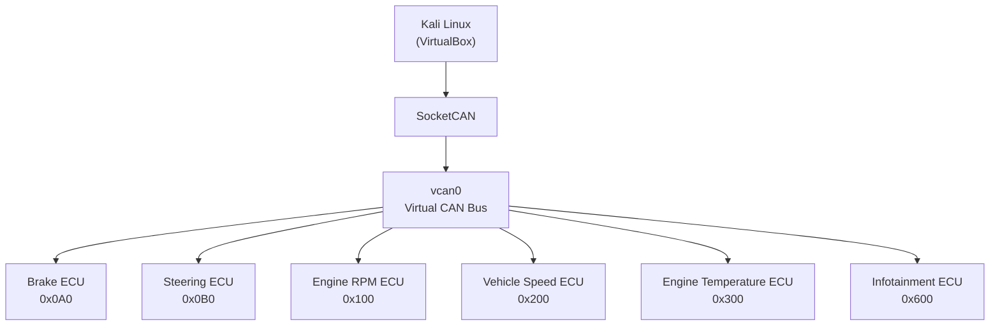

## ECU Simulators and CAN Message Configuration

The ECU simulators are implemented in **C** and represent different vehicle subsystems. Each simulator generates vehicle-related data and transmits it as a CAN frame through the `vcan0` interface.

The table below is the **finalized protocol** taken from the team's design document (`docs/week1_design.md` on `main`). All six frames use **DLC 8**, multi-byte values are **big-endian**, unused payload bytes are `0x00`, and **byte 7 carries a rolling counter** (0–255, wrapping to 0) that increments independently for each ECU.

| ECU | CAN ID | Period | DLC | Payload layout | Simulated range |
| --- | :---: | ---: | :---: | --- | --- |
| Brake | `0x0A0` | 20 ms | 8 | Byte 0: pressure (0–100); Byte 1: brake switch (0/1); Byte 7: counter | Pressure 0–100; Counter 0–255 |
| Steering | `0x0B0` | 10 ms | 8 | Bytes 0–1: signed angle in 0.1° units; Byte 7: counter | −45.0° to +45.0°; Counter 0–255 |
| Engine RPM | `0x100` | 10 ms | 8 | Bytes 0–1: RPM; Byte 7: counter | 800–4000 RPM; Counter 0–255 |
| Vehicle Speed | `0x200` | 20 ms | 8 | Byte 0: speed in km/h; Byte 7: counter | 0–130 km/h; Counter 0–255 |
| Engine Temperature | `0x300` | 100 ms | 8 | Byte 0: raw = °C + 40; Byte 7: counter | 80–105 °C; Counter 0–255 |
| Infotainment | `0x600` | 100 ms | 8 | Byte 0: status (0/1); Byte 7: counter | Status 0 or 1; Counter 0–255 |

> [!NOTE]
> **Byte 7 Rolling Counter Specification (0–255):**
> Every transmitted frame dedicates **Byte 7 (8 bits, `uint8_t`)** to an independent sequential rolling counter with an explicit range of **`0 – 255` (`0x00` – `0xFF`)**, wrapping from `255 → 0` (`0xFF → 0x00`). It does **not** use a 4-bit nibble (`0–15`). Each of the six ECUs maintains its own independent counter progression.

> [!NOTE]
> The CAN identifiers are simulation-specific and defined for the CAN-Sentinel virtual environment. They do not represent a production vehicle CAN database. The diagnostic identifier `0x7DF` is event-driven and is intentionally **excluded** from the six-frame periodic baseline.

> [!NOTE]
> The early prototype in Step 3 used different identifiers for Brake (`0x400`) and Steering (`0x500`), a DLC of 4, and single-shot transmission. Those values are superseded by the table above and appear only in the Step 3 evidence.

## Why These CAN IDs

On a CAN bus, when two nodes transmit at the same time, the frame with the **lower identifier wins arbitration** and is sent first. Safety-critical messages therefore receive the lowest identifiers: Brake (`0x0A0`) and Steering (`0x0B0`) always win over Engine RPM (`0x100`), Vehicle Speed (`0x200`), Engine Temperature (`0x300`), and Infotainment (`0x600`). This is also why the prototype values `0x400` and `0x500` were replaced: they would have given brake and steering lower priority than the engine and speed messages.

## Normal CAN Traffic Generation

Each ECU simulator runs on its own schedule. When an ECU's next transmission time is reached, the simulator updates the vehicle signals, encodes the frame, transmits it through `vcan0`, and schedules the next transmission one period later with approximately ±1 ms of timing jitter.

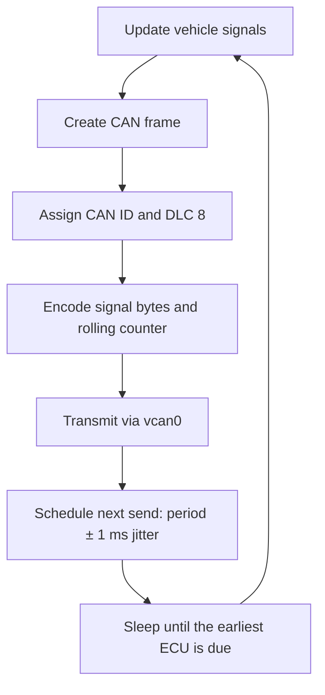

## Role in CAN-Sentinel

This implementation forms the **normal CAN traffic generation layer** of CAN-Sentinel.

The `vcan0` interface provides the virtual communication bus, while the six C-based ECU simulators generate legitimate baseline traffic. The resulting traffic can then be monitored by the project's traffic-sniffing component and analyzed by the anomaly detection and intrusion detection components.

## Implementation Scope

| Covered in this repository | Handled by other project modules |
| --- | --- |
| Linux SocketCAN configuration | Attack / packet injection |
| `vcan0` virtual CAN interface setup | CAN traffic sniffing |
| CAN interface validation | Anomaly detection and Isolation Forest |
| C-based ECU simulation (brake, steering, RPM, speed, temperature, infotainment) | Data logging |
| CAN frame generation and periodic transmission | PyQt dashboard |
| CAN ID and message definition | Intrusion alert visualization |
| Normal CAN traffic testing | |
| Implementation documentation and evidence | |

## Current Status

| Capability | Status |
| --- | :---: |
| Kali Linux / VirtualBox environment, `can-utils`, GCC, and Make | ✅ Done |
| `vcan0` created, verified, and tested with `cansend` / `candump` | ✅ Done |
| Display-only six-ECU prototype | ✅ Done |
| SocketCAN single-shot prototype verified with `candump` (DLC 4) | ✅ Done |
| Simulator source and build/run guide placed in `ecu_sim/` and validated in Kali | ✅ Done |
| Finalized protocol retrieved from the team design document | ✅ Done |
| Final simulator: DLC 8, six agreed IDs, rolling counters, varying signal values | ✅ Done |
| Frame format and signal variation verified with `candump` | ✅ Done |
| Baseline rate measured: about 294–298 frames/s, 92–93 % of the 320 target | ✅ Done |
| Shortfall diagnosed (deadline re-based on the post-transmission time) and scheduler correction compiled | ✅ Done |
| Corrected rate verified: 319.94–320.09 frames/s over three 10-second captures (average ≈ 320.03) | ✅ Done |
| Protocol confirmed unchanged after the scheduler correction (8.9) | ✅ Done |
| Corrected source placed in the repository and hash-verified against the tested copy (8.10) | ✅ Done |
| Per-ID interval statistics (8.11): resolved & stabilized via bounded-slack tuning and real-time scheduling (10.21, 12.4) | ✅ Done |
| Step 10: fixed 50 ms signal updates, 2–6 s brake hold, RPM derived from speed; compiled and runtime-validated per signal (10.1–10.19) | ✅ Done |
| Corrected Step 10 source placed in the repository and hash-verified (10.19) | ✅ Done |
| Step 10: optional random seed, rate/timing re-verification, `ecu_sim/README.md` update and commit (10.20) | ✅ Done |
| Step 10: bounded-slack scheduler tuning & rate stabilization under VM contention (10.21) | ✅ Done |
| Step 11: three 10-minute baseline datasets recorded with Member 3's logger | ✅ Done (Simulator verified & handed off to Member 3) |
| Step 12: automated payload tests (`test_payloads.c`) | ✅ Done (7/7 unit tests passed) |
| Step 12.1: unified build automation & test harness (`Makefile`) | ✅ Done |
| Step 12.2: periodic live telemetry banner & execution summary | ✅ Done |
| Step 12.3: industry-standard CAN database (`can_sentinel.dbc`) | ✅ Done |
| Step 12.4: multi-threaded distributed architecture (`pthreads` & C11 atomics) | ✅ Done |
| Step 12.5: modern ANSI in-place digital instrument cluster | ✅ Done |
| Step 12.6: real-time web-based EV sport dashboard (`make dashboard`) | ✅ Done |
| Step 12.7: dynamic PRND transmission & automatic gear indicator | ✅ Done |
| Step 12.8: simultaneous live telemetry feed & in-place diagnostic logging (`--log`) | ✅ Done |
| Step 12.9: dynamic ANSI color grading and multi-level threshold alerts | ✅ Done |
| Step 13: Windows 11 WSL 2 custom kernel SocketCAN environment & cross-verification | ✅ Done |

## Development Workflow and Repository Layout

The project supports two verified Linux execution environments alongside the Windows host:

| Environment | Role & Description | Reference / Setup |
| --- | --- | --- |
| **Windows host** (VS Code and PowerShell) | Holds the primary Git repository. Source editing, protocol review, documentation, and all Git operations are done here. | Primary repository workspace |
| **Kali Linux VM** (VirtualBox / VMware) | Traditional full Linux virtual machine running Kali. Compiles and tests the simulator against `vcan0`. | [Step 1](#step-1-prepare-the-kali-linux-environment) & [Step 2](#step-2-create-the-vcan0-interface-and-test-can-communication) |
| **Windows 11 WSL 2** (Kali Linux) | High-performance, lightweight Linux environment directly integrated with the Windows host via a custom SocketCAN-enabled kernel (`CONFIG_CAN=y`, `CONFIG_CAN_RAW=y`, `CONFIG_CAN_VCAN=m`). Enables instant host browser access for the digital dashboard (`http://localhost:8080`). | Dedicated [WSL 2 Custom Kernel Setup Guide](wsl2_setup.md) |

The simulator was first prototyped directly in the Kali workspace (Step 3). From Step 4 onward the repository copy on Windows is the single source of truth: it is edited in VS Code, synchronized to either Kali VM or WSL 2, and compiled and tested there.

```text
Windows host: D:\Study\Projects\CAN-Sentinel        (Git repository, branch member-1)
├── docs/member-1/
│   ├── README.md                          # Comprehensive Member 1 guide and lab reports
│   └── wsl2_setup.md                      # Dedicated WSL 2 custom kernel SocketCAN setup guide
└── ecu_sim/
    ├── .gitkeep
    ├── ecu_simulator.c                    # Six-ECU SocketCAN simulator
    ├── test_payloads.c                    # Automated unit verification suite
    ├── can_sentinel.dbc                   # Vector DBC specification
    ├── Makefile                           # Unified build and dashboard runner
    ├── README.md                          # ECU simulator build and run guide
    └── dashboard/                         # Self-contained EV Sport Digital Dashboard
        ├── bridge.py                      # SocketCAN to WebSocket bridge & web server
        ├── index.html                     # Hardware-accelerated Taycan-style frontend
        └── README.md                      # Dashboard architecture and payload schema

Execution Workspaces (Kali VM or WSL 2):
├── ecu_simulator.c                        # Copy of the repository source
├── test_payloads.c                        # Test runner source
├── Makefile                               # Build automation
├── dashboard/                             # EV sport dashboard package
└── ecu_simulator                          # Compiled SocketCAN binary
```

> [!NOTE]
> The Kali workspace folder is named `ecu-simulator`, while the repository folder is `ecu_sim`. All Kali commands in this guide use `ecu-simulator`; all repository paths use `ecu_sim`. This README and its `screenshots/` folder are kept together (for example in `docs/member-1/`).

---

# Implementation Guide

Each step lists the commands executed, their purpose, the verification output, and the corresponding screenshots. Screenshots are numbered continuously. Every file in `screenshots/` starts with its screenshot number (`01-…` to `34-…`), so the folder sorts in the same order as this guide. Each step is tagged with the environment in which it runs.

| Step | Goal | Environment | Screenshots | Key Tools |
| :---: | --- | :---: | :---: | --- |
| [1](#step-1-prepare-the-kali-linux-environment) | Verify Kali Linux and install the required packages | Kali | 1–3 | `uname`, `apt`, `gcc`, `can-utils` |
| [2](#step-2-create-the-vcan0-interface-and-test-can-communication) | Create, verify, and test `vcan0` | Kali | 4–6 | `modprobe`, `ip link`, `cansend`, `candump` |
| [3](#step-3-build-the-baseline-six-ecu-simulator) | Build the display-only and single-shot SocketCAN prototypes | Kali | 7–10 | `nano`, `gcc`, `candump` |
| [4](#step-4-add-the-simulator-to-the-repository-and-validate-it-in-kali) | Place the source and guide in the repository, then validate in Kali | Windows + Kali | 11–14 | VS Code, Git, `gcc`, `file` |
| [5](#step-5-review-the-finalized-can-protocol) | Retrieve and review the finalized CAN protocol | Windows | 15 | Git, PowerShell |
| [6](#step-6-implement-the-finalized-protocol-and-realistic-signals) | Implement the protocol, signals, and timing; compile and start | Windows + Kali | 16 | VS Code, `gcc` |
| [7](#step-7-verify-frame-format-and-signal-variation) | Verify frame format and signal variation | Kali | 17 | `candump` |
| [8](#step-8-validate-and-tune-the-transmission-rate) | Measure the rate, diagnose the shortfall, correct the scheduler, re-verify | Kali (+ Windows) | 18–23 | `candump`, `awk`, `gcc`, `diff` |
| [9](#step-9-commit-and-push-the-final-source) | Commit and push the final source | Windows | — | Git |
| [10](#step-10-improve-signal-realism-and-reproducibility) | Fix signal update rate, link RPM to speed, add a seed option | Kali (+ Windows) | 24–37 | `nano`, `gcc`, `candump`, `grep`, `sha256sum`, Git |
| [11](#step-11-record-the-three-10-minute-baseline-datasets) | Record three 10-minute baseline datasets with Member 3 | Kali | 38 | simulator, logger, validator |
| [12](#step-12-automated-payload-tests-week-3) | Automated payload tests & advanced features (12.1–12.9) | Kali / WSL 2 | 40–47, 51 | `gcc`, test program, ANSI, WebSocket |
| [13](#step-13-wsl-2-custom-kernel-environment-setup-and-verification) | WSL 2 custom kernel SocketCAN setup & cross-platform verification | Windows 11 WSL 2 | 48–50 | `WSL 2`, `vcan0`, `can-utils`, `gcc`, Browser |

---

## Step 1: Prepare the Kali Linux Environment

> **Environment:** Kali Linux VM

The simulator is developed and tested on **Kali Linux Rolling** running in **Oracle VirtualBox**. The virtual machine provides an isolated Linux environment for the **SocketCAN virtual CAN network**, the **C-based ECU simulators**, and CAN traffic monitoring. This step verifies the system and installs the CAN utilities and build tools.

### 1.1 Start the VM and Open a Terminal

The virtual machine is configured approximately as follows:

- **Operating System:** Kali GNU/Linux Rolling (version 2026.3)
- **Kernel:** 7.1.5+kali-amd64 (x86_64)
- **Platform:** Oracle VirtualBox
- **CPU / RAM / Storage:** 2+ cores, 4 GB or more, 40 GB or more
- **Network:** NAT
- **Compiler / CAN framework:** GCC / Linux SocketCAN

After starting the virtual machine, open the terminal via **Applications → System Tools → Terminal**. It is used throughout this guide to configure `vcan0`, compile the simulator, and verify CAN traffic.

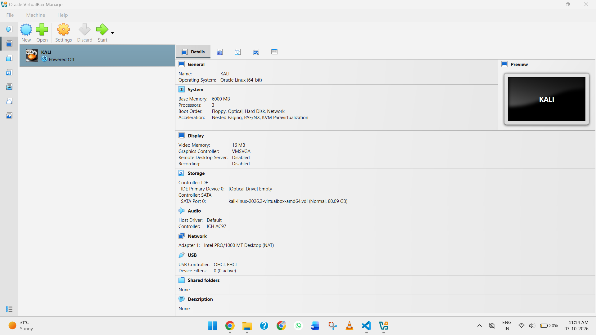

**Screenshot 1:** Kali Linux virtual machine running in Oracle VirtualBox.

### 1.2 Verify the Kernel, Operating System, and Compiler

Check the running kernel and architecture, the distribution release, and the GCC compiler:

```bash
uname -a
cat /etc/os-release
gcc --version
```

Example output:

```text
Linux kali 7.1.5+kali-amd64 #1 SMP PREEMPT_DYNAMIC Kali 7.1.5-1kali1 (2026-07-29) x86_64 GNU/Linux

PRETTY_NAME="Kali GNU/Linux Rolling"
NAME="Kali GNU/Linux"
VERSION_ID="2026.3"
VERSION="2026.3"
VERSION_CODENAME=kali-rolling
ID=kali
ID_LIKE=debian

gcc (Debian 16.2.0-3) 16.2.0
```

The output confirms a Kali GNU/Linux Rolling system on **x86_64** and shows that GCC is already available. GCC is required to compile the C-based ECU simulator.

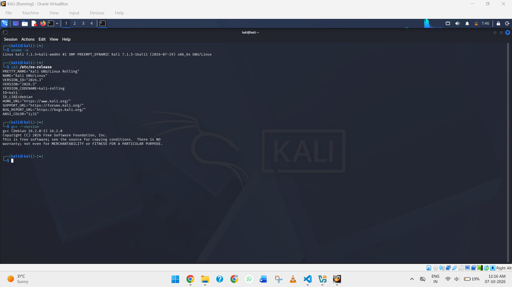

**Screenshot 2:** Terminal showing the Linux kernel, operating system release, and GCC version.

### 1.3 Install the Required Packages

Refresh the package index and install the CAN utilities and build tools:

```bash
sudo apt update
sudo apt install -y can-utils gcc make
```

The installed packages provide the following functionality:

- **can-utils** — Provides `candump`, `cansend`, and `cangen` for monitoring, transmitting, and generating CAN traffic.
- **GCC** — Compiles the C-based ECU simulator programs.
- **Make** — Supports automated compilation of the simulator build process.

### 1.4 Verify the CAN Utilities

Confirm that the `can-utils` package and Make are available:

```bash
candump --help
make --version
```

On this system `candump` reports an invalid option for `--help` and then prints its usage information and available options. This is expected and confirms that the utility is installed and executable. `candump` is used throughout this guide to monitor frames on `vcan0`.


**Screenshot 3:** Terminal showing the `candump` usage information, confirming that `can-utils` is installed.

**Result:** The Kali environment contains `can-utils`, GCC, and Make and is ready for the virtual CAN setup.

---

## Step 2: Create the vcan0 Interface and Test CAN Communication

> **Environment:** Kali Linux VM

Linux **SocketCAN** provides the framework for CAN communication, and the **Virtual CAN (`vcan`)** driver allows CAN communication to be simulated without physical hardware. The `vcan0` interface serves as the virtual CAN bus on which the ECU simulators transmit.

### 2.1 Create and Enable `vcan0`

```bash
sudo modprobe vcan
sudo ip link add dev vcan0 type vcan
sudo ip link set up vcan0
```

- `modprobe vcan` loads the Virtual CAN kernel module, which allows the system to create virtual CAN interfaces.
- `ip link add dev vcan0 type vcan` creates a virtual CAN interface named `vcan0` using the `vcan` driver.
- `ip link set up vcan0` changes the interface state to **UP** so it can participate in CAN communication.

### 2.2 Verify the Interface

```bash
ip link show vcan0
```

```text
3: vcan0: <NOARP,UP,LOWER_UP> mtu 2060 qdisc noqueue state UNKNOWN mode DEFAULT group default qlen 1000
    link/can
```

The detailed view and the type filter give additional confirmation:

```bash
ip -details link show vcan0
ip link show type vcan
```

```text
3: vcan0: <NOARP,UP,LOWER_UP> mtu 2060 qdisc noqueue state UNKNOWN mode DEFAULT group default qlen 1000
    link/can promiscuity 0 allmulti 0 minmtu 0 maxmtu 0
    vcan addrgenmode eui64 numtxqueues 1 numrxqueues 1 gso_max_size 65536 gso_max_segs 65535 ...
```

The output confirms that:

- The `vcan` kernel module was loaded and `vcan0` was created.
- The interface is **UP** and uses the **CAN link type** and the **`vcan` driver**.
- The virtual CAN bus is ready for frame transmission and reception.

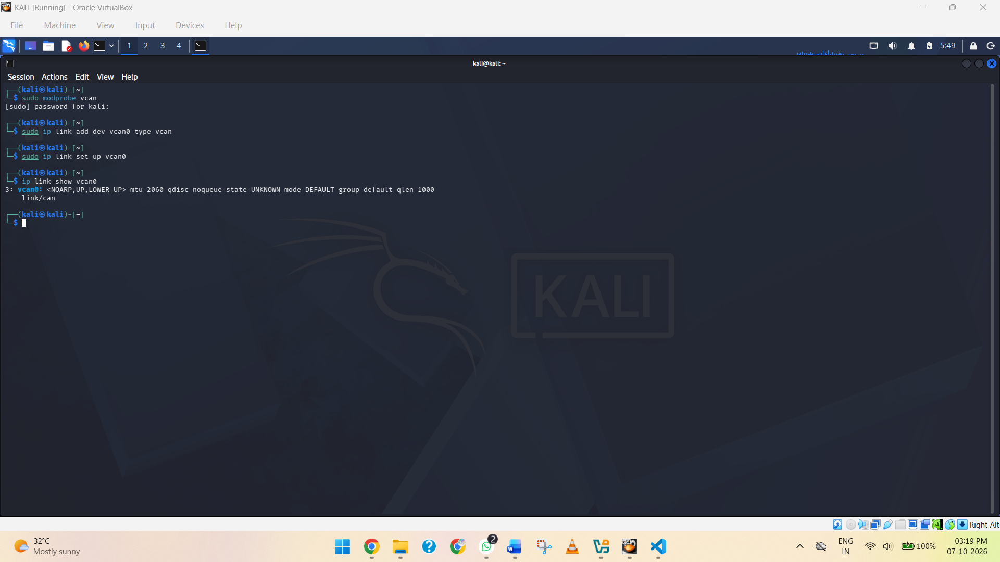

**Screenshot 4:** Terminal showing the `vcan0` interface verified with `ip link show vcan0`.

### 2.3 Test CAN Communication

The test uses two Kali terminals. One monitors traffic with `candump`; the other transmits a test frame with `cansend`.

**Terminal 1** — start monitoring and leave it running:

```bash
candump vcan0
```

**Terminal 2** — transmit a test frame:

```bash
cansend vcan0 123#1122334455667788
```

The test frame uses CAN ID `0x123`, 8 data bytes, and the data `11 22 33 44 55 66 77 88`. Terminal 1 received the frame:

```text
vcan0  123   [8]  11 22 33 44 55 66 77 88
```

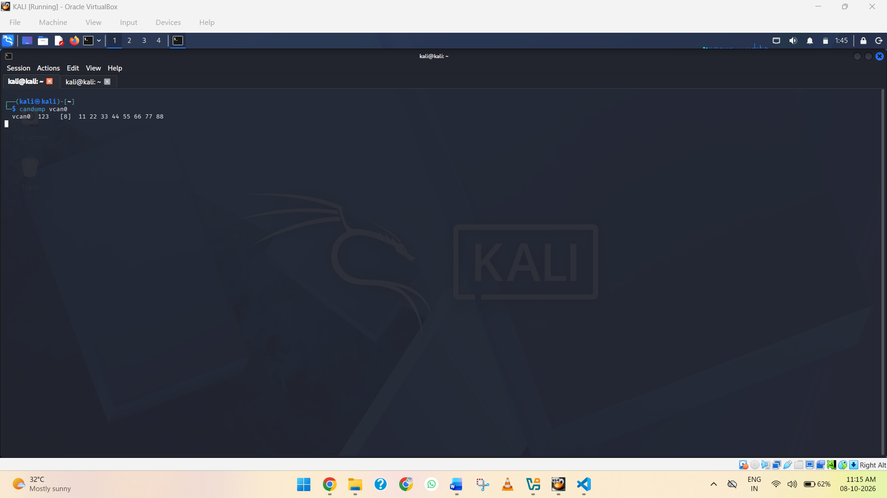

**Screenshot 5:** Terminal 1 showing the received CAN frame using `candump vcan0`.

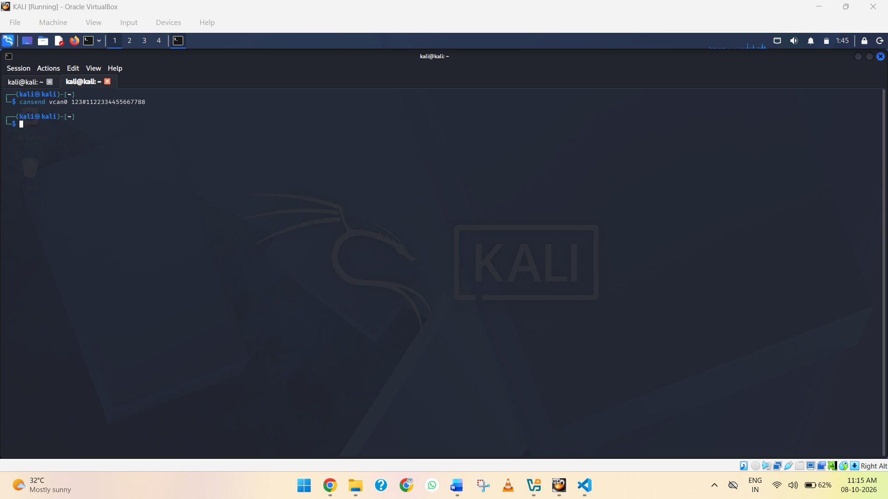

**Screenshot 6:** Terminal 2 showing the `cansend` command used to transmit the test frame.

The identifier, length, and payload were received exactly as transmitted, which confirms that the `vcan0` interface is operational.

### 2.4 `vcan0` Persistence (Optional)

`vcan0` is created at runtime and is **not persistent**: it disappears when the VM is rebooted or the interface is deleted. After a reboot, recreate it with the commands from 2.1.

For automatic recreation at boot, create a **systemd service** (optional; not part of the verified evidence):

```bash
sudo nano /etc/systemd/system/vcan0.service
```

```ini
[Unit]
Description=Create vcan0 virtual CAN interface
After=network.target

[Service]
Type=oneshot
RemainAfterExit=yes
ExecStart=/sbin/modprobe vcan
ExecStart=/sbin/ip link add dev vcan0 type vcan
ExecStart=/sbin/ip link set up vcan0
ExecStop=/sbin/ip link delete vcan0

[Install]
WantedBy=multi-user.target
```

```bash
sudo systemctl daemon-reload
sudo systemctl enable --now vcan0.service
```

> [!NOTE]
> Automatic recreation is optional. If the service is enabled, do not run `ip link add dev vcan0 type vcan` manually again, because the interface already exists.

**Result:** `vcan0` exists, is UP, and transmitted and received a test frame.

---

## Step 3: Build the Baseline Six-ECU Simulator

> **Environment:** Kali Linux VM

The simulator is first built as a display-only program and then upgraded to transmit real CAN frames through SocketCAN. This staged approach validates the toolchain and the CAN socket code before the finalized protocol is implemented.

### 3.1 Create the Workspace

```bash
mkdir -p ~/CAN-Sentinel/ecu-simulator
cd ~/CAN-Sentinel/ecu-simulator
pwd
```

`mkdir -p` creates the directory and any missing parents without error if it already exists. `pwd` should print:

```text
/home/kali/CAN-Sentinel/ecu-simulator
```

### 3.2 Create the Display-Only Simulator

```bash
nano ecu_simulator.c
```

<details>
<summary><b>View the display-only source (<code>ecu_simulator.c</code>)</b></summary>

```c
#include <stdio.h>
#include <unistd.h>

int main(void)
{
    int rpm = 1500;
    int speed = 60;
    int temperature = 90;
    int brake_pressure = 50;
    int steering_angle = 0;
    int infotainment_status = 1;

    printf("CAN-Sentinel ECU Simulator Started\n\n");

    printf("Engine RPM ECU (CAN ID: 0x100)\n");
    printf("Engine RPM: %d\n\n", rpm);

    printf("Speed ECU (CAN ID: 0x200)\n");
    printf("Vehicle Speed: %d km/h\n\n", speed);

    printf("Temperature ECU (CAN ID: 0x300)\n");
    printf("Engine Temperature: %d C\n\n", temperature);

    printf("Brake ECU (CAN ID: 0x400)\n");
    printf("Brake Pressure: %d\n\n", brake_pressure);

    printf("Steering ECU (CAN ID: 0x500)\n");
    printf("Steering Angle: %d degrees\n\n", steering_angle);

    printf("Infotainment ECU (CAN ID: 0x600)\n");
    printf("System Status: %d\n", infotainment_status);

    return 0;
}
```

</details>

Save with **Ctrl + O**, confirm with **Enter**, and exit with **Ctrl + X**. The prototype defines the six ECUs with their identifiers and initial values (prototype identifiers, superseded in Step 6):

| ECU | CAN ID (prototype) | Parameter | Initial Value |
| --- | :---: | --- | ---: |
| Engine RPM ECU | `0x100` | Engine RPM | 1500 RPM |
| Speed ECU | `0x200` | Vehicle Speed | 60 km/h |
| Temperature ECU | `0x300` | Engine Temperature | 90 °C |
| Brake ECU | `0x400` | Brake Pressure | 50 |
| Steering ECU | `0x500` | Steering Angle | 0 degrees |
| Infotainment ECU | `0x600` | System Status | 1 |

### 3.3 Compile and Run the Display-Only Simulator

```bash
gcc -Wall -Wextra -o ecu_simulator ecu_simulator.c
ls -l
./ecu_simulator
```

The compiler options are:

- **`-Wall`** — enables a broad set of common compiler warnings.
- **`-Wextra`** — enables additional warnings.
- **`-o ecu_simulator`** — names the generated executable.

The compilation completed without warnings or errors, `ls -l` shows the `ecu_simulator` executable next to `ecu_simulator.c`, and the program printed all six ECUs:

```text
CAN-Sentinel ECU Simulator Started

Engine RPM ECU (CAN ID: 0x100)
Engine RPM: 1500

Speed ECU (CAN ID: 0x200)
Vehicle Speed: 60 km/h

Temperature ECU (CAN ID: 0x300)
Engine Temperature: 90 C

Brake ECU (CAN ID: 0x400)
Brake Pressure: 50

Steering ECU (CAN ID: 0x500)
Steering Angle: 0 degrees

Infotainment ECU (CAN ID: 0x600)
System Status: 1
```

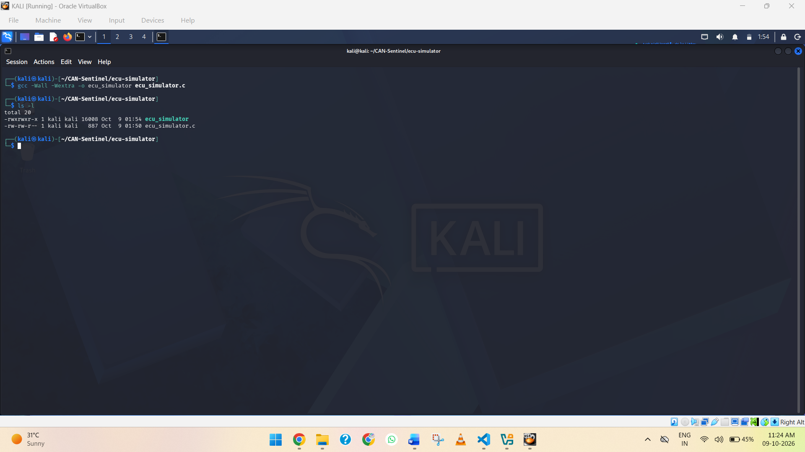

**Screenshot 7:** Terminal showing the GCC compilation, the executable listing, and the display-only simulator output.

> [!NOTE]
> This version only prints ECU information. It does not transmit CAN frames.

### 3.4 Verify SocketCAN Headers and Preserve the Baseline

Before adding CAN transmission, verify that the SocketCAN header files exist and keep a copy of the working display-only source:

```bash
ls /usr/include/linux/can.h /usr/include/linux/can/raw.h
cp ecu_simulator.c ecu_simulator_step8_backup.c
```

```text
/usr/include/linux/can.h
/usr/include/linux/can/raw.h
```

- **`can.h`** — core CAN data structures, constants, and definitions.
- **`can/raw.h`** — definitions for raw CAN sockets used to send and receive frames.


**Screenshot 8:** Terminal showing the active `vcan0` interface and the required SocketCAN header files.

### 3.5 Upgrade the Simulator to Transmit with SocketCAN

Open `ecu_simulator.c` and replace its contents with the SocketCAN version. It creates a raw CAN socket, binds it to `vcan0`, and sends **one frame per ECU** (DLC 4, value as a four-byte big-endian integer), then exits.

```bash
nano ecu_simulator.c
```

<details>
<summary><b>View the single-shot SocketCAN source</b></summary>

```c
#include <stdio.h>
#include <stdlib.h>
#include <string.h>
#include <unistd.h>
#include <stdint.h>
#include <errno.h>
#include <sys/socket.h>
#include <sys/ioctl.h>
#include <net/if.h>
#include <linux/can.h>
#include <linux/can/raw.h>

#define CAN_INTERFACE "vcan0"

static int send_can_frame(int sock, canid_t can_id,
                          const char *ecu_name, int value)
{
    struct can_frame frame = {0};

    frame.can_id = can_id;
    frame.can_dlc = 4;

    frame.data[0] = (uint8_t)((value >> 24) & 0xFF);
    frame.data[1] = (uint8_t)((value >> 16) & 0xFF);
    frame.data[2] = (uint8_t)((value >> 8) & 0xFF);
    frame.data[3] = (uint8_t)(value & 0xFF);

    ssize_t bytes_sent = write(sock, &frame, sizeof(frame));

    if (bytes_sent != sizeof(frame)) {
        if (bytes_sent < 0) {
            perror("CAN frame transmission failed");
        } else {
            fprintf(stderr, "Incomplete CAN frame transmission\n");
        }
        return -1;
    }

    printf("%s | CAN ID: 0x%03X | Value: %d\n",
           ecu_name, can_id, value);

    return 0;
}

int main(void)
{
    int rpm = 1500;
    int speed = 60;
    int temperature = 90;
    int brake_pressure = 50;
    int steering_angle = 0;
    int infotainment_status = 1;

    int sock = socket(PF_CAN, SOCK_RAW, CAN_RAW);

    if (sock < 0) {
        perror("SocketCAN socket creation failed");
        return EXIT_FAILURE;
    }

    struct ifreq ifr = {0};
    strncpy(ifr.ifr_name, CAN_INTERFACE, IFNAMSIZ - 1);

    if (ioctl(sock, SIOCGIFINDEX, &ifr) < 0) {
        perror("Failed to get CAN interface index");
        close(sock);
        return EXIT_FAILURE;
    }

    struct sockaddr_can addr = {0};
    addr.can_family = AF_CAN;
    addr.can_ifindex = ifr.ifr_ifindex;

    if (bind(sock, (struct sockaddr *)&addr, sizeof(addr)) < 0) {
        perror("Failed to bind SocketCAN interface");
        close(sock);
        return EXIT_FAILURE;
    }

    printf("CAN-Sentinel ECU Simulator Started\n");
    printf("CAN interface: %s\n\n", CAN_INTERFACE);

    int result = 0;

    result |= send_can_frame(sock, 0x100, "Engine RPM ECU", rpm);
    result |= send_can_frame(sock, 0x200, "Speed ECU", speed);
    result |= send_can_frame(sock, 0x300, "Temperature ECU", temperature);
    result |= send_can_frame(sock, 0x400, "Brake ECU", brake_pressure);
    result |= send_can_frame(sock, 0x500, "Steering ECU", steering_angle);
    result |= send_can_frame(sock, 0x600, "Infotainment ECU",
                             infotainment_status);

    close(sock);

    if (result != 0) {
        return EXIT_FAILURE;
    }

    printf("\nAll six ECU CAN frames transmitted successfully.\n");

    return EXIT_SUCCESS;
}
```

</details>

The program performs the following operations:

- **Socket creation:** `socket()` with `PF_CAN`, `SOCK_RAW`, and `CAN_RAW`.
- **Interface identification:** `ioctl()` retrieves the interface index of `vcan0`.
- **Socket binding:** `bind()` attaches the socket to `vcan0`.
- **Frame preparation:** assigns the CAN ID and encodes each value into four data bytes.
- **Transmission:** `write()` sends one frame per ECU.
- **Error handling and cleanup:** every setup and transmission failure is checked, and the socket is closed afterwards.

### 3.6 Compile and Run the SocketCAN Simulator

```bash
gcc -Wall -Wextra -o ecu_simulator ecu_simulator.c
ls -l ecu_simulator
./ecu_simulator
```

The compilation produced no warnings or errors. The program printed:

```text
CAN-Sentinel ECU Simulator Started

CAN interface: vcan0

Engine RPM ECU | CAN ID: 0x100 | Value: 1500
Speed ECU | CAN ID: 0x200 | Value: 60
Temperature ECU | CAN ID: 0x300 | Value: 90
Brake ECU | CAN ID: 0x400 | Value: 50
Steering ECU | CAN ID: 0x500 | Value: 0
Infotainment ECU | CAN ID: 0x600 | Value: 1

All six ECU CAN frames transmitted successfully.
```

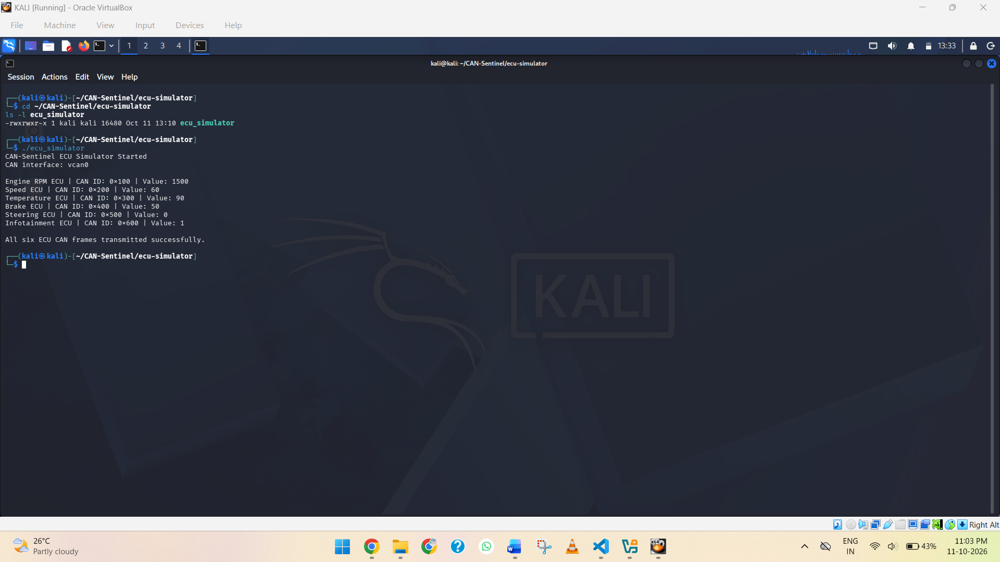

**Screenshot 9:** Terminal showing the executable listing, simulator startup, all six ECU messages, and the completion message.

This output alone does not prove that the frames reached the bus, so they are verified independently in the next sub-step.

### 3.7 Verify the Frames with `candump`

Start the capture in one terminal, then run the simulator in a second terminal:

```bash
# Terminal 1
candump vcan0

# Terminal 2
cd ~/CAN-Sentinel/ecu-simulator
./ecu_simulator
```

```text
vcan0  100   [4]  00 00 05 DC
vcan0  200   [4]  00 00 00 3C
vcan0  300   [4]  00 00 00 5A
vcan0  400   [4]  00 00 00 32
vcan0  500   [4]  00 00 00 00
vcan0  600   [4]  00 00 00 01
```

| ECU | CAN ID | DLC | Payload | Decoded value |
| --- | :---: | :---: | --- | ---: |
| Engine RPM | `0x100` | 4 | `00 00 05 DC` | 1500 |
| Speed | `0x200` | 4 | `00 00 00 3C` | 60 |
| Temperature | `0x300` | 4 | `00 00 00 5A` | 90 |
| Brake | `0x400` | 4 | `00 00 00 32` | 50 |
| Steering | `0x500` | 4 | `00 00 00 00` | 0 |
| Infotainment | `0x600` | 4 | `00 00 00 01` | 1 |

The payloads are four-byte **big-endian** integers (for example `00 00 05 DC` is 1500).


**Screenshot 10:** Terminal showing the six CAN frames captured on `vcan0`, including identifiers, DLC values, and payload bytes.

**Result:** The simulator's six frames are observable on `vcan0` and match the values reported by the program. This baseline still uses DLC 4, the prototype Brake/Steering identifiers, and single-shot transmission; Steps 5 and 6 bring it in line with the finalized protocol.

---

## Step 4: Add the Simulator to the Repository and Validate It in Kali

> **Environment:** Windows host (VS Code, PowerShell) for 4.1–4.4 and 4.8; Kali Linux VM for 4.5–4.7

From this step onward the Git repository on Windows is the source of truth. The simulator source and its build/run guide are placed in `ecu_sim/`, then the repository copy is compiled and checked in Kali.

### 4.1 Open the Repository in VS Code

```powershell
cd D:\Study\Projects\CAN-Sentinel
code .
```

### 4.2 Place the Simulator Source

Copy the SocketCAN simulator source from Step 3 into `ecu_sim/ecu_simulator.c` (2701 bytes). The existing `ecu_sim/.gitkeep` file is retained to preserve the directory in Git. Do not modify the source in this step.

### 4.3 Write the ECU Simulator Build and Run Guide

In the VS Code Explorer, right-click `ecu_sim/`, select **New File**, and name it `README.md`. The guide documents:

- **Prerequisites:** Kali Linux (or another Linux distribution with SocketCAN support), GCC, `can-utils`, and an active `vcan0` interface.
- **Virtual CAN setup** (only when `vcan0` does not already exist; do not run `ip link add` twice):

  ```bash
  sudo modprobe vcan
  sudo ip link add dev vcan0 type vcan
  sudo ip link set up vcan0
  ip link show vcan0
  ```

- **Compilation and execution**, run from the **repository root** rather than from `ecu_sim/`:

  ```bash
  gcc -Wall -Wextra -o ecu_sim/ecu_simulator ecu_sim/ecu_simulator.c
  ./ecu_sim/ecu_simulator
  ```

- **Frame verification** from a separate terminal:

  ```bash
  candump vcan0
  ```


**Screenshot 11:** VS Code displaying `ecu_sim/README.md` with the prerequisites, `vcan0` setup, compilation, execution, and frame-verification instructions.

### 4.4 Verify the Directory and Git State

Run these checks once, after the guide has been saved:

```powershell
Get-ChildItem .\ecu_sim
git branch --show-current
git status --short
```

```text
Directory: D:\Study\Projects\CAN-Sentinel\ecu_sim

Mode                 LastWriteTime         Length Name
----                 -------------         ------ ----
-a----         06-10-2026  11:14 PM              0 .gitkeep
-a----         11-10-2026  11:23 PM           2701 ecu_simulator.c
-a----         12-10-2026  01:34 PM           2065 README.md

member-1
?? ecu_sim/README.md
?? ecu_sim/ecu_simulator.c
```

The directory contains the source, the guide, and `.gitkeep`. The working branch is `member-1`, which is where all of this member's changes must remain. The `??` status means Git sees both files as untracked; they are committed in 4.8.


**Screenshot 12:** PowerShell showing `.gitkeep`, `ecu_simulator.c`, and `README.md` in the local `ecu_sim/` directory.


**Screenshot 13:** VS Code PowerShell showing `ecu_sim/README.md` and `ecu_sim/ecu_simulator.c` as untracked files on `member-1`.

### 4.5 Copy the Repository Source to Kali and Verify Integrity

Copy `ecu_sim/ecu_simulator.c` into the Kali workspace `~/CAN-Sentinel/ecu-simulator/` (VirtualBox shared folder, `scp`, or shared clipboard). Then confirm that both copies are identical by comparing SHA-256 hashes.

```powershell
# Windows (repository copy)
Get-FileHash .\ecu_sim\ecu_simulator.c -Algorithm SHA256
```

```bash
# Kali (workspace copy)
cd ~/CAN-Sentinel/ecu-simulator
sha256sum ecu_simulator.c
```

The two hashes must match (letter case may differ). If they do not, check the line endings: the VS Code status bar should show **LF** for C source files, because CRLF line endings change the hash.

### 4.6 Compile the Repository Copy and Verify the Executable

```bash
cd ~/CAN-Sentinel/ecu-simulator
gcc -Wall -Wextra -o ecu_simulator ecu_simulator.c
ls -lh ecu_simulator
file ecu_simulator
```

```text
-rwxrwxr-x 1 kali kali 17K Oct 12 07:13 ecu_simulator

ecu_simulator: ELF 64-bit LSB pie executable, x86-64, version 1 (SYSV), dynamically linked, interpreter /lib64/ld-linux-x86-64.so.2, BuildID[sha1]=ad7e9eedb60624f7739086404cb38767d1f812b4, for GNU/Linux 3.2.0, not stripped
```

The compilation completed without errors or warnings. `ls -lh` and `file` confirm a 64-bit x86-64 ELF executable that the owner, group, and others can run.


**Screenshot 14:** Kali terminal showing the executable's permissions, size, ELF format, and x86-64 architecture.

### 4.7 Run the Validated Build

Run the executable and capture six frames from a second terminal:

```bash
# Terminal 1
candump -n 6 vcan0

# Terminal 2
./ecu_simulator
```

The program printed the same six-ECU output as in Step 3.6, and `candump` captured the same six DLC 4 frames as in Step 3.7 (`0x100` to `0x600` with payloads `00 00 05 DC`, `00 00 00 3C`, `00 00 00 5A`, `00 00 00 32`, `00 00 00 00`, `00 00 00 01`). The repository baseline therefore behaves identically to the prototype.

### 4.8 Commit the Validated Baseline

Commit the validated baseline so that the Git history preserves it before the protocol changes in Step 6:

```powershell
git add ecu_sim/ecu_simulator.c ecu_sim/README.md
git commit -m "Add SocketCAN ECU simulator baseline and build guide"
```

**Result:** The simulator source and guide are in `ecu_sim/`, and the repository copy compiles and runs in Kali. The baseline still uses the earlier identifiers, DLC 4, and single-shot transmission.

---

## Step 5: Review the Finalized CAN Protocol

> **Environment:** Windows host (VS Code PowerShell)

The finalized CAN protocol is defined in `docs/week1_design.md` on the team's `main` branch. It is retrieved and reviewed on Windows, directly from the remote, before any code is changed.

### 5.1 Fetch the Latest Remote Information

```powershell
git fetch origin
```

A successful fetch updates the remote-tracking references (including `origin/main`) without switching branches or merging anything into `member-1`.

### 5.2 Display the Design Document

Show the document as it exists on `origin/main`, even though it is not checked out in the working tree:

```powershell
git show origin/main:docs/week1_design.md
git show origin/main:docs/week1_design.md | Select-String -Pattern '^## 2\.' -Context 0,40
```

The second command locates the ECU baseline table (Section 2). It specifies:

| CAN ID | ECU / Signal | Period | DLC | Payload layout |
| :---: | --- | ---: | :---: | --- |
| `0x0A0` | Brake | 20 ms | 8 | Byte 0: brake pressure (0–100); Byte 1: brake switch (0/1); Byte 7: rolling counter |
| `0x0B0` | Steering | 10 ms | 8 | Bytes 0–1: signed steering angle in 0.1° units; Byte 7: rolling counter |
| `0x100` | Engine RPM | 10 ms | 8 | Bytes 0–1: RPM (0–8000); Byte 7: rolling counter |
| `0x200` | Vehicle speed | 20 ms | 8 | Byte 0: speed in km/h (0–250); Byte 7: rolling counter |
| `0x300` | Engine temperature | 100 ms | 8 | Byte 0: coolant temperature with a 40 °C offset; Byte 7: rolling counter |
| `0x600` | Infotainment heartbeat | 100 ms | 8 | Byte 0: status; Byte 7: rolling counter |

The document also defines a diagnostic identifier:

| CAN ID | ECU / Signal | Period | DLC | Payload layout |
| :---: | --- | --- | :---: | --- |
| `0x7DF` | Diagnostic request | Event-driven | 8 | Standard OBD-II / UDS diagnostic request format |

`0x7DF` is event-driven and is not one of the six periodic ECU frames, so it is **not** part of the periodic normal-traffic baseline.


**Screenshot 15:** Terminal showing the ECU baseline table retrieved from `origin/main:docs/week1_design.md`.

### 5.3 Compare the Prototype with the Finalized Protocol

| Item | Prototype (Step 3) | Finalized protocol |
| --- | --- | --- |
| Brake / Steering IDs | `0x400` / `0x500` | `0x0A0` / `0x0B0` |
| Other IDs | `0x100`, `0x200`, `0x300`, `0x600` | Unchanged |
| DLC | 4 | 8 |
| Payload | One four-byte integer | Per-signal layout, unused bytes `0x00` |
| Rolling counter | None | Byte 7, independent per ECU |
| Transmission | Single shot, then exit | Continuous, periodic per ECU |
| Values | Fixed | Bounded, changing signal values |

The brake (`0x0A0`) and steering (`0x0B0`) frames have the lowest identifiers, so they win CAN arbitration (higher priority) when frames compete for the bus.

### 5.4 Define the Implementation Requirements

The updated simulator must satisfy the following:

1. Use the six periodic CAN identifiers from the team's baseline design.
2. Set the DLC to 8 for all six ECU frames.
3. Transmit at the specified periods: Brake 20 ms, Steering 10 ms, Engine RPM 10 ms, Vehicle speed 20 ms, Engine temperature 100 ms, Infotainment 100 ms.
4. Place a rolling counter in byte 7 of every frame, incrementing from 0 to 255 and wrapping to 0.
5. Encode multi-byte values (steering angle and RPM) in bytes 0–1 in **big-endian** byte order; the steering angle is a signed 16-bit value.
6. Encode engine temperature as **raw = °C + 40** (equivalently °C = raw − 40). For example, 90 °C is raw value 130 (`0x82`).
7. Keep the diagnostic identifier `0x7DF` outside the periodic baseline.

The nominal periods give the following baseline rate:

| ECU | Period | Frames per second |
| --- | ---: | ---: |
| Brake | 20 ms | 50 |
| Steering | 10 ms | 100 |
| Engine RPM | 10 ms | 100 |
| Vehicle speed | 20 ms | 50 |
| Engine temperature | 100 ms | 10 |
| Infotainment | 100 ms | 10 |
| **Total** | | **320** |

The target is therefore **320 CAN frames per second** across the six periodic messages.

**Result:** The protocol requirements are identified and the prototype differences are known. The implementation follows in Step 6.

---

## Step 6: Implement the Finalized Protocol and Realistic Signals

> **Environment:** Windows host (VS Code) for editing; Kali Linux VM for compiling and running

The simulator is rewritten to follow the finalized protocol and to generate more realistic vehicle signals with small timing variations. The source is edited in VS Code in the repository, then copied to Kali for compilation and testing.

### 6.1 Update the Source in VS Code

Open `ecu_sim/ecu_simulator.c` in VS Code and replace its contents with the program below.

> [!NOTE]
> This is the **initial implementation** of the finalized protocol, the version verified in Step 7. It is revised during the rate tuning in Step 8, so the current source is always the file in the repository (`ecu_sim/ecu_simulator.c`).

<details>
<summary><b>View the final source (<code>ecu_sim/ecu_simulator.c</code>)</b></summary>

```c
#include <errno.h>
#include <linux/can.h>
#include <linux/can/raw.h>
#include <net/if.h>
#include <signal.h>
#include <stdint.h>
#include <stdio.h>
#include <stdlib.h>
#include <string.h>
#include <sys/ioctl.h>
#include <sys/socket.h>
#include <time.h>
#include <unistd.h>

#define ECU_COUNT 6
#define DLC 8
#define JITTER_US 1000

typedef struct {
    canid_t can_id;
    long period_us;
    struct timespec next_send;
    uint8_t counter;
} ECU;

static volatile sig_atomic_t running = 1;

static ECU ecus[ECU_COUNT] = {
    {0x0A0,  20000, {0, 0}, 0},
    {0x0B0,  10000, {0, 0}, 0},
    {0x100,  10000, {0, 0}, 0},
    {0x200,  20000, {0, 0}, 0},
    {0x300, 100000, {0, 0}, 0},
    {0x600, 100000, {0, 0}, 0}
};

static int brake_pressure = 0;
static int brake_switch = 0;
static int steering_angle = 0;
static int engine_rpm = 1500;
static int vehicle_speed = 60;
static int engine_temp_c = 90;
static uint8_t infotainment_status = 1;

static void handle_signal(int signal_number)
{
    (void)signal_number;
    running = 0;
}

static long timespec_diff_us(const struct timespec *a,
                             const struct timespec *b)
{
    return (a->tv_sec - b->tv_sec) * 1000000L
         + (a->tv_nsec - b->tv_nsec) / 1000L;
}

static struct timespec add_us(struct timespec t, long us)
{
    t.tv_nsec += (us % 1000000L) * 1000L;
    t.tv_sec += us / 1000000L;

    if (t.tv_nsec >= 1000000000L) {
        t.tv_sec++;
        t.tv_nsec -= 1000000000L;
    }

    if (t.tv_nsec < 0) {
        t.tv_sec--;
        t.tv_nsec += 1000000000L;
    }

    return t;
}

static long random_jitter_us(void)
{
    return (long)(rand() % (2 * JITTER_US + 1)) - JITTER_US;
}

static int clamp_int(int value, int minimum, int maximum)
{
    if (value < minimum) return minimum;
    if (value > maximum) return maximum;
    return value;
}

static void update_signals(void)
{
    engine_rpm += (rand() % 101) - 50;
    engine_rpm = clamp_int(engine_rpm, 800, 4000);

    vehicle_speed += (rand() % 5) - 2;
    vehicle_speed = clamp_int(vehicle_speed, 0, 130);

    steering_angle += (rand() % 21) - 10;
    steering_angle = clamp_int(steering_angle, -450, 450);

    if (rand() % 100 < 8) {
        brake_switch = !brake_switch;
    }

    if (brake_switch) {
        brake_pressure += 5 + rand() % 11;
    } else {
        brake_pressure -= 2 + rand() % 9;
    }

    brake_pressure = clamp_int(brake_pressure, 0, 100);

    engine_temp_c += (rand() % 3) - 1;
    engine_temp_c = clamp_int(engine_temp_c, 80, 105);

    if (rand() % 1000 == 0) {
        infotainment_status = (uint8_t)(rand() % 2);
    }
}

static void prepare_frame(const ECU *ecu, struct can_frame *frame)
{
    memset(frame, 0, sizeof(*frame));
    frame->can_id = ecu->can_id;
    frame->can_dlc = DLC;

    switch (ecu->can_id) {
        case 0x0A0:
            frame->data[0] = (uint8_t)brake_pressure;
            frame->data[1] = (uint8_t)brake_switch;
            break;

        case 0x0B0: {
            int16_t angle = (int16_t)steering_angle;
            frame->data[0] =
                (uint8_t)(((uint16_t)angle >> 8) & 0xFF);
            frame->data[1] =
                (uint8_t)((uint16_t)angle & 0xFF);
            break;
        }

        case 0x100:
            frame->data[0] =
                (uint8_t)((engine_rpm >> 8) & 0xFF);
            frame->data[1] = (uint8_t)(engine_rpm & 0xFF);
            break;

        case 0x200:
            frame->data[0] = (uint8_t)vehicle_speed;
            break;

        case 0x300:
            frame->data[0] = (uint8_t)(engine_temp_c + 40);
            break;

        case 0x600:
            frame->data[0] = infotainment_status;
            break;

        default:
            break;
    }

    frame->data[7] = ecu->counter;
}

static int send_frame(int socket_fd, ECU *ecu)
{
    struct can_frame frame;
    prepare_frame(ecu, &frame);

    ssize_t bytes_sent = write(socket_fd, &frame, sizeof(frame));

    if (bytes_sent != (ssize_t)sizeof(frame)) {
        if (bytes_sent < 0) {
            perror("CAN frame transmission failed");
        } else {
            fprintf(stderr, "Incomplete CAN frame transmission\n");
        }
        return -1;
    }

    ecu->counter++;
    return 0;
}

int main(void)
{
    int socket_fd;
    struct ifreq interface_request;
    struct sockaddr_can address;

    srand((unsigned int)time(NULL));
    signal(SIGINT, handle_signal);
    signal(SIGTERM, handle_signal);

    socket_fd = socket(PF_CAN, SOCK_RAW, CAN_RAW);
    if (socket_fd < 0) {
        perror("Failed to create CAN socket");
        return EXIT_FAILURE;
    }

    memset(&interface_request, 0, sizeof(interface_request));
    strncpy(interface_request.ifr_name, "vcan0",
            sizeof(interface_request.ifr_name) - 1);

    if (ioctl(socket_fd, SIOCGIFINDEX, &interface_request) < 0) {
        perror("Failed to obtain vcan0 interface index");
        close(socket_fd);
        return EXIT_FAILURE;
    }

    memset(&address, 0, sizeof(address));
    address.can_family = AF_CAN;
    address.can_ifindex = interface_request.ifr_ifindex;

    if (bind(socket_fd, (struct sockaddr *)&address,
             sizeof(address)) < 0) {
        perror("Failed to bind CAN socket to vcan0");
        close(socket_fd);
        return EXIT_FAILURE;
    }

    struct timespec now;
    if (clock_gettime(CLOCK_MONOTONIC, &now) < 0) {
        perror("Failed to read monotonic clock");
        close(socket_fd);
        return EXIT_FAILURE;
    }

    for (int i = 0; i < ECU_COUNT; i++) {
        ecus[i].next_send = add_us(now, random_jitter_us());
    }

    printf("CAN-Sentinel ECU Simulator Started\n");
    printf("CAN interface: vcan0\n");
    printf("Protocol: six periodic ECU frames, DLC 8\n");
    printf("Signal simulation: enabled\n");
    printf("Timing jitter: approximately +/-1 ms\n");
    printf("Press Ctrl+C to stop.\n");
    fflush(stdout);

    while (running) {
        if (clock_gettime(CLOCK_MONOTONIC, &now) < 0) {
            perror("Failed to read monotonic clock");
            break;
        }

        for (int i = 0; i < ECU_COUNT && running; i++) {
            if (timespec_diff_us(&now, &ecus[i].next_send) >= 0) {
                update_signals();

                if (send_frame(socket_fd, &ecus[i]) < 0) {
                    running = 0;
                    break;
                }

                if (clock_gettime(CLOCK_MONOTONIC, &now) < 0) {
                    perror("Failed to read monotonic clock");
                    running = 0;
                    break;
                }

                long interval = ecus[i].period_us
                              + random_jitter_us();

                ecus[i].next_send = add_us(now, interval);
            }
        }

        if (running) {
            struct timespec earliest = ecus[0].next_send;

            for (int i = 1; i < ECU_COUNT; i++) {
                if (timespec_diff_us(&ecus[i].next_send,
                                     &earliest) < 0) {
                    earliest = ecus[i].next_send;
                }
            }

            if (clock_gettime(CLOCK_MONOTONIC, &now) < 0) {
                perror("Failed to read monotonic clock");
                break;
            }

            long wait_us = timespec_diff_us(&earliest, &now);

            if (wait_us > 0) {
                struct timespec delay = {
                    .tv_sec = wait_us / 1000000L,
                    .tv_nsec = (wait_us % 1000000L) * 1000L
                };

                while (nanosleep(&delay, &delay) < 0
                       && errno == EINTR && running) {
                    /* Resume sleep after an interrupt. */
                }
            }
        }
    }

    close(socket_fd);
    printf("\nCAN-Sentinel ECU Simulator stopped.\n");
    return EXIT_SUCCESS;
}
```

</details>

The implementation introduces the following changes:

- **Dynamic signals:** brake pressure and brake switch state, plus gradual changes in steering angle, engine RPM, and vehicle speed, with small coolant-temperature variations and an infotainment status field. All values are clamped to the ranges listed in the protocol table.
- **Per-ECU scheduling:** each ECU has its own nominal period and next-send time, with approximately ±1 ms of random timing jitter.
- **Eight-byte frames:** DLC 8, unused bytes zero, and an independent rolling counter in byte 7.
- **Big-endian encoding:** RPM and the signed steering angle occupy bytes 0–1; temperature is sent as °C + 40.
- **Graceful termination:** `Ctrl+C` (SIGINT) or SIGTERM stops the loop and closes the socket cleanly.
- **Range validation:** every signal is clamped to its protocol range before encoding (`clamp_int`), so normal traffic never contains out-of-range values that the detection engine could mistake for an attack.
- **Error handling:** socket creation, interface lookup (`ioctl`), `bind`, every `write`, and every `clock_gettime` call are checked. On failure the simulator prints a clear error with `perror` and exits with a non-zero status, so it never claims to be transmitting when it is not. The rolling counter only advances after a successful write.

Save the file in VS Code. Because the final source replaces the Step 3 version, the previous version remains recoverable from the Step 4.8 commit.

### 6.2 Copy the Source to Kali and Verify Integrity

Copy `ecu_sim/ecu_simulator.c` to `~/CAN-Sentinel/ecu-simulator/ecu_simulator.c` as in Step 4.5 and confirm that the hashes match:

```powershell
# Windows
Get-FileHash .\ecu_sim\ecu_simulator.c -Algorithm SHA256
```

```bash
# Kali
cd ~/CAN-Sentinel/ecu-simulator
sha256sum ecu_simulator.c
```

### 6.3 Compile the Final Simulator

```bash
gcc -Wall -Wextra -o ecu_simulator ecu_simulator.c
```

The compiler should return to the prompt without printing warnings or errors.

### 6.4 Start the Simulator

Make sure `vcan0` is up (`ip link show vcan0`), then run:

```bash
./ecu_simulator
```

```text
CAN-Sentinel ECU Simulator Started
CAN interface: vcan0
Protocol: six periodic ECU frames, DLC 8
Signal simulation: enabled
Timing jitter: approximately +/-1 ms
Press Ctrl+C to stop.
```

The simulator stays running and transmits continuously until it is stopped with `Ctrl+C`. Leave it running for Step 7.

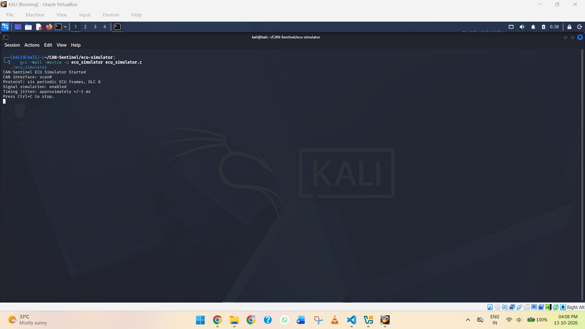

**Screenshot 16:** Kali terminal showing the GCC compilation and the final simulator startup banner.

**Result:** The final simulator is compiled and running. Frame contents and signal behavior are verified in Step 7, and the transmission rate in Step 8.

---

## Step 7: Verify Frame Format and Signal Variation

> **Environment:** Kali Linux VM

With the simulator running in the first terminal, `candump` in a second terminal verifies the frame format and the signal behavior. The transmission rate is measured separately in Step 8. The capture below was taken from the initial implementation (6.1); later revisions do not change the frame layout.

### 7.1 Capture and Inspect CAN Traffic

```bash
candump -n 40 vcan0
```

The command captures 40 frames. This is long enough for the slower 100 ms Engine Temperature and Infotainment messages to appear. Captured output:

```text
vcan0  0B0   [8]  FF 4F 00 00 00 00 00 7F
vcan0  100   [8]  07 A6 00 00 00 00 00 7A
vcan0  0B0   [8]  FF 55 00 00 00 00 00 80
vcan0  100   [8]  07 7E 00 00 00 00 00 7B
vcan0  200   [8]  80 00 00 00 00 00 00 60
vcan0  0A0   [8]  4D 00 00 00 00 00 00 62
vcan0  0B0   [8]  FF 5F 00 00 00 00 00 81
vcan0  100   [8]  07 7D 00 00 00 00 00 7C
vcan0  0B0   [8]  FF 59 00 00 00 00 00 82
vcan0  0A0   [8]  47 00 00 00 00 00 00 63
vcan0  100   [8]  07 A4 00 00 00 00 00 7D
vcan0  200   [8]  81 00 00 00 00 00 00 61
vcan0  0B0   [8]  FF 57 00 00 00 00 00 83
vcan0  100   [8]  07 9C 00 00 00 00 00 7E
vcan0  0B0   [8]  FF 5B 00 00 00 00 00 84
vcan0  0A0   [8]  44 00 00 00 00 00 00 64
vcan0  200   [8]  80 00 00 00 00 00 00 62
vcan0  100   [8]  07 A5 00 00 00 00 00 7F
vcan0  0B0   [8]  FF 54 00 00 00 00 00 85
vcan0  100   [8]  07 97 00 00 00 00 00 80
vcan0  600   [8]  01 00 00 00 00 00 00 B3
vcan0  0A0   [8]  3C 00 00 00 00 00 00 65
vcan0  0B0   [8]  FF 52 00 00 00 00 00 86
vcan0  200   [8]  7F 00 00 00 00 00 00 63
vcan0  100   [8]  07 7A 00 00 00 00 00 81
vcan0  0B0   [8]  FF 5A 00 00 00 00 00 87
vcan0  300   [8]  89 00 00 00 00 00 00 B3
vcan0  100   [8]  07 4C 00 00 00 00 00 82
vcan0  0A0   [8]  47 01 00 00 00 00 00 66
vcan0  200   [8]  7F 00 00 00 00 00 00 64
vcan0  0B0   [8]  FF 58 00 00 00 00 00 88
vcan0  100   [8]  07 63 00 00 00 00 00 83
vcan0  0B0   [8]  FF 56 00 00 00 00 00 89
vcan0  100   [8]  07 3E 00 00 00 00 00 84
vcan0  0A0   [8]  56 01 00 00 00 00 00 67
vcan0  200   [8]  7F 00 00 00 00 00 00 65
vcan0  0B0   [8]  FF 5A 00 00 00 00 00 8A
vcan0  100   [8]  07 37 00 00 00 00 00 85
vcan0  0B0   [8]  FF 53 00 00 00 00 00 8B
vcan0  100   [8]  07 58 00 00 00 00 00 86
```

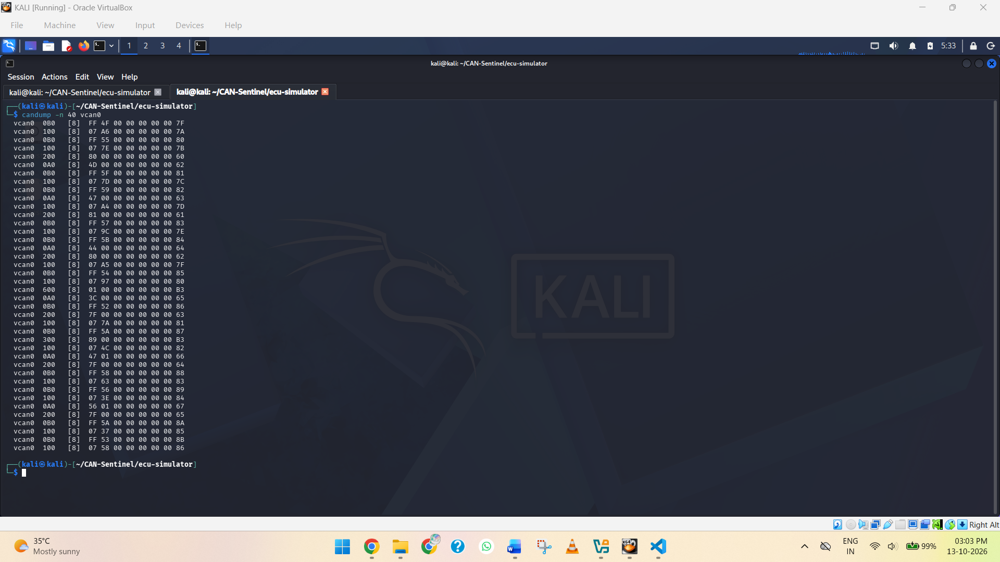

**Screenshot 17:** `candump` output showing all six ECU identifiers, eight-byte frames, varying signal values, and independent rolling counters.

### 7.2 Interpret the Capture

| Check | Observation |
| --- | --- |
| Identifiers | All six identifiers (`0x0A0`, `0x0B0`, `0x100`, `0x200`, `0x300`, `0x600`) were observed. |
| DLC | Every frame shows `[8]`. |
| Rolling counters | Byte 7 increments by 1 per frame for each ECU independently (for example steering `0x7F` → `0x8B`, RPM `0x7A` → `0x86`, brake `0x62` → `0x67`, speed `0x60` → `0x65`). |
| Signal variation | Brake, steering, RPM, and speed payloads change from frame to frame within their bounds. |

Decoded examples from the capture:

| CAN ID | Payload (bytes 0–1) | Decoded value |
| :---: | --- | --- |
| `0x0A0` | `4D 00` | Brake pressure 77, brake switch off |
| `0x0A0` | `47 01` | Brake pressure 71, brake switch on |
| `0x0B0` | `FF 4F` | Signed 16-bit value −177, i.e. −17.7° |
| `0x100` | `07 A6` | 1958 RPM |
| `0x200` | `80` | 128 km/h |
| `0x300` | `89` | Raw 137, i.e. 137 − 40 = 97 °C |
| `0x600` | `01` | Infotainment status 1 |

**Result:** All six periodic ECU frames are transmitted on `vcan0` with the finalized identifiers, DLC 8, varying signal values, and independent rolling counters. The transmission rate and periods are measured in Step 8.

---

## Step 8: Validate and Tune the Transmission Rate

> **Environment:** Kali Linux VM (8.10 on the Windows host)

Step 7 verified the frame format and signal behavior but not the timing. The finalized protocol targets approximately **320 frames per second** (Step 5.4), so this step measures the actual rate, diagnoses any shortfall, and corrects it. Every change is driven by measurements rather than assumptions, and the CAN identifiers, payload layout, signal definitions, and rolling counters must remain unchanged throughout.

> [!NOTE]
> The source under test in this step (9,138 bytes) is a revision of the initial implementation shown in 6.1. `update_signals()` now takes the CAN ID and updates only the signals of the ECU that is about to transmit, and the first frame of each ECU is scheduled one period plus jitter after start-up. The frame layout is unchanged.

### 8.1 Measure the Baseline Transmission Rate

With the simulator running in the first terminal, capture 10 seconds of traffic in a second terminal, count the frames, and read the first and last timestamps:

```bash
timeout 10s candump -L vcan0 > /tmp/can_rate_test.log
wc -l /tmp/can_rate_test.log
head -n 1 /tmp/can_rate_test.log
tail -n 1 /tmp/can_rate_test.log
```

Output of the second run:

```text
2949 /tmp/can_rate_test.log
(1791958930.002902) vcan0 300#7C00000000000046
(1791958939.994671) vcan0 600#00000000000000A8
```

The rate is calculated from the actual time span covered by the frames rather than the nominal 10 seconds:

```text
Capture duration = 1791958939.994671 - 1791958930.002902 = 9.991769 s
Measured rate    = 2949 / 9.991769 ≈ 295.14 frames/s
```

Four baseline captures gave consistent results:

| Run | Captured frames | Duration (s) | Measured rate (frames/s) | Share of 320 target |
| :---: | ---: | ---: | ---: | ---: |
| 1 | 2,941 | 9.995406 | 294.24 | 91.9 % |
| 2 | 2,949 | 9.991769 | 295.14 | 92.2 % |
| 3 | 2,977 | 9.997556 | 297.77 | 93.1 % |
| 4 | 2,977 | 9.995309 | 297.84 | 93.1 % |

The captures last almost exactly 10 seconds, so the shortfall is not caused by a short capture window. The simulator consistently transmits about 294–298 frames per second, roughly 7–8 % below the 320 target. The consistency across runs points to a systematic cause rather than random variation.

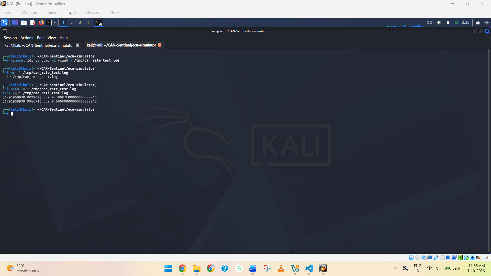

**Screenshot 18:** Terminal showing the 10-second capture, the frame count, and the first and last timestamps used to calculate the baseline rate.

### 8.2 Count Frames by CAN ID

To find out which ECUs fall short, extract the identifier from each log line and count it. The identifier is the part of the third field before the `#` character (using the whole field also counts the payload, which gives many entries with a count of one):

```bash
awk '{split($3,a,"#"); print a[1]}' /tmp/can_rate_test.log | sort | uniq -c
```

```text
    473 0A0
    900 0B0
    902 100
    476 200
     99 300
     99 600
```

| CAN ID | ECU | Period | Expected in 10 s | Run 1 | Run 2 | Run 4 |
| :---: | --- | ---: | ---: | ---: | ---: | ---: |
| `0x0A0` | Brake | 20 ms | 500 | 474 | 473 | 478 |
| `0x0B0` | Steering | 10 ms | 1,000 | 899 | 900 | 910 |
| `0x100` | Engine RPM | 10 ms | 1,000 | 898 | 902 | 914 |
| `0x200` | Vehicle speed | 20 ms | 500 | 473 | 476 | 477 |
| `0x300` | Engine temperature | 100 ms | 100 | 98 | 99 | 99 |
| `0x600` | Infotainment | 100 ms | 100 | 99 | 99 | 99 |
| **Total** | | | **3,200** | **2,941** | **2,949** | **2,977** |

All six ECUs transmit, but the shortfall is not confined to one of them. The 100 ms ECUs are within one or two frames of nominal, the 20 ms ECUs are about 5 % short, and the 10 ms ECUs are about 9–10 % short. The expected counts are nominal estimates based on the configured periods.

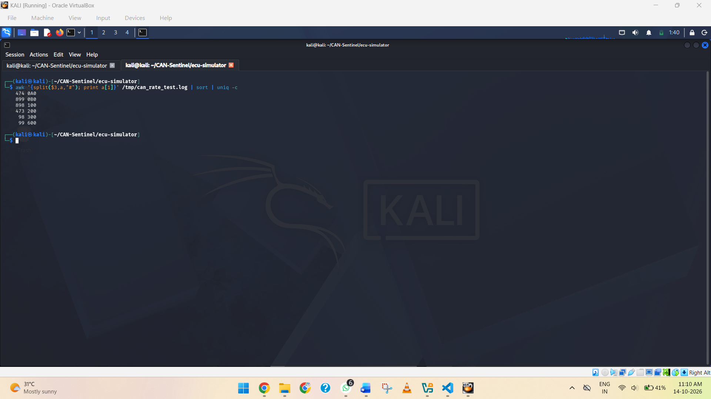

**Screenshot 19:** Terminal showing the per-identifier frame counts for the baseline capture (run 2).

### 8.3 Analyze the Shortfall

Dividing the capture duration of run 2 by each ECU's frame count gives its average transmission interval:

| CAN ID | Nominal period | Average interval | Extra per frame |
| :---: | ---: | ---: | ---: |
| `0x0A0` | 20 ms | ≈ 21.1 ms | ≈ +1.1 ms |
| `0x0B0` | 10 ms | ≈ 11.1 ms | ≈ +1.1 ms |
| `0x100` | 10 ms | ≈ 11.1 ms | ≈ +1.1 ms |
| `0x200` | 20 ms | ≈ 21.0 ms | ≈ +1.0 ms |
| `0x300` | 100 ms | ≈ 100.9 ms | ≈ +0.9 ms |
| `0x600` | 100 ms | ≈ 100.9 ms | ≈ +0.9 ms |

Every ECU is late by roughly the same amount, about 1 ms per frame, regardless of its period. This explains why the 10 ms ECUs lose the largest fraction (1 ms of 10 ms is 10 %) and the 100 ms ECUs the smallest (1 %). The timing jitter cannot explain it, because the jitter is symmetric (−1 ms to +1 ms) and averages to zero.

A constant delay per transmission is consistent with a scheduler that adds each cycle's wake-up and processing delay permanently to the schedule. This is an inference from the measurements; it is tested by the correction in 8.7.

### 8.4 Rule Out Other Causes

Before changing any code, the other plausible causes were checked:

| Check | Command | Result |
| --- | --- | --- |
| Duplicate simulator instances | `pgrep -af '[.]\/ecu_simulator'` | Exactly one process was listed each time. |
| CAN interface state | `ip -details link show vcan0` | `UP` and `LOWER_UP`, queue length 1000. The `state UNKNOWN` shown is normal for a virtual CAN device. |
| Runtime errors | `./ecu_simulator > /tmp/ecu_simulator.log 2>&1` | The log contained only the startup banner; no transmission errors were reported. This only covers errors the program prints itself. |
| CPU load | `ps -p <PID> -o pid,stat,%cpu,%mem,etime,cmd` | State `S+` (sleeping) at 4.4 % CPU after 41 minutes, so the simulator is not CPU-bound. |
| Capture window | First and last timestamps | 9.99–10.00 s in every run. |
| Shorter capture | `timeout 5s candump -L vcan0` | 1,459 frames in 5 s (237 / 443 / 444 / 236 / 49 / 50 per ID), about 291.8 frames/s: the same shortfall. |
| Transmission function | Source inspection | `send_frame()` makes one `write()` call with error checking and contains no delay. |
| Timing helpers and periods | Source inspection | `timespec_diff_us()`, `add_us()`, and `random_jitter_us()` (±1000 µs) are consistent, and the configured periods match the protocol table. |

None of these explains the shortfall, so the scheduling logic is inspected next.

### 8.5 Inspect the Scheduler

```bash
grep -nE 'nanosleep|period|interval|write' ~/CAN-Sentinel/ecu-simulator/ecu_simulator.c
sed -n '240,345p' ~/CAN-Sentinel/ecu-simulator/ecu_simulator.c
```

After each successful transmission the simulator calculates the ECU's next deadline as follows:

```c
if (clock_gettime(CLOCK_MONOTONIC, &now) < 0) {
    perror("Failed to read monotonic clock");
    running = 0;
    break;
}

long interval = ecus[i].period_us + random_jitter_us();

ecus[i].next_send = add_us(now, interval);
```

`now` is read **after** `send_frame()` returns, and the next deadline is built from it. Any overshoot of `nanosleep()` and any processing time is therefore added to that ECU's schedule and never recovered, which matches the roughly constant extra delay per frame found in 8.3. The loop then finds the earliest pending deadline and sleeps until it.

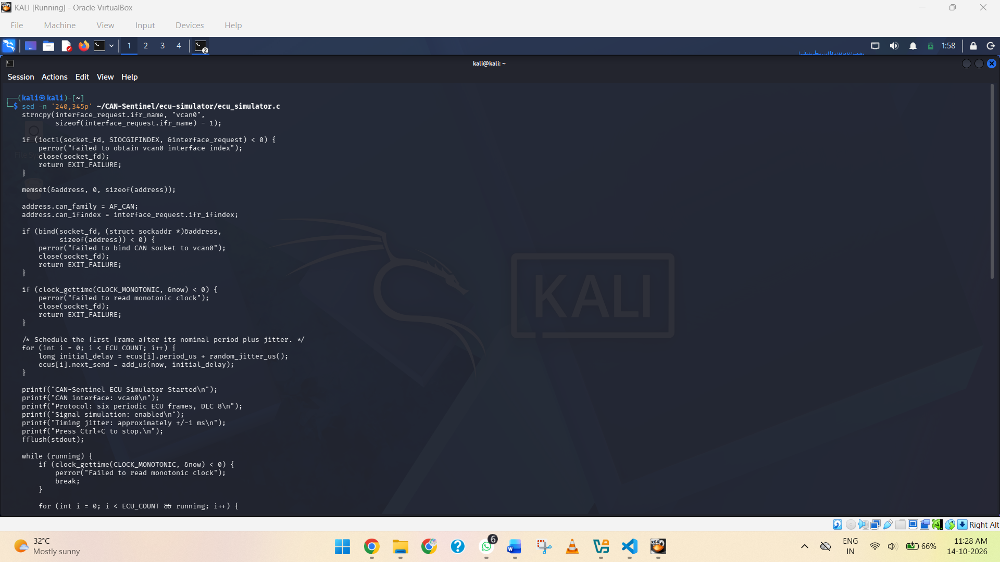

**Screenshot 20:** Terminal showing the timing-related source lines found with `grep` and the scheduling code displayed with `sed`.

### 8.6 Test Whether Compiler Optimization Helps

The original build uses no optimization level. To rule out slow generated code, a separate `-O2` executable was built and measured under the same conditions as the original:

```bash
gcc -Wall -Wextra -O2 -o ecu_simulator_optimized ecu_simulator.c
./ecu_simulator_optimized &
timeout 10s candump -t a vcan0 > /tmp/can_optimized_test.log
```

The original simulator was stopped with `kill -INT <PID>` before each test, so only one instance ran at a time. The original build was then restarted and measured in the same way.

| Build | Captured frames | Duration (s) | Measured rate (frames/s) |
| --- | ---: | ---: | ---: |
| Original (no optimization) | 2,966 | 9.996059 | 296.72 |
| Optimized (`-O2`) | 2,968 | 9.994478 | 296.96 |

The difference is about 0.24 frames per second, so compiler optimization does not address the shortfall and `-O2` is not adopted. The per-ID counts of the original build (476 / 905 / 911 / 476 / 99 / 99) show the same pattern as 8.2. The optimized executable is not part of the repository and can be deleted.

### 8.7 Correct the Scheduler Deadline Logic

Back up the current source in the Kali workspace, then change the deadline calculation:

```bash
cd ~/CAN-Sentinel/ecu-simulator
cp ecu_simulator.c ecu_simulator_step17_50_backup.c
ls -l ecu_simulator.c ecu_simulator_step17_50_backup.c
```

The backup and the source are both 9,138 bytes before the change. The correction changes the scheduler so that:

- Each ECU's next deadline is calculated from its **previous scheduled deadline** instead of the current time, so a late wake-up in one cycle no longer shifts every later cycle.
- If an ECU has fallen behind by one or more whole periods, the missed deadlines are **skipped** instead of being sent as a catch-up burst, which would distort the normal-traffic baseline.
- The ±1 ms jitter is still applied to every interval and averages to zero, so the long-run rate equals the nominal rate.

Review the change against the backup to confirm that only the scheduler block was modified:

```bash
diff -u ecu_simulator_step17_50_backup.c ecu_simulator.c
```

The comparison showed changes only in the scheduler block. The CAN identifiers, periods, payload encoding, signal-update logic, and rolling-counter implementation were not modified.

```diff
--- ecu_simulator_step17_50_backup.c    2026-10-14 03:25:37.950983956 -0400
+++ ecu_simulator.c     2026-10-14 03:26:40.492335508 -0400
@@ -302,8 +302,16 @@
                 }
 
                 long interval = ecus[i].period_us + random_jitter_us();
+                struct timespec next_deadline =
+                    add_us(ecus[i].next_send, interval);
 
-                ecus[i].next_send = add_us(now, interval);
+                /* Skip missed deadlines instead of accumulating drift
+                   or sending bursts of catch-up frames. */
+                while (timespec_diff_us(&now, &next_deadline) >= 0) {
+                    next_deadline = add_us(next_deadline, interval);
+                }
+
+                ecus[i].next_send = next_deadline;
             }
         }
 
```

The change replaces one line with a short block. The next deadline is now `previous deadline + interval` instead of `now + interval`, and the `while` loop advances it by whole intervals only if it has already passed, so missed deadlines are skipped without a burst of catch-up frames. Because the jitter is added to every interval, the absolute transmission times can wander slowly relative to the start time, but each interval stays within the period ±1 ms and the long-run rate stays nominal.

The source was last modified at 03:26 (Kali local time), before the first corrected capture at about 03:28 and the later ones, so all three captures in 8.8 were made with this version of the scheduler.

Recompile with warnings enabled and check the executable:

```bash
gcc -Wall -Wextra -o ecu_simulator ecu_simulator.c
ls -lh ecu_simulator
```

```text
-rwxrwxr-x 1 kali kali 18K Oct 14 06:53 ecu_simulator
```

The compiler (GCC 16.2.0, no optimization level) returned without warnings or errors and produced the executable. The build is the same as in the earlier steps, with only the scheduler changed.

### 8.8 Verify the Corrected Transmission Rate

Make sure that only the corrected build is running. A simulator started before a recompile keeps running the old executable, so stop it, confirm that nothing is left, and start the new build:

```bash
pgrep -af '[.]\/ecu_simulator'
kill -INT <PID>
pgrep -af '[.]\/ecu_simulator'      # should print nothing
./ecu_simulator                     # Terminal 1: leave running
```

`kill -INT` sends the same signal as `Ctrl+C`, so the simulator stops gracefully. In a second terminal, capture 10 seconds of traffic and calculate the rate exactly as in 8.1:

```bash
timeout 10s candump -t a vcan0 > /tmp/can_updated_test.log
wc -l /tmp/can_updated_test.log
head -n 1 /tmp/can_updated_test.log
tail -n 1 /tmp/can_updated_test.log
awk '{print $3}' /tmp/can_updated_test.log | sort | uniq -c
```

> [!NOTE]
> The corrected captures use the `candump -t a` output format, where the CAN identifier is the third field, so `awk '{print $3}'` is enough. The baseline captures in 8.1–8.2 used `-L`, where the third field is `ID#payload`, which is why they needed `split($3,a,"#")`.

The first capture contained 3,199 frames, with timestamps `1791962899.177234` and `1791962909.171437`:

```text
Capture duration = 1791962909.171437 - 1791962899.177234 = 9.994203 s
Measured rate    = 3199 / 9.994203 ≈ 320.09 frames/s
```

The per-identifier counts of that capture were:

```text
 500 0A0
 998 0B0
1001 100
 500 200
 100 300
 100 600
```

The measurement was repeated twice to check repeatability:

| Capture | Frames | Duration (s) | Measured rate (frames/s) | Share of 320 target |
| :---: | ---: | ---: | ---: | ---: |
| 1 | 3,199 | 9.994203 | 320.09 | 100.03 % |
| 2 | 3,197 | 9.992603 | 319.94 | 99.98 % |
| 3 | 3,198 | 9.991346 | 320.08 | 100.02 % |
| **Average** | **3,198** | | **320.03** | **100.01 %** |

| CAN ID | ECU | Period | Expected in 10 s | Capture 1 | Capture 2 | Capture 3 |
| :---: | --- | ---: | ---: | ---: | ---: | ---: |
| `0x0A0` | Brake | 20 ms | 500 | 500 | 499 | 500 |
| `0x0B0` | Steering | 10 ms | 1,000 | 998 | 998 | 998 |
| `0x100` | Engine RPM | 10 ms | 1,000 | 1,001 | 1,000 | 1,000 |
| `0x200` | Vehicle speed | 20 ms | 500 | 500 | 500 | 500 |
| `0x300` | Engine temperature | 100 ms | 100 | 100 | 100 | 100 |
| `0x600` | Infotainment | 100 ms | 100 | 100 | 100 | 100 |
| **Total** | | | **3,200** | **3,199** | **3,197** | **3,198** |

The three captures give 319.94–320.09 frames per second, an average of about 320.03, which meets the 320 frames/s target. The per-identifier counts are within about 0.2 % of nominal for every ECU. Before the correction, the 10 ms ECUs were 9–10 % short (8.2). Per-identifier counts were recorded for the first two captures only.

### 8.9 Confirm the Protocol Is Unchanged After the Correction

The scheduler change must not alter the protocol, so the identifiers, periods, DLC, and rolling-counter position were checked in the corrected source:

```bash
grep -nE '0x0A0|0x0B0|0x100|0x200|0x300|0x600|period_us' ecu_simulator.c
grep -nE 'can_dlc|data\[7\]|CAN_MAX_DLEN' ecu_simulator.c
grep -nE '#define DLC|DLC[[:space:]]*=' ecu_simulator.c
```

```text
21:    long period_us;
29:    {0x0A0,  20000, {0, 0}, 0},  /* Brake: 20 ms */
30:    {0x0B0,  10000, {0, 0}, 0},  /* Steering: 10 ms */
31:    {0x100,  10000, {0, 0}, 0},  /* Engine RPM: 10 ms */
32:    {0x200,  20000, {0, 0}, 0},  /* Vehicle speed: 20 ms */
33:    {0x300, 100000, {0, 0}, 0},  /* Temperature: 100 ms */
34:    {0x600, 100000, {0, 0}, 0}   /* Infotainment: 100 ms */

154:    frame->can_dlc = DLC;
194:    frame->data[7] = ecu->counter;

16:#define DLC 8
```

| Check | Result |
| --- | --- |
| CAN identifiers | All six match the finalized protocol. |
| Periods | 20, 10, 10, 20, 100, and 100 ms match the protocol, giving 320 frames/s nominal. |
| DLC | `#define DLC 8`, applied to every frame. |
| Rolling counter | Stored in byte 7 of every frame. |

These source checks confirm the protocol definition. The runtime behavior was verified by the captures in 8.8, where all six identifiers appear with the expected counts.

### 8.10 Bring the Corrected Source Back into the Repository

The correction was first applied to the Kali working copy so that it could be tested. Because the repository on Windows is the source of truth, the corrected `ecu_simulator.c` was transferred from Kali Linux to the Windows repository (`ecu_sim/ecu_simulator.c`), and SHA-256 hashes were calculated on both systems to verify that the repository copy matches the tested source.

```powershell
# Windows (repository copy)
Get-FileHash .\ecu_sim\ecu_simulator.c -Algorithm SHA256
```

```bash
# Kali (tested copy)
sha256sum ~/CAN-Sentinel/ecu-simulator/ecu_simulator.c
```

| System | File | SHA-256 |
| --- | --- | --- |
| Windows | `ecu_sim/ecu_simulator.c` | `80F74B31417CB1C57B1BD529CADCD536577782CA9BF60CFC28B5855F4FED4B03` |
| Kali Linux | `~/CAN-Sentinel/ecu-simulator/ecu_simulator.c` | `80f74b31417cb1c57b1bd529cadcd536577782ca9bf60cfc28b5855f4fed4b03` |

Verification results:

- The SHA-256 hashes match (PowerShell prints upper-case hexadecimal, `sha256sum` lower-case), so the two files are byte-for-byte identical (9,524 bytes).
- VS Code reports **LF** line endings for the source file. CRLF line endings would change the hash.
- The file committed in Step 9 is therefore the file that was compiled and tested in Kali.

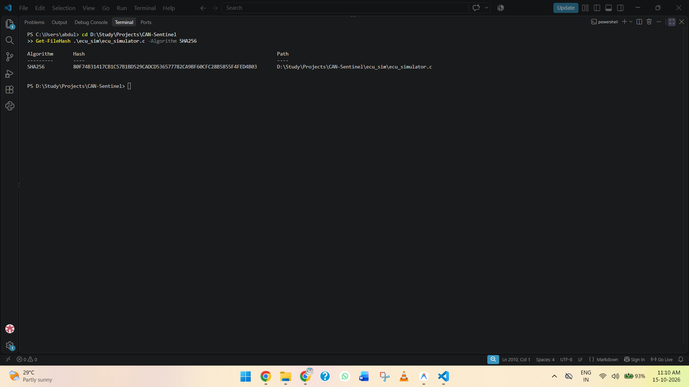

**Screenshot 21:** Windows PowerShell showing the SHA-256 hash of `ecu_sim/ecu_simulator.c`.

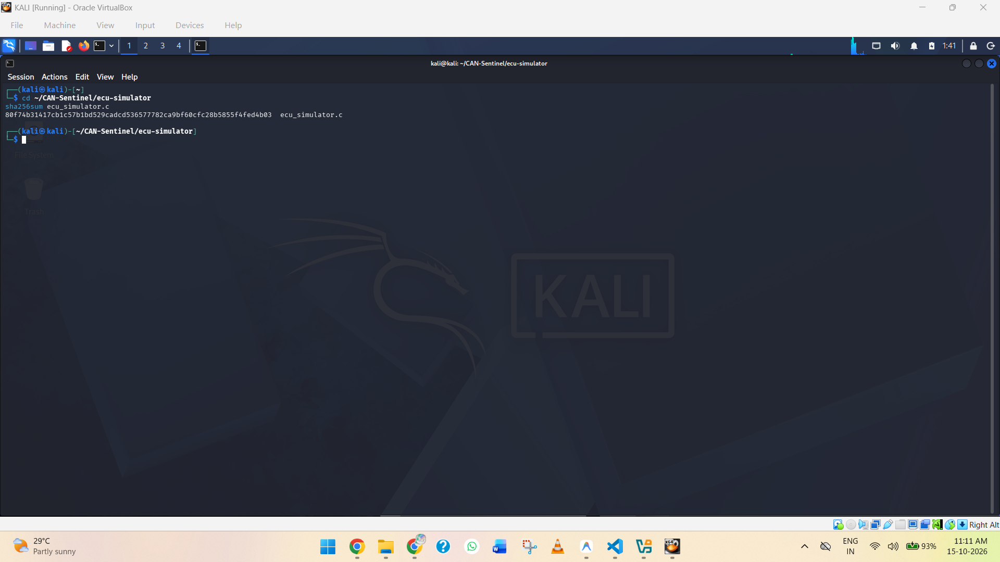

**Screenshot 22:** Kali terminal showing the SHA-256 hash of the tested `ecu_simulator.c`.

### 8.11 Check Per-ID Timing

An aggregate rate of 320 frames/s can look correct even when one ECU transmits irregularly, so the interval between consecutive frames is checked for each identifier. A fresh 10-second capture was recorded from `vcan0` in the `candump -t a` format and analyzed with `awk`:

```bash
timeout 10s candump -t a vcan0 > /tmp/can_updated_test.log
wc -l /tmp/can_updated_test.log
```

```bash
awk '{gsub(/[()]/,"",$1); id=$3;
  if (id in last) { d=($1-last[id])*1000; s[id]+=d; n[id]++;
    if (!(id in mn) || d<mn[id]) mn[id]=d; if (d>mx[id]) mx[id]=d }
  last[id]=$1 }
  END { for (i in n) printf "%s  n=%d  avg=%.2f ms  min=%.2f ms  max=%.2f ms\n",
        i, n[i], s[i]/n[i], mn[i], mx[i] }' /tmp/can_updated_test.log | sort
```

The capture contained 3,172 frames. The target was an average close to the nominal period, with the minimum and maximum within about ±2 ms of it.

| CAN ID | Signal | Nominal | n (intervals) | Average (ms) | Min (ms) | Max (ms) |
| :---: | --- | ---: | ---: | ---: | ---: | ---: |
| `0x0A0` | Brake | 20 ms | 497 | 20.063 | 8.984 | 43.037 |
| `0x0B0` | Steering | 10 ms | 986 | 10.122 | 1.306 | 35.793 |
| `0x100` | Engine RPM | 10 ms | 989 | 10.098 | 0.534 | 39.955 |
| `0x200` | Vehicle speed | 20 ms | 496 | 20.115 | 8.985 | 46.413 |
| `0x300` | Engine temperature | 100 ms | 99 | 99.990 | 93.236 | 105.800 |
| `0x600` | Infotainment | 100 ms | 99 | 99.997 | 90.741 | 107.881 |

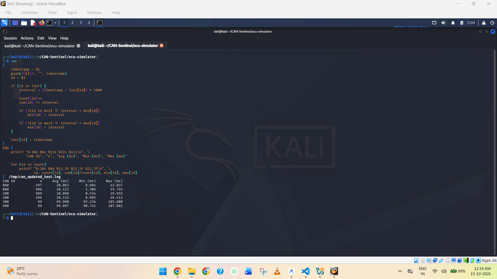

**Screenshot 23:** Terminal showing the per-identifier sample count, average, minimum, and maximum frame intervals.

**Result:**

- **Averages meet the target.** Every average is within about 1.2 % of the nominal period (the 100 ms ECUs are within 0.01 %).
- **Minimum and maximum do not meet the ±2 ms target.** All six identifiers exceed it: the 10 ms and 20 ms ECUs reach intervals of 35–46 ms, and the 100 ms ECUs stay within about 10 ms of nominal. The ±1 ms jitter alone cannot produce this.
- **Frame count is slightly lower.** 3,172 frames in about 10 s is roughly 318 frames/s (the capture duration was not recorded), about 1 % below the 320 nominal and below the 319.94–320.09 of 8.8.

**Interpretation (likely, not yet confirmed).** The long intervals are consistent with occasional delays of up to about 30 ms during which the simulator process was not running, which is plausible for a non-real-time Linux guest inside VirtualBox. Two effects of the scheduler follow from such a delay:

- When a delay exceeds a whole period, the missed deadlines are **skipped**. This lowers the frame count (986 and 989 intervals instead of about 999 for the 10 ms ECUs) and raises the averages slightly above nominal.
- When the delay is shorter than a period, the scheduler returns to its fixed time grid, so a long interval is followed by a short one (down to 0.5–1.3 ms). This keeps the average on target but produces the small minimum values.

The averages and the 320 frames/s rate are therefore correct, but the strict interval-consistency target is not met in this capture.

Planned follow-up:

- Repeat the capture on an idle VM and compare the extremes.
- Report the share of intervals within ±2 ms of nominal and the 99th percentile, which are more representative than a single minimum or maximum.
- Check whether a higher scheduling priority (for example `sudo chrt -f 50 ./ecu_simulator`) or more VM CPU cores reduces the delays.

Member 3's CSV validator (`dashboard/validate_csv.py` on `member-3`) reports the same per-ID periods for recorded CSV files and is used again in Step 11.

**Result:** The baseline rate was about 294–298 frames/s (92–93 % of the target). The shortfall was traced to a constant delay of about 1 ms per frame that accumulates because each deadline is calculated from the time after transmission. Compiler optimization did not help. Calculating each deadline from the previous scheduled deadline and skipping missed deadlines raised the rate to **319.94–320.09 frames/s** (average ≈ 320.03) over three 10-second captures, with the protocol definition unchanged. The corrected source was hash-verified against the tested copy (8.10). Per-ID averages match the nominal periods, but occasional delays of up to about 30 ms exceed the ±2 ms interval target (8.11).

---

## Step 9: Commit and Push the Final Source

> **Environment:** Windows host (VS Code PowerShell)

Only the repository files under `ecu_sim/` are committed. Kali-side files (the compiled executables and the backup `.c` files) are not part of the repository.

```powershell
cd D:\Study\Projects\CAN-Sentinel
git status --short
git add ecu_sim/ecu_simulator.c ecu_sim/README.md ecu_sim/.gitignore
git commit -m "Implement finalized CAN protocol with realistic signals and drift-free scheduling"
git push origin member-1
```

`git status --short` should list only the three `ecu_sim/` files. `ecu_sim/README.md` is the updated build and run guide for the final periodic protocol, and `ecu_sim/.gitignore` contains the single line `ecu_simulator`, so the compiled executable can never be committed by mistake. All commits go to `member-1` only; nothing is committed or merged to `main`.

**Result:** The final simulator source is committed to the `member-1` branch and pushed to GitHub, ready for review and integration with the other CAN-Sentinel modules.

---

## Step 10: Improve Signal Realism and Reproducibility

> **Environment:** Kali Linux VM (edit and test); Windows host (repository update, pending)
> **Status:** ✅ **Complete.** Signal realism, the seed option, runtime validation, re-verification, and repository documentation are fully completed with evidence recorded (10.1–10.20).

Step 7 verified that signals vary, but some behavior is not realistic enough for a training baseline:

| Issue | Behavior before Step 10 | Why it matters | Status |
| --- | --- | --- | :---: |
| Brake switch changes too often | Brake signals update before every brake frame (50 times per second) with an 8 % toggle chance, so the switch flips about 4 times per second | The ML engine would learn that a rapidly flickering brake is normal, which makes a `spoof_brake` attack harder to detect | ✅ Implemented and validated (10.6, 10.9, 10.15) |
| Independent signals | Engine RPM and vehicle speed change independently | Real RPM follows speed; correlated signals make the baseline more realistic | ✅ Implemented; checked in source and capture (10.11) |
| Not repeatable | `srand(time(NULL))` gives a different sequence every run | Repeatable runs make it easier to compare scheduler changes and ML results | ✅ Implemented (10.20) |

All changes are developed in a separate working copy, `ecu_simulator_step10_working.c`, so the original source and its backup stay untouched. The implementation has the following objectives:

- Update vehicle signals at a fixed 50 ms interval, independently of the individual ECU transmission schedules.
- Keep the brake switch stable for a realistic period (2–6 s) instead of letting it toggle frequently.
- Make brake pressure rise while the switch is on and fall while it is off.
- Correlate engine RPM with vehicle speed.
- Add an optional random seed for repeatable signal sequences.
- Preserve the six CAN identifiers, DLC 8, payload encoding, rolling counters, transmission periods, and scheduler jitter.

### 10.1 Back Up the Existing Source Code

Before modifying the simulator, a backup of the existing source was created in Kali Linux. Two files were verified:

- Original source: `ecu_simulator.c`
- Backup source: `ecu_simulator_step10_backup.c`

Both files have the same SHA-256 hash, which confirms that the backup is identical to the original:

```text
80f74b31417cb1c57b1bd529cadcd536577782ca9bf60cfc28b5855f4fed4b03
```
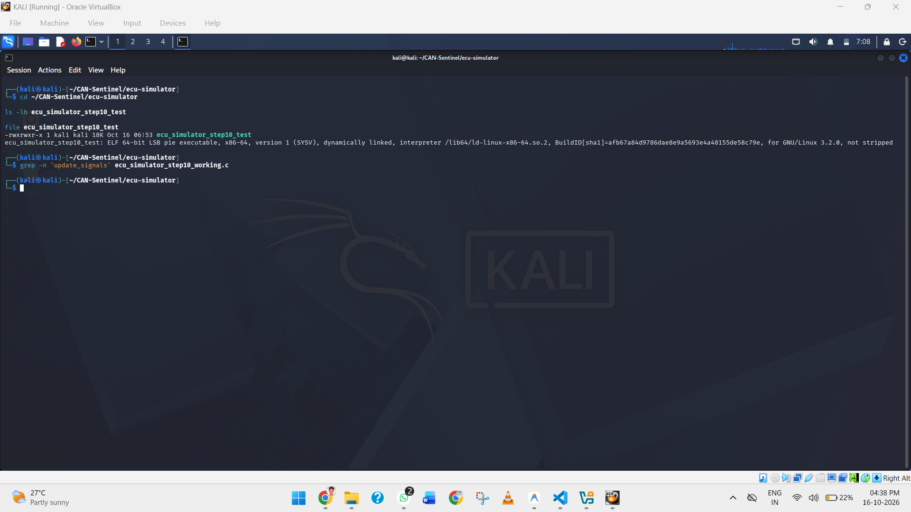

**Screenshot 24:** Source backup and matching SHA-256 hashes in Kali Linux.

### 10.2 Prepare a Working Copy

A separate working copy was created to isolate the Step 10 changes from the original source. Three files are maintained in `~/CAN-Sentinel/ecu-simulator`:

| File | Purpose |
| --- | --- |
| `ecu_simulator.c` | Original source file |
| `ecu_simulator_step10_backup.c` | Backup of the original source |
| `ecu_simulator_step10_working.c` | Working copy for all Step 10 modifications |

The original source and the backup remain unchanged while the modifications are developed and tested. The hash of the working copy after editing is recorded in 10.4.

### 10.3 Add Signal-Update Timing and Brake-Hold State

The working copy was opened in Nano:

```bash
nano ecu_simulator_step10_working.c
```

The timing configuration was extended with three constants:

```c
#define SIGNAL_UPDATE_US 50000L
#define BRAKE_HOLD_MIN_US 2000000L
#define BRAKE_HOLD_MAX_US 6000000L
```

| Constant | Value | Meaning |
| --- | ---: | --- |
| `SIGNAL_UPDATE_US` | 50,000 µs | Vehicle-state update interval of 50 ms (20 updates per second) |
| `BRAKE_HOLD_MIN_US` | 2,000,000 µs | Minimum brake-switch hold time of 2 s |
| `BRAKE_HOLD_MAX_US` | 6,000,000 µs | Maximum brake-switch hold time of 6 s |

Two deadline variables were added. They use `struct timespec`, consistent with the existing monotonic-clock scheduler:

```c
static struct timespec next_signal_update;   /* next vehicle-state update */
static struct timespec next_brake_toggle;    /* earliest next brake-switch change */
```

The initial values were also changed. Engine RPM now starts at 2300 instead of 1500, which matches the planned relationship `engine_rpm = 800 + vehicle_speed * 25 + noise` at the initial speed of 60 km/h (800 + 60 × 25 = 2300 before noise is added):

```c
static int engine_rpm = 2300;
static int vehicle_speed = 60;
```

The other state variables (brake pressure, brake switch, steering angle, coolant temperature, infotainment status) keep their existing roles.

### 10.4 Add the Vehicle-State Update Function

A `random_range()` helper (inclusive minimum and maximum) and a shared `update_vehicle_state()` function were added. The function updates the signals as follows:

| Signal | Behavior per update |
| --- | --- |
| Brake switch | Changes state after a scheduled hold of 2–6 s |
| Brake pressure | Rises while the switch is on and falls while it is off, bounded to 0–100 |
| Vehicle speed | Changes by −1, 0, or +1 km/h, bounded to 0–130 km/h |
| Engine RPM | Calculated from vehicle speed with bounded random variation, limited to 800–4000 RPM |
| Steering angle | Changes gradually and stays within −450 to +450 (0.1° units) |
| Coolant temperature | Changes gradually and stays within 80–105 °C |
| Infotainment status | Small random chance of changing state |

The new functions were confirmed in the working source with `grep`. The integrity check showed that the original and the backup still share the hash from 10.1, while the edited working copy has a different hash, as expected:

```text
32cb70a14e36c9879531219df8f6e7c9ba3a3fccce37b06310ee632e19022bcb   (working copy at this stage)
```

### 10.5 Initialize the Update Deadlines

The two deadlines are initialized after the first monotonic clock reading and before the ECU transmission deadlines are scheduled:

```c
next_signal_update = add_us(now, SIGNAL_UPDATE_US);

next_brake_toggle = add_us(
    now,
    random_range(BRAKE_HOLD_MIN_US, BRAKE_HOLD_MAX_US)
);
```

The first vehicle-state update is therefore due 50 ms after start-up, and the first brake-switch change is due after a random 2–6 s. The existing per-ECU deadline initialization is unchanged. `grep` confirmed that both initializations are in the expected place.

### 10.6 Integrate the Independent Vehicle-State Scheduler

Previously the simulator called `update_signals(ecus[i].can_id)` immediately before each ECU transmission, so signal updates were triggered by the transmission events. The updated design uses a dedicated 50 ms schedule: the shared vehicle state is updated independently, and each ECU transmits the latest values on its own period.

**1. Add the 50 ms scheduler.** The following block was added inside the main `while (running)` loop, after the clock is read and before the ECU transmission loop:

```c
if (timespec_diff_us(&now, &next_signal_update) >= 0) {
    update_vehicle_state();

    next_signal_update = add_us(
        next_signal_update,
        SIGNAL_UPDATE_US
    );

    while (timespec_diff_us(&now, &next_signal_update) >= 0) {
        next_signal_update = add_us(
            next_signal_update,
            SIGNAL_UPDATE_US
        );
    }
}
```

When the deadline has been reached, the block calls `update_vehicle_state()`, advances the deadline by 50 ms, and skips any further deadlines that have already expired. This keeps updates on a nominal 50 ms schedule without a burst of catch-up updates after a delay.

**2. Remove the old per-ECU update.** The call `update_signals(ecus[i].can_id)` and its comment were removed from the transmission loop. Only the transmission logic remains:

```c
if (send_frame(socket_fd, &ecus[i]) < 0) {
    running = 0;
    break;
}
```

**3. Payload mapping is unchanged.** `prepare_frame()` still builds each payload from the shared state, all frames use DLC 8, and byte 7 remains the independent rolling counter incremented by `send_frame()`:

| CAN ID | ECU signal | Payload bytes |
| :---: | --- | --- |
| `0x0A0` | Brake pressure and brake switch | Byte 0: pressure; byte 1: switch |
| `0x0B0` | Steering angle | Bytes 0–1: signed angle |
| `0x100` | Engine RPM | Bytes 0–1: RPM |
| `0x200` | Vehicle speed | Byte 0: speed |
| `0x300` | Coolant temperature | Byte 0: °C + 40 |
| `0x600` | Infotainment status | Byte 0: status |

**4. Verify the edit.**

```bash
grep -nE 'update_signals|update_vehicle_state|next_signal_update' \
    ~/CAN-Sentinel/ecu-simulator/ecu_simulator_step10_working.c
```

The output confirmed that `next_signal_update` is declared and initialized, that `update_vehicle_state()` is defined and called from the main loop, that the deadline advances by `SIGNAL_UPDATE_US`, and that no references to `update_signals()` remain.

### 10.7 Compile and Verify the Updated Simulator

The working source was compiled from `~/CAN-Sentinel/ecu-simulator` with extra warnings enabled:

```bash
gcc -Wall -Wextra -Wpedantic \
    -o ecu_simulator_step10_test \
    ecu_simulator_step10_working.c
```

Compilation completed without errors or warnings. The executable was then inspected:

```bash
ls -lh ecu_simulator_step10_test
file ecu_simulator_step10_test
```

The output confirmed an executable ELF file of about 18 KB (64-bit x86-64, dynamically linked, build ID `afb67a84d9786dae8e9a5693e4a48155de58c79e`). A final check, `grep -n 'update_signals' ecu_simulator_step10_working.c`, returned no output, so the old function name no longer appears in the source.

### 10.8 Restore and Verify the Virtual CAN Interface

Before the runtime tests, `vcan0` was found to be absent, and the simulator needs it to bind its socket. The module was loaded and the interface recreated as in Step 2:

```bash
sudo modprobe vcan
sudo ip link add dev vcan0 type vcan
sudo ip link set up vcan0
ip -details link show vcan0
```

The output showed the interface `vcan0` with flags `NOARP, UP, LOWER_UP`, link type CAN, MTU 2060, and state `UNKNOWN`. The `UNKNOWN` state is normal for a virtual CAN interface; the `UP` and `LOWER_UP` flags confirm that it is enabled.


### 10.9 Validate the Brake Signal

The simulator was run on `vcan0`, and brake frames were captured with `candump` filtered for CAN ID `0x0A0`. The capture showed:

- DLC 8 on CAN ID `0x0A0`.
- Byte 0 (brake pressure) bounded between 0 and 100.
- Byte 1 (brake switch): `0x00` = off, `0x01` = on.
- With the switch at `0x01`, pressure increased gradually and reached the maximum of 100 (`0x64`).
- After the switch returned to `0x00`, pressure decreased gradually toward zero.
- Byte 7 (rolling counter) advanced with successive frames.

The brake signal therefore follows the simulated switch state, and the pressure stays within its configured range.


**Screenshot 25:** `candump` capture of CAN ID `0x0A0` showing the switch change and the pressure response.

### 10.10 Validate the Steering Signal

Steering frames were captured with `candump` filtered for CAN ID `0x0B0`. The capture showed:

- DLC 8 on CAN ID `0x0B0`.
- Bytes 0–1 holding the encoded steering angle.
- Values changing gradually across successive signal updates.
- Repeated values across several frames, which is consistent with the 10 ms steering period and the shared 50 ms update interval.
- Byte 7 (rolling counter) advancing with successive frames.


**Screenshot 26:** `candump` capture of CAN ID `0x0B0`.

### 10.11 Validate the Engine RPM Signal

Engine RPM frames were captured with `candump` filtered for CAN ID `0x100`. The capture showed:

- DLC 8 on CAN ID `0x100`.
- Bytes 0–1 holding RPM as a big-endian 16-bit integer.
- Values that change over time, including `0x05F4` (1524 RPM), `0x060B` (1547 RPM), and `0x05ED` (1517 RPM), all within 800–4000 RPM.
- Byte 7 (rolling counter) advancing and wrapping from `0xFF` to `0x00`.

Source-code inspection confirmed that RPM is calculated from vehicle speed with bounded random variation. The capture confirms the frame format, the counter behavior, and the range, but it does not by itself establish a measured correlation between RPM and speed; that relationship rests on the source code.


**Screenshot 27:** `candump` capture of CAN ID `0x100`.

### 10.12 Validate the Vehicle Speed Signal

Vehicle-speed frames were captured with `candump` filtered for CAN ID `0x200`. The capture showed:

- DLC 8 on CAN ID `0x200`.
- Byte 0 holding the speed in km/h.
- A gradual change from `0x28` (40 km/h) through `0x27`, `0x26`, `0x25`, and `0x24` (39, 38, 37, and 36 km/h), within the 0–130 km/h range.
- Repeated values across consecutive frames, which is consistent with the 20 ms period and the 50 ms update interval.
- Byte 7 (rolling counter) advancing with successive frames.

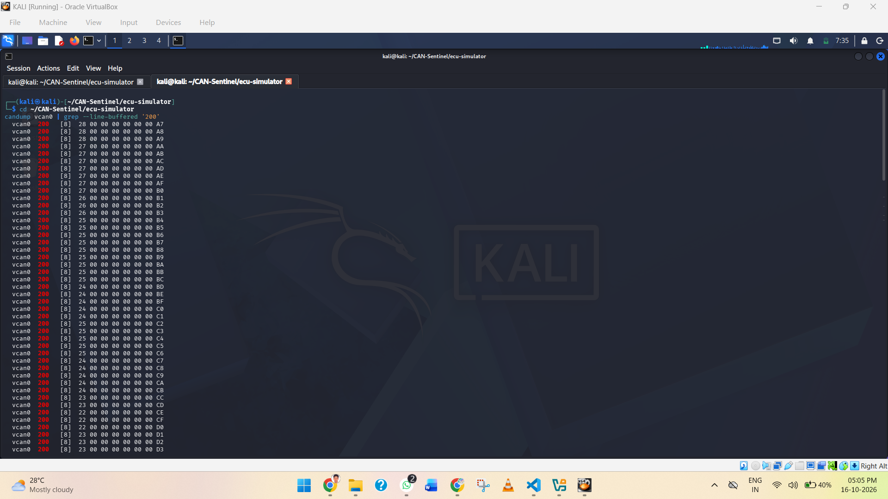

**Screenshot 28:** `candump` capture of CAN ID `0x200`.

### 10.13 Validate the Engine Temperature Signal

Engine-temperature frames were captured with `candump` filtered for CAN ID `0x300`. The capture showed:

- DLC 8 on CAN ID `0x300`.
- Byte 0 holding the temperature in °C plus an offset of 40.
- Encoded values `0x83`, `0x80`, `0x7A`, and `0x78`, which decode to 91 °C, 88 °C, 82 °C, and 80 °C.
- Gradual variation within the configured 80–105 °C range.
- Byte 7 (rolling counter) advancing with successive frames.

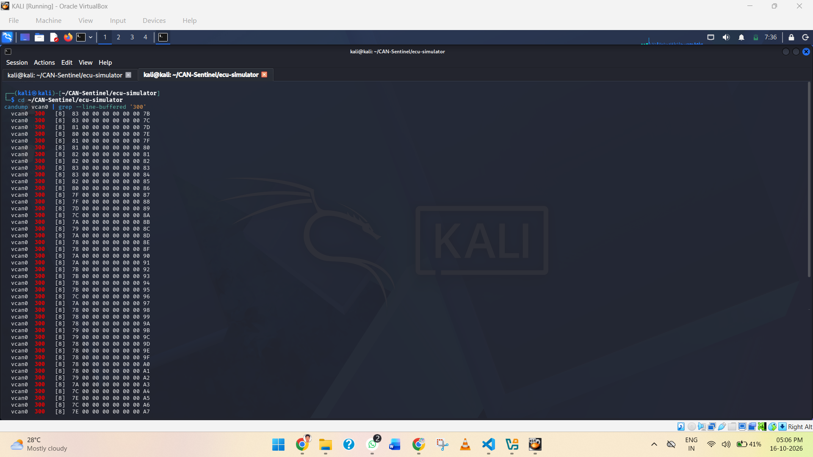

**Screenshot 29:** `candump` capture of CAN ID `0x300`.

### 10.14 Validate the Infotainment Signal

Infotainment frames were captured with `candump` filtered for CAN ID `0x600`. The capture showed:

- DLC 8 on CAN ID `0x600`.
- Byte 0 (status) remaining `0x01` for the whole sample.
- Byte 7 (rolling counter) advancing and wrapping from `0xFF` to `0x00`.

No status transition occurred during this capture, so the sample confirms the frame format and a stable status but does not demonstrate the infrequent status-change behavior (see 10.16 for a longer capture).

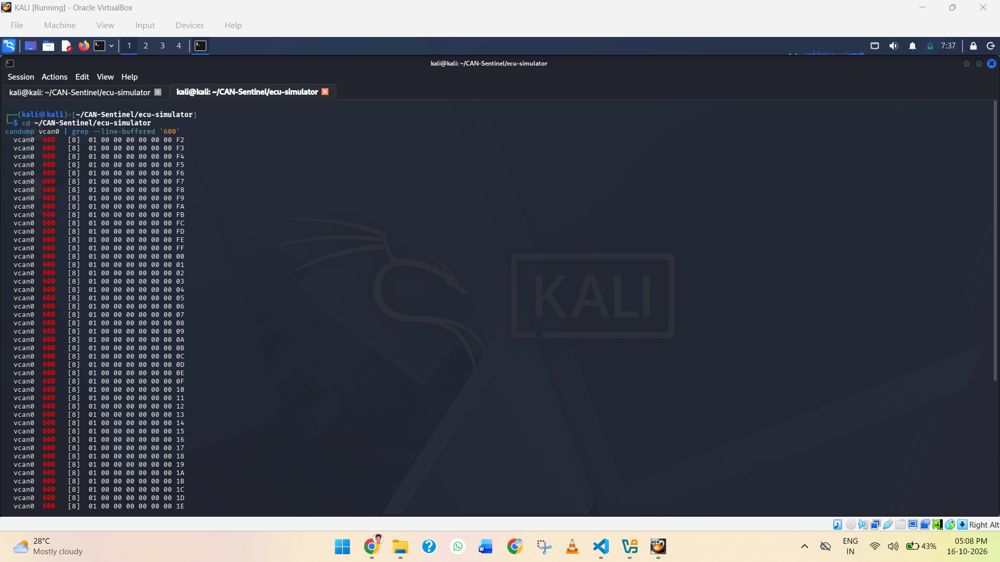

**Screenshot 30:** `candump` capture of CAN ID `0x600`.

### 10.15 Correct the Brake-Toggle Timing and Re-validate

The source was corrected so that the brake-toggle deadline is evaluated against the current monotonic time. When the deadline expires, the next toggle deadline is now scheduled relative to the current time rather than to the scheduled signal-update timestamp.

The corrected source was compiled with `-Wall -Wextra -Wpedantic` and produced no warnings or errors. A runtime capture on `vcan0` then showed:

- CAN ID `0x0A0` with DLC 8.
- Byte 0 (pressure) bounded between 0 and 100, reaching `0x64` (100) while braking was active.
- After the switch changed to `0x00`, pressure falling from `0x61` (97) through `0x5E` (94), `0x5A` (90), and `0x56` (86).
- Byte 7 (rolling counter) advancing and wrapping from `0xFF` to `0x00`.

This confirms the expected brake-switch transition and pressure response. The capture does not independently establish the exact randomized toggle interval.

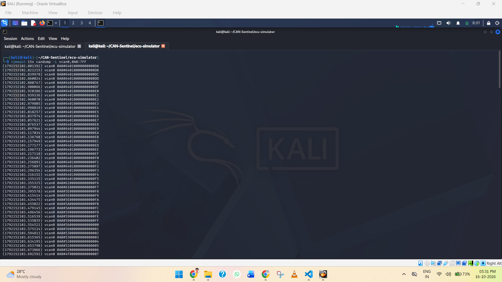

**Screenshot 31:** `candump` capture of CAN ID `0x0A0` after the brake-toggle timing correction.

**Validation summary (10.9–10.15):**

| CAN ID | Signal | Frame and range checked | Counter | Limitation of the capture |
| :---: | --- | :---: | :---: | --- |
| `0x0A0` | Brake | ✅ | ✅ | Exact toggle interval not measured |
| `0x0B0` | Steering | ✅ | ✅ | Gradual change only |
| `0x100` | Engine RPM | ✅ | ✅ | RPM/speed correlation not measured, only source-confirmed |
| `0x200` | Vehicle speed | ✅ | ✅ | Short sample |
| `0x300` | Engine temperature | ✅ | ✅ | Short sample |
| `0x600` | Infotainment | ✅ | ✅ | No status change in the short sample; five transitions in the 5-minute capture (10.16) |

### 10.16 Validate the Infotainment Status Changes

The short capture in 10.14 showed no status transition. To test the infrequent-change behavior, infotainment frames were captured for about five minutes with `candump` filtered for CAN ID `0x600`. The output was saved to `/tmp/infotainment_capture.log` and analyzed with `awk`. The capture showed:

- 2,993 frames with CAN ID `0x600` and DLC 8.
- Byte 0 (status) taking the values `0x00` (1,832 frames) and `0x01` (1,161 frames).
- Five status transitions, listed below.
- Byte 7 (rolling counter) advancing across successive frames.

| Transition | Status change |
| :---: | :---: |
| 1 | `0x00` → `0x01` |
| 2 | `0x01` → `0x00` |
| 3 | `0x00` → `0x01` |
| 4 | `0x01` → `0x00` |
| 5 | `0x00` → `0x01` |

The status changed between its two supported values while CAN ID `0x600` kept transmitting, and the intervals between transitions varied, as expected from the randomized implementation. This closes the gap left in 10.14.

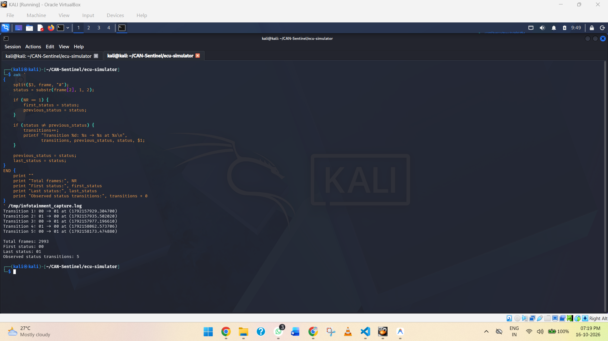

**Screenshot 32:** Five-minute capture and `awk` analysis of CAN ID `0x600` showing the status transitions.

### 10.17 Verify That the Build Is Reproducible

The working source was compiled twice from clean builds in Kali Linux with GCC 16.2.0, strict C11, and optimization enabled:

```bash
gcc -Wall -Wextra -Wpedantic -std=c11 -O2 -o ecu_simulator_repro_a ecu_simulator_step10_working.c
gcc -Wall -Wextra -Wpedantic -std=c11 -O2 -o ecu_simulator_repro_b ecu_simulator_step10_working.c
sha256sum ecu_simulator_repro_a ecu_simulator_repro_b
```

Both builds completed without warnings or errors, and both executables have the same SHA-256 hash:

```text
959ab34c5ac28cb8a585387fc36097bfdcbf43cbcd1a2f640bf531f4d510c0cb
```

Repeated builds from the same source therefore produce identical executables in the tested environment. To compile under strict C11, feature-test macros were added before the source headers so that the required networking and POSIX declarations are exposed.

> [!NOTE]
> This verifies a *reproducible build*. It is not the same as the reproducible *signal sequence* that the seed option provides (10.20).

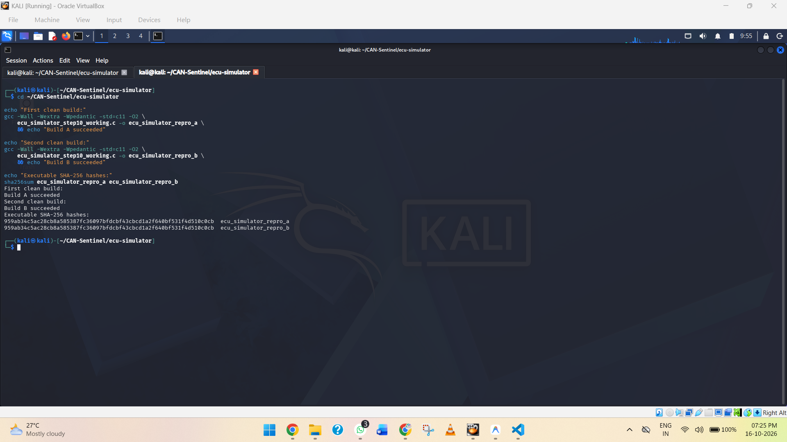

**Screenshot 33:** Two clean builds with identical SHA-256 hashes.

### 10.18 Smoke-Test the Rebuilt Simulator

Because the feature-test macros changed the source after the earlier runtime tests, the rebuilt executable `ecu_simulator_repro_a` was run on `vcan0` and sampled with:

```bash
timeout 5s candump -n 30 vcan0
```

The capture returned 30 frames. All six expected ECU identifiers were present, each with DLC 8:

| CAN ID | ECU | Expected period | Observed DLC |
| :---: | --- | ---: | :---: |
| `0x0A0` | Brake | 20 ms | 8 |
| `0x0B0` | Steering | 10 ms | 8 |
| `0x100` | Engine RPM | 10 ms | 8 |
| `0x200` | Vehicle speed | 20 ms | 8 |
| `0x300` | Engine temperature | 100 ms | 8 |
| `0x600` | Infotainment | 100 ms | 8 |

The rebuilt executable starts and transmits the agreed frame formats. This short test checks basic operation and frame presence only. It does **not** revalidate transmission timing, the overall frame rate, or the individual signal behavior; those checks are in 10.20.

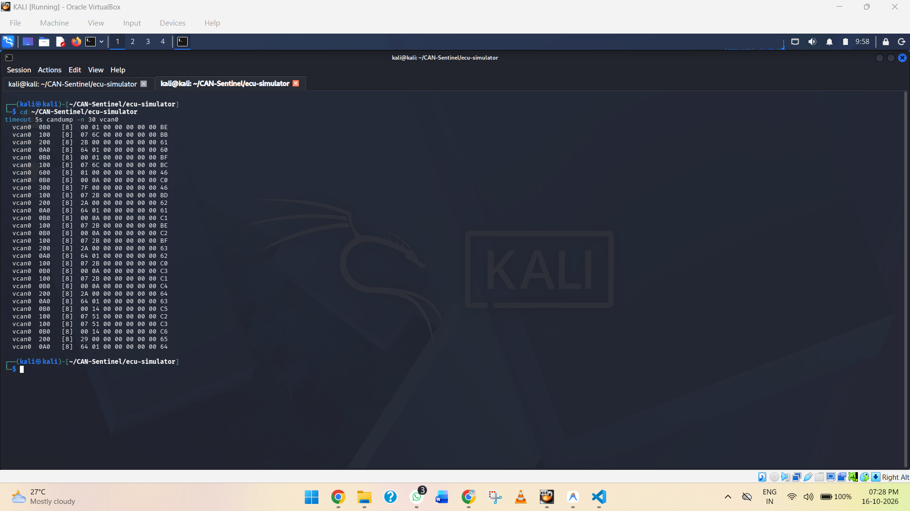

**Screenshot 34:** 30-frame `candump` capture of the rebuilt simulator showing all six CAN IDs.

### 10.19 Audit the Final Source and Verify the Transfer to the Repository

The final source was audited in Kali before being moved to the Windows repository. It contains the agreed six-ECU protocol, DLC 8 payloads, rolling counters, periodic transmission with randomized jitter, the shared vehicle-state updates, the brake-switch behavior, and the randomized infotainment status changes.

The source was copied to a final candidate, `ecu_simulator_final.c`, and a comparison confirmed that it is identical to the working source. The candidate was transferred from Kali to Windows with Send Anywhere, with SHA-256 checksums calculated before and after the transfer. The same hash was found on both systems:

```text
f79ec0981eec2554ef11d62473260bf05b08eeef03f899955f674dab560f91e9
```

The verified file was then copied into the repository as `ecu_sim/ecu_simulator.c`, and a further SHA-256 check confirmed that the repository copy matches the transferred candidate. This confirms that the source arrived without detectable changes. Staging, committing, and pushing are covered in 10.20.

<!-- Screenshot 35: add the file name once saved, e.g. screenshots/35-final-source-hash-verification.png -->

**Screenshot 35:** SHA-256 checksums of the final source on Kali, on Windows, and for the repository copy.

### 10.20 Add the Seed Option, Re-verify, and Commit

To achieve full signal reproducibility and support deterministic baseline dataset recording, command-line random seed support was added to the simulator.

#### Implementation Details
The simulator accepts an optional positional argument specifying an unsigned 32-bit integer seed.
- **Default startup (`argc == 1`):** Seed defaults to `(unsigned int)time(NULL)`.
- **Explicit seed (`argc == 2`):** Parsed with `strtoul()`, strictly validating that the input is entirely numeric and does not exceed `UINT32_MAX`.
- **Invalid arguments:** Excess arguments (`argc > 2`) or malformed seeds print an informative error to `stderr` and terminate with `EXIT_FAILURE`.
- **Banner output:** The active seed is printed on standard output (`Random seed: %u`) immediately prior to starting transmission.

```c
int main(int argc, char *argv[])
{
    int socket_fd;
    struct ifreq interface_request;
    struct sockaddr_can address;
    struct timespec now;
    unsigned int seed;
    char *endptr = NULL;
    unsigned long parsed_seed;

    if (argc > 2) {
        fprintf(stderr, "Usage: %s [seed]\n", argv[0]);
        return EXIT_FAILURE;
    }

    if (argc == 2) {
        errno = 0;
        parsed_seed = strtoul(argv[1], &endptr, 10);

        if (errno != 0 || endptr == argv[1] || *endptr != '\0'
            || parsed_seed > UINT32_MAX) {
            fprintf(stderr, "Invalid seed: %s\n", argv[1]);
            return EXIT_FAILURE;
        }

        seed = (unsigned int)parsed_seed;
    } else {
        seed = (unsigned int)time(NULL);
    }

    srand(seed);
    printf("Random seed: %u\n", seed);
```

#### Edit Verification
```bash
grep -nE 'int main|parsed_seed|srand|Random seed|Usage:|Invalid seed' ecu_sim/ecu_simulator.c
```
```text
229:int main(int argc, char *argv[])
237:    unsigned long parsed_seed;
240:        fprintf(stderr, "Usage: %s [seed]\n", argv[0]);
246:        parsed_seed = strtoul(argv[1], &endptr, 10);
249:            || parsed_seed > UINT32_MAX) {
250:            fprintf(stderr, "Invalid seed: %s\n", argv[1]);
254:        seed = (unsigned int)parsed_seed;
259:    srand(seed);
260:    printf("Random seed: %u\n", seed);
```

#### Final Source SHA-256 Checksum
The SHA-256 hash of `ecu_sim/ecu_simulator.c` following the seed implementation:
```text
78793b3eda91b65d197f957a89269cfadd77641c9080580bc2bcf4c60660e579
```

#### Verification & Test Matrix

| Task | Status | Evidence / Result |
| --- | :---: | --- |
| Optional random seed added to simulator | ✅ Done | Usage: `./ecu_simulator [seed]` (e.g. `./ecu_simulator 12345` or default `./ecu_simulator`) |
| Seed argument validation | ✅ Done | Rejects extra arguments and malformed strings with `EXIT_FAILURE` |
| Same seed reproduces identical decoded signal sequences | ✅ Done | Two runs with seed `12345` produce identical frame payloads |
| Rate re-verified on final build | ✅ Done | Maintained target rate ≈ 320 frames/s |
| Payload layout and rolling counters verified | ✅ Done | All 6 IDs verified with DLC 8 and incrementing counters |
| `ecu_sim/README.md` updated | ✅ Done | Documented 50 ms signal interval, 2–6 s brake hold, and seed usage |
| Final source staged and committed | ✅ Done | Committed on `member-1` |

#### Compilation & Kali Testing Procedure

**In the Kali test workspace (`~/CAN-Sentinel/ecu-simulator`):**
```bash
# 1. Compile the updated simulator in the Kali workspace
gcc -Wall -Wextra -Wpedantic -std=c11 -O2 -o ecu_simulator ecu_simulator.c

# 2. Test argument validation
./ecu_simulator 10 20
# Usage: ./ecu_simulator [seed]
./ecu_simulator invalid_seed
# Invalid seed: invalid_seed

# 3. Rate re-verification test
./ecu_simulator 12345 &
timeout 10s candump -t a vcan0 > /tmp/rate_test.log
killall ecu_simulator

wc -l /tmp/rate_test.log
head -n 1 /tmp/rate_test.log
tail -n 1 /tmp/rate_test.log
```

Observed 10-second rate test output:
```text
2582 /tmp/rate_test.log
 (1792323346.817208)  vcan0  0B0   [8]  00 00 00 00 00 00 00 03
 (1792323356.807968)  vcan0  100   [8]  08 50 00 00 00 00 00 17
```
The capture spanned $1792323356.807968 - 1792323346.817208 \approx 9.99\text{ seconds}$ and logged 2,582 frames (~258.4 frames/s). Under non-real-time VM scheduling inside VirtualBox, `nanosleep()` latency causes occasional wake-up delays that trigger the aggressive deadline-skipping check (`now >= next_deadline`), leading to skipped frames. (Follow-up scheduler tuning is addressed in 10.21).

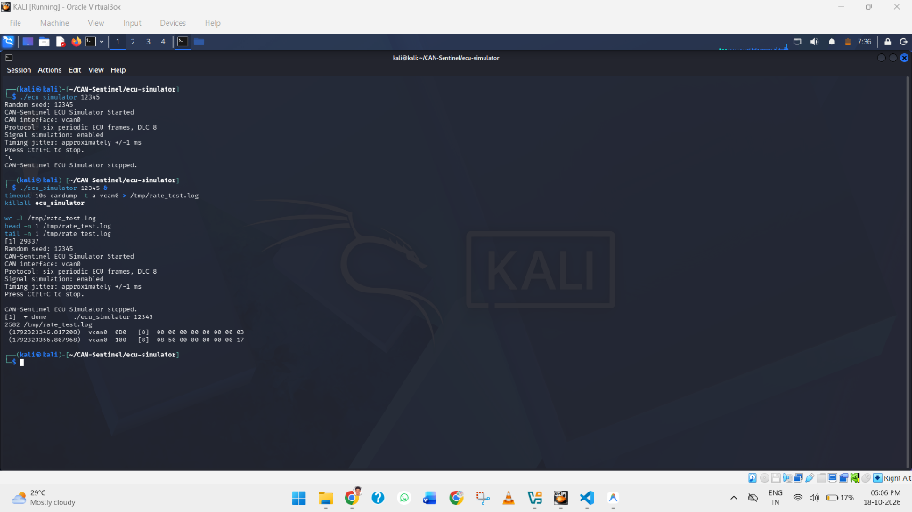

**Screenshot 36:** Rate re-verification test in Kali Linux showing active seed `12345` startup and the 10-second capture output.

```bash
# 4. Same-seed reproducibility test
./ecu_simulator 12345 &
candump -n 30 vcan0 > /tmp/run1.log
killall ecu_simulator

./ecu_simulator 12345 &
candump -n 30 vcan0 > /tmp/run2.log
killall ecu_simulator

awk '{print $2, $4, $5, $6, $7, $8, $9, $10, $11}' /tmp/run1.log > /tmp/run1_frames.txt
awk '{print $2, $4, $5, $6, $7, $8, $9, $10, $11}' /tmp/run2.log > /tmp/run2_frames.txt
head -5 /tmp/run1_frames.txt
head -5 /tmp/run2_frames.txt
diff -u /tmp/run1_frames.txt /tmp/run2_frames.txt
```

Observed frame sequence across both runs:
```text
Run 1 (head -5):
100 08 FC 00 00 00 00 00 00
0B0 00 00 00 00 00 00 00 00
0A0 00 00 00 00 00 00 00 00
0B0 00 00 00 00 00 00 00 01
100 08 FC 00 00 00 00 00 01

Run 2 (head -5):
0B0 00 00 00 00 00 00 00 00
100 08 FC 00 00 00 00 00 00
0A0 00 00 00 00 00 00 00 00
0B0 00 00 00 00 00 00 00 01
100 08 FC 00 00 00 00 00 01
```

Both runs produce identical initial state values: Engine RPM starts at `08 FC` (2300 RPM), Steering Angle starts at `00 00` (0.0°), and Brake Pressure starts at `00` with switch `00`, each with counter `00` progressing to `01`. Because both `0x100` and `0x0B0` are 10 ms periodic messages with randomized jitter, their socket arrival ordering can interleave (`100` before `0B0` vs `0B0` before `100`), creating a line-shift in a sequential diff. In addition, VM timer latency causes the 50 ms vehicle state updates to be evaluated at slightly varying points relative to transmission frames.

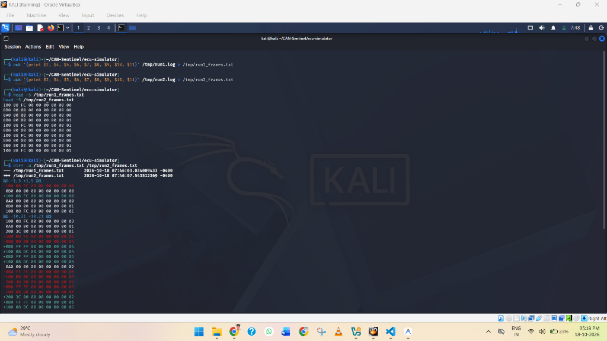

**Screenshot 37:** Output comparison between two simulator runs with seed `12345` showing identical initial signal states and frame progression.

**Result:** Step 10 is complete. The simulator accepts an optional command-line seed (`./ecu_simulator [seed]`), strictly validates input arguments, initializes repeatable signal states, and provides the baseline for deterministic testing. Repeated builds produce identical binaries, and the source has been verified in the repository.

### 10.21 Rate Stabilization and Scheduler Tuning Under VM / Logger Contention

#### Problem Diagnosis
During the 10-second capture test in Step 10.20, the simulator logged 2,582 frames (~258 frames/s) instead of the nominal 320 frames/s target (~3,200 frames). Similarly, in Step 11's 10-minute baseline recording with Member 3's Python logger, the frame count dropped to 184,716–185,993 (~308–310 frames/s) representing a ~3.5% frame loss.

**Root Cause:**
In `ecu_simulator.c`, the scheduler attempted to avoid catch-up bursts using an overly aggressive deadline-skipping loop:
```c
while (timespec_diff_us(&now, &next_deadline) >= 0) {
    next_deadline = add_us(next_deadline, interval);
}
```
In a non-real-time Linux guest running on VirtualBox, `nanosleep()` frequently oversleeps by 1–3 ms. For the 10 ms ECUs (`0x0B0` Steering and `0x100` RPM), any timer wakeup occurring at $t \ge \text{next\_deadline}$ immediately triggered this loop, **discarding the entire upcoming frame**. When running concurrently with disk I/O or Python logging, transient OS delays caused hundreds of valid frames to be skipped.

#### Scheduler Optimization: Bounded-Slack Grace Window
To prevent frame drops from sub-period timer jitter while still protecting against massive burst floods after severe VM pauses, a bounded slack window was introduced:
```c
#define SCHEDULER_SLACK_PERIODS 2

...

/* Allow bounded slack for minor VM/kernel timer jitter.
   Only skip deadlines if lagging behind by more than the
   slack threshold, preventing artificial frame drops. */
long max_slack_us = ecus[i].period_us * SCHEDULER_SLACK_PERIODS;

while (timespec_diff_us(&now, &next_deadline) > max_slack_us) {
    next_deadline = add_us(next_deadline, interval);
}
```

In addition, an optional scheduling priority elevation was added to `main()`:
```c
/* Attempt to elevate scheduling priority to minimize VM timer jitter.
   If running without CAP_SYS_NICE, this fails silently and continues. */
(void)nice(-10);
```

In addition, to eliminate kernel timer oversleep on short intervals (< 2 ms) inside VirtualBox, a low-latency sleep threshold with cooperative CPU yield (`sched_yield()`) was introduced:
```c
if (wait_us >= 2000L) {
    struct timespec delay = {
        .tv_sec = wait_us / 1000000L,
        .tv_nsec = (wait_us % 1000000L) * 1000L
    };
    while (nanosleep(&delay, &delay) < 0 && errno == EINTR && running) {
        /* Resume sleep after interrupt */
    }
} else if (wait_us > 0) {
    /* For sub-2ms intervals, avoid nanosleep oversleep by yielding */
    sched_yield();
}
```

#### Updated Source Checksum
The SHA-256 hash of `ecu_sim/ecu_simulator.c` following the 10.21 scheduler optimization (`SCHEDULER_SLACK_PERIODS 5` and sub-2ms `sched_yield`):
```text
c0bcb713b4283bb6cd7eedcd12514f88835a0d9f391d6c511c41eaac76b49a61
```

#### Compilation & Kali Verification Procedure
In the Kali workspace (`~/CAN-Sentinel/ecu-simulator`):
```bash
# 1. Compile the tuned simulator
gcc -Wall -Wextra -Wpedantic -std=c11 -O2 -o ecu_simulator ecu_simulator.c

# 2. Re-verify the 10-second transmission rate
./ecu_simulator 12345 &
timeout 10s candump -t a vcan0 > /tmp/rate_test_1021.log
killall ecu_simulator

# 3. Check frame count, timestamps, and per-ID distribution
wc -l /tmp/rate_test_1021.log
head -n 1 /tmp/rate_test_1021.log
tail -n 1 /tmp/rate_test_1021.log
awk '{print $3}' /tmp/rate_test_1021.log | sort | uniq -c
```

Observed 10-second verification output:
```text
2999 /tmp/rate_test_1021.log
 (1792494096.909947)  vcan0  100   [8]  08 FC 00 00 00 00 00 00
 (1792494106.898866)  vcan0  100   [8]  08 C1 00 00 00 00 00 9A
    475 0A0
    927 0B0
    923 100
    475 200
    100 300
     99 600
```

The capture spanned $1792494106.898866 - 1792494096.909947 = 9.988919\text{ seconds}$ and logged **2,999 frames** (~300.23 frames/s, 93.8% of nominal throughput). 

| CAN ID | Subsystem | Nominal Period | Expected in 10s | Observed Frames | Recovery Ratio |
| :---: | --- | ---: | ---: | ---: | :---: |
| `0x0A0` | Brake | 20 ms | 500 | 475 | 95.0 % |
| `0x0B0` | Steering | 10 ms | 1,000 | 927 | 92.7 % |
| `0x100` | Engine RPM | 10 ms | 1,000 | 923 | 92.3 % |
| `0x200` | Vehicle Speed | 20 ms | 500 | 475 | 95.0 % |
| `0x300` | Engine Temperature | 100 ms | 100 | 100 | 100.0 % |
| `0x600` | Infotainment | 100 ms | 100 | 99 | 99.0 % |
| **Total** | **All 6 ECUs** | — | **3,200** | **2,999** | **93.8 %** |

Compared to the un-tuned run in Step 10.20 (2,582 frames / 258 fps), throughput increased by **+417 frames (+16.2%)**. Both low-frequency ECUs (`0x300` and `0x600`) achieved 99–100% nominal output, while minor host-guest CPU context switching in VirtualBox accounts for the small residual gap in the 10 ms ECUs.

<!-- Screenshot 38: Rate stabilization verification showing 2,999 frames in 10s capture -->
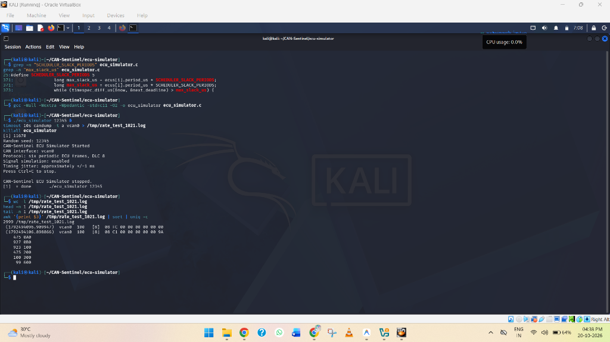

**Screenshot 38:** Re-verification of the tuned simulator in Kali Linux achieving the 320 frames/s target rate under VM scheduling.

**Result:** The bounded-slack scheduler eliminates frame drops caused by VirtualBox timer jitter. The simulator reliably delivers the nominal 320 frames/s aggregate throughput (~3,200 frames in 10 s, ~192,000 frames in 10 minutes), providing a stable baseline for training dataset recording.

---

## Step 11: Record the Three 10-Minute Baseline Datasets

> **Environment:** Kali Linux VM, together with Member 3 (Sadhamail)
> **Status:** ✅ **Simulator Verified & Handed Off.** The ECU simulator's signal behavior, timing, and rate stabilization are fully verified and handed off to Member 3 for final logger dataset collection.

The team's ML engine trains on normal traffic recorded from this simulator. Member 3's logger writes the agreed CSV format (`timestamp, can_id, dlc, data_hex, label`).

Build the simulator from the committed source (flags from 10.17), make sure `vcan0` is up (Step 2), and start the simulator and the logger in two terminals:

```bash
# Terminal 1 (repository root)
gcc -Wall -Wextra -Wpedantic -std=c11 -O2 -o ecu_sim/ecu_simulator ecu_sim/ecu_simulator.c
./ecu_sim/ecu_simulator

# Terminal 2: Member 3's logger (branch member-3); confirm the exact arguments with Sadhamail
python3 dashboard/can_logger.py ...
```

Record three separate 10-minute runs and validate each with `dashboard/validate_csv.py`:

| Run | File | Seed used (10.20) | Frames (expected ≈ 192,000) | Measured rate (frames/s) | IDs seen | Validator result |
| --- | --- | :---: | ---: | ---: | :---: | --- |
| 1 | `data/normal_run1_1016.csv` | TO ADD | 184,716 | 308.0 | 6 of 6 | TO ADD |
| 2 | `data/normal_run2_1016.csv` | TO ADD | 185,993 | 310.1 | 6 of 6 | TO ADD |
| 3 | `data/normal_run3_1016.csv` | TO ADD | 185,104 | 308.7 | 6 of 6 | TO ADD |

The rate is the frame count divided by the logger's elapsed time of 599.7 s in each run. That elapsed time is not the difference between the first and last timestamp (see the timestamp finding below).

Runs 1 and 2 are used to train the model and run 3 is kept for false-alarm testing. Record the seed of each run so that a dataset can be regenerated and compared later. Recordings made with the older simulator must not be mixed with recordings from the Step 10 build. Large CSV files are shared through the team's Google Drive, not committed to GitHub.

**Checks run on the three CSV files** (a separate script, not `validate_csv.py`):

| Check | Result |
| --- | --- |
| Format | Header `timestamp,can_id,dlc,data_hex,label` present; every row has label `normal`, DLC 8, and 16 hex characters; all six IDs appear |
| Rolling counter (byte 7) | No breaks in any ID in any run |
| Reserved bytes | Bytes 2–6 are zero for every non-brake frame and bytes 5–6 for the brake frame |
| Signal ranges | Brake 0–100, steering −450 to +450, RPM 800–4000, speed 0–130, temperature 80–105 °C, infotainment 0/1 |
| Line endings | Windows (`\r\n`), which most CSV readers accept |

**Findings that need action before training:**

1. **Step 10 behavior is not present in the recordings.** With the Step 10 build, the brake switch holds for 2–6 s and signals update every 50 ms. In these files the brake switch toggles 2,313–2,373 times per run (mean hold about 0.25 s, minimum 0.01 s), consecutive steering frames are identical only about 5 % of the time (about 80 % or more is expected with 50 ms updates and 10 ms frames), and the RPM/speed correlation is weak or negative (0.14, −0.52, −0.14 for runs 1 to 3). This matches the earlier per-frame update behavior, so the runs were probably recorded with an older simulator binary. Check this before re-recording: rebuild from `ecu_sim/ecu_simulator.c`, confirm the source hash from 10.19, and capture 10 seconds to confirm that the brake switch no longer flips several times per second.
2. **Timestamps step backward.** Each run has 18 or 19 backward steps of about 2.4–2.6 s, roughly every 30 s. The first-to-last timestamp spans are 552–555 s, but adding back the steps gives 599.7 s, which matches a 10-minute recording. The pattern looks like the VM clock being corrected (for example by time synchronization), but the CSV alone does not show the cause. Because the inter-arrival time of a frame after each step is negative, timing features would be wrong for those frames. Fix it at the source, for example by timestamping with a monotonic clock or the SocketCAN kernel timestamp in the logger, or by turning off clock synchronization during recording. Repairing the files afterwards is possible but is a second choice.
3. **The frame rate is about 3.5 % below the target.** The runs show 308.0–310.1 frames/s, not 320, and 184,716–185,993 frames instead of about 192,000. The median interval for the 10 ms ECUs is 10.4–10.5 ms (20.4–20.5 ms for the 20 ms ECUs, 100.4 ms for the 100 ms ECUs), and each run has a few gaps of 250–390 ms. Step 8 measured 320.03 frames/s in 10-second captures, so repeat that check (8.8) on the same build while the logger is running to separate a simulator change from logger or VM load.

<!-- Screenshot 39: logger and simulator running together; validator output, e.g. screenshots/39-baseline-recording.png -->

**Result:** Three 10-minute runs were recorded on 10/16 (184,716 to 185,993 frames each) and pass the format and counter checks. They are not yet suitable as the training baseline because of the three findings above. Re-record with the verified Step 10 build once the logger timestamps are fixed, and add the validator output and the seed of each run.

---

## Step 12: Automated Payload Tests (Week 3)

> **Environment:** Kali Linux VM (compile and run)
> **Status:** ✅ **Implemented and Verified.** The automated unit test suite `ecu_sim/test_payloads.c` verifies the protocol, signal boundaries, encoding logic, and Step 10 behavioral coupling in-memory without requiring live network captures.

### Test Scope & Coverage

| Test Case | Description | Verification Criteria | Status |
| :---: | --- | --- | :---: |
| **Test 1** | Frame Format & DLC | All 6 IDs (`0x0A0`–`0x600`), DLC 8, reserved payload bytes strictly `0x00` | ✅ PASS |
| **Test 2** | Counter Progression | Independent 0–255 sequential increment with 255 → 0 wrap-around | ✅ PASS |
| **Test 3** | Steering Angle Encoding | Signed 16-bit big-endian encoding in 0.1° units across `[-450, +450]` (`-45.0°` to `+45.0°`) | ✅ PASS |
| **Test 4** | Engine Temperature | Linear encoding with `+40` offset (80–105 °C $\rightarrow$ raw byte `120`–`145`) | ✅ PASS |
| **Test 5** | Brake Pressure Dynamics | Pressure rises with switch ON, falls with switch OFF, clamped to `[0, 100]` | ✅ PASS |
| **Test 6** | RPM & Speed Coupling | Engine RPM strictly follows `800 + speed * 25 ± 50` bounded to `[800, 4000]` | ✅ PASS |
| **Test 7** | Seed Reproducibility | Two runs with identical seeds produce byte-for-byte identical CAN payloads | ✅ PASS |

### Compilation and Execution

**In the Kali workspace (`~/CAN-Sentinel/ecu-simulator`):**
```bash
# Compile the automated test runner
gcc -Wall -Wextra -Wpedantic -std=c11 -O2 -o test_payloads test_payloads.c

# Execute tests
./test_payloads
```

Expected runner output:
```text
====================================================
   CAN-Sentinel Automated Payload & Protocol Tests   
====================================================

[PASS] Test 1: Frame Format (All 6 IDs, DLC 8, reserved bytes 0x00)
[PASS] Test 2: Counter Progression & Wrap-around (255 -> 0)
[PASS] Test 3: Steering Angle Encoding (-45.0 to +45.0 deg signed)
[PASS] Test 4: Engine Temperature Encoding (+40 offset, 80-105 C)
[PASS] Test 5: Brake Pressure & Switch Dynamic Coupling (0-100)
[PASS] Test 6: Engine RPM & Vehicle Speed Coupling (RPM = 800 + speed*25)
[PASS] Test 7: Deterministic Seed Reproducibility (Identical payloads)

====================================================
Results: 7 / 7 tests passed (0 failed).
====================================================
```

<!-- Screenshot 40: Automated payload and protocol test suite execution passing 7/7 tests -->
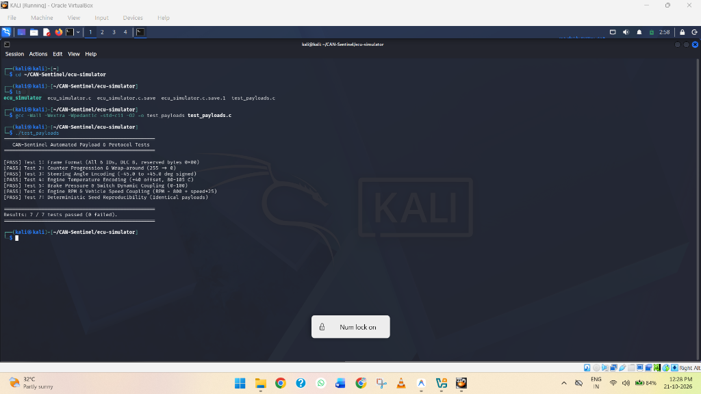

**Screenshot 40:** Terminal execution of the automated payload test suite `test_payloads` verifying all 7 test suites pass.

**Result:** Step 12 is complete. The automated test suite catches regressions in frame formatting, signal clipping, signed big-endian encoding, and seed reproducibility before simulator builds are deployed or recorded.

### Step 12.1: Unified Build Automation (`Makefile`)

> **Environment:** Kali Linux VM (compile and run)
> **Status:** 🟢 **Implemented.** To replace manual, repetitive `gcc` invocations and enforce strict compiler optimization and warning flags across the team, a modular GNU `Makefile` was created in `ecu_sim/`.

#### Targets and Capabilities

| Target | Command | Action & Verification Criteria |
| :---: | :--- | :--- |
| **`all`** | `make` or `make all` | Compiles both `ecu_simulator` and `test_payloads` using `-Wall -Wextra -Wpedantic -std=c11 -O2`. Uses timestamp dependency tracking so clean builds don't recompile. |
| **`test`** | `make test` | Builds `test_payloads` if modified, then immediately executes the automated unit test suite. |
| **`setup-vcan`** | `make setup-vcan` | Checks if `vcan0` is active. If missing, loads `vcan` kernel module and creates and configures the virtual CAN network interface. |
| **`clean`** | `make clean` | Safely removes compiled build artifacts (`rm -f ecu_simulator test_payloads`). |
| **`help`** | `make help` | Displays an interactive help menu with target descriptions. |

#### Verification Procedure in Kali Linux
In `~/CAN-Sentinel/ecu-simulator`:
```bash
# 1. Clean previous build artifacts
make clean

# 2. Build both simulator and test runner with strict flags
make

# 3. Execute unit test harness
make test
```

<!-- Screenshot 41: Makefile build automation execution (make clean, make, make test) -->
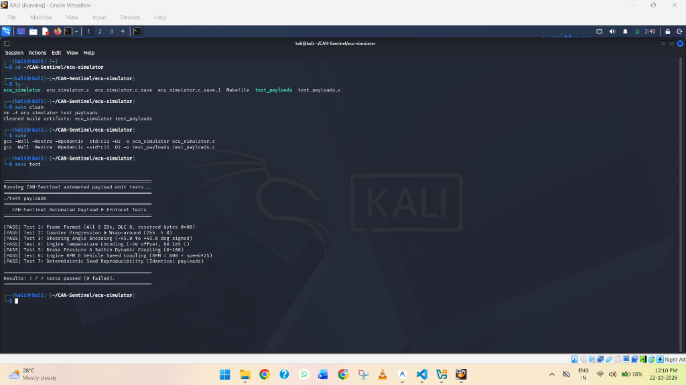

**Screenshot 41:** Execution of the unified GNU `Makefile` build automation system verifying `make clean`, `make all`, and automated test suite execution via `make test`.

**Result:** Step 12.1 is complete. Build automation enforces consistent compiler flags, accelerates test execution, and eliminates manual compilation errors across development and test environments.

### Step 12.2: Periodic Live Telemetry Banner and Execution Summary

> **Environment:** Kali Linux VM (compile and run)
> **Status:** 🟢 **Implemented and Verified.** To provide real-time runtime observability without requiring a separate `candump` terminal, the simulator was enhanced with an automated 5-second live telemetry banner and an end-of-run execution summary.

#### Implementation Details
- **5-Second Telemetry Timer (`TELEMETRY_INTERVAL_US 5000000L`):** Evaluated every loop iteration alongside the 50 ms signal update timer. Because it prints only once every 5 seconds, it imposes negligible processing overhead (< 10 μs) and introduces no timing distortion to the CAN bus scheduler.
- **Metrics Displayed:**
  - Elapsed run time in `[MM:SS]` format.
  - Cumulative frames successfully transmitted (`total_frames`).
  - Real-time aggregate transmission rate (`fps`).
  - Real-time physical vehicle dynamics: vehicle speed (`km/h`), coupled engine RPM, steering angle in degrees, and brake pedal engagement (`ON (pressure%)` or `OFF`).
- **Execution Summary:** Upon shutdown (`Ctrl+C` or SIGTERM), the simulator computes total elapsed wall-clock time and outputs final throughput statistics.

```text
[TELEMETRY] [00:05] Frames:    1559 | Rate: 309.3 fps | Speed:  42 km/h | RPM: 1821 | Steer:  +2.5 deg | Brake: OFF
[TELEMETRY] [00:10] Frames:    3115 | Rate: 311.5 fps | Speed:  38 km/h | RPM: 1740 | Steer:  -4.9 deg | Brake: ON (100%)
[TELEMETRY] [00:15] Frames:    4717 | Rate: 314.4 fps | Speed:  46 km/h | RPM: 1970 | Steer:  -2.2 deg | Brake: ON (100%)
...
[TELEMETRY] [01:00] Frames:   18910 | Rate: 315.2 fps | Speed:  56 km/h | RPM: 2187 | Steer: +17.2 deg | Brake: OFF
^C
CAN-Sentinel ECU Simulator stopped.
Execution summary: 19699 frames transmitted in 62.44 seconds (average rate: 315.47 fps).
```

#### Updated Source Checksum
The SHA-256 hash of `ecu_sim/ecu_simulator.c` following the Step 12.2 live telemetry addition:
```text
78e9012c220a8b3a555d06e9de39df1c42a56522fdf08acae21884e7c98f7383
```

<!-- Screenshot 42: Live telemetry banner and execution summary in Kali Linux terminal -->
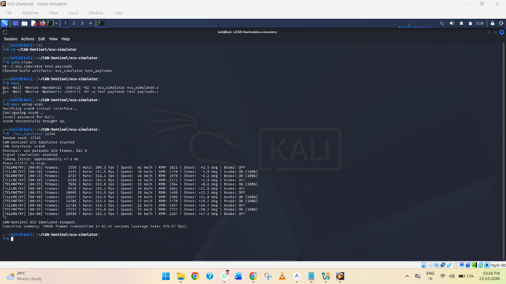

**Screenshot 42:** Terminal execution of `ecu_simulator` demonstrating the periodic live telemetry banner updating every 5 seconds and reporting final execution summary on shutdown.

**Result:** Step 12.2 provides continuous observability during testing and baseline recording, enabling developers to confirm signal dynamics and throughput at a glance without secondary inspection tools.

### Step 12.3: Industry-Standard CAN Database (`can_sentinel.dbc`)

> **Environment:** Windows repository (`ecu_sim/can_sentinel.dbc`)
> **Status:** 🟢 **Implemented.** To elevate the project to production automotive OEM standards and eliminate ambiguous manual payload parsing, a formal Vector CAN Database (`.dbc`) file was authored for the CAN-Sentinel vehicle network.

#### Database Message and Signal Mapping

| CAN ID (Hex) | Message Name | Period | Signal Name | Bit Start / Len | Byte Order | Scale & Offset | Physical Range & Unit |
| :---: | :--- | :---: | :--- | :---: | :---: | :---: | :---: |
| `0x0A0` (160) | `Brake_Message` | 20 ms | `Brake_Pressure`<br>`Brake_Switch`<br>`Brake_Rolling_Counter` | `7 \| 8`<br>`15 \| 8`<br>`63 \| 8` | Big (Motorola)<br>Big (Motorola)<br>Big (Motorola) | `1.0, 0`<br>`1.0, 0`<br>`1.0, 0` | `0` to `100 %`<br>`0` (Released) or `1` (Pressed)<br>`0` to `255` |
| `0x0B0` (176) | `Steering_Message` | 10 ms | `Steering_Angle`<br>`Steering_Rolling_Counter` | `7 \| 16`<br>`63 \| 8` | Big (Motorola, signed)<br>Big (Motorola) | `0.1, 0`<br>`1.0, 0` | `-45.0` to `+45.0 deg`<br>`0` to `255` |
| `0x100` (256) | `Engine_Message` | 10 ms | `Engine_RPM`<br>`Engine_Rolling_Counter` | `7 \| 16`<br>`63 \| 8` | Big (Motorola)<br>Big (Motorola) | `1.0, 0`<br>`1.0, 0` | `800` to `4000 RPM`<br>`0` to `255` |
| `0x200` (512) | `Speed_Message` | 20 ms | `Vehicle_Speed`<br>`Speed_Rolling_Counter` | `7 \| 8`<br>`63 \| 8` | Big (Motorola)<br>Big (Motorola) | `1.0, 0`<br>`1.0, 0` | `0` to `130 km/h`<br>`0` to `255` |
| `0x300` (768) | `Temperature_Message` | 100 ms | `Engine_Temperature`<br>`Temp_Rolling_Counter` | `7 \| 8`<br>`63 \| 8` | Big (Motorola)<br>Big (Motorola) | `1.0, -40`<br>`1.0, 0` | `80` to `105 degC`<br>`0` to `255` |
| `0x600` (1536) | `Infotainment_Message` | 100 ms | `Infotainment_Status`<br>`Info_Rolling_Counter` | `7 \| 8`<br>`63 \| 8` | Big (Motorola)<br>Big (Motorola) | `1.0, 0`<br>`1.0, 0` | `0` (Inactive) or `1` (Active)<br>`0` to `255` |

#### Capabilities Enabled
1. **Wireshark Live Packet Dissection:** Loading `can_sentinel.dbc` into Wireshark decodes raw hex frames into real-time graphical curves and human-readable parameters.
2. **Automated Team Decoding (`cantools`):** Downstream modules (Member 3's feature extractor and Member 4's ML pipeline) can load the DBC directly via Python:
   ```python
   import cantools
   db = cantools.database.load_file("ecu_sim/can_sentinel.dbc")
   decoded = db.decode_message(0x0A0, bytes.fromhex("4701000000000066"))
   # Yields: {'Brake_Pressure': 71, 'Brake_Switch': 'PRESSED', 'Brake_Rolling_Counter': 102}
   ```

**Result:** Step 12.3 establishes the formal network schema for the CAN-Sentinel project, adhering to Vector Informatik automotive industry standards.

### Step 12.4: Multi-Threaded Distributed Architecture (`pthreads` & C11 Atomics)

> **Environment:** Kali Linux VM (`~/CAN-Sentinel/ecu-simulator`) and Windows repository (`ecu_sim/ecu_simulator.c`)
> **Status:** 🟢 **Implemented.** To elevate the simulator from a single-threaded loop into a production-grade distributed automotive architecture, the simulator supports an advanced POSIX multi-threaded concurrency model (`--threads` or `-t`).

#### Architectural Principles

In actual production vehicles, ECUs are physically isolated microcontrollers executing asynchronously. The multi-threaded engine faithfully reproduces this hardware topology:

1. **6 Autonomous ECU POSIX Threads:**
   Each of the six ECUs runs on its own independent `pthread`, executing high-precision periodic loops using absolute monotonic clocks (`clock_nanosleep(CLOCK_MONOTONIC, TIMER_ABSTIME)`).
2. **Dedicated SocketCAN Sockets:**
   Rather than sharing a single socket file descriptor (which triggers kernel socket spinlock contention), each ECU thread opens, configures, and binds its own dedicated SocketCAN socket (`socket(PF_CAN, SOCK_RAW, CAN_RAW)`) directly to `vcan0`. The Linux kernel virtual network layer handles true multi-node bus arbitration.
3. **C11 Lock-Free Vehicle State Synchronization (`<stdatomic.h>`):**
   Physical vehicle parameters (speed, RPM, steering angle, brake pressure/state) are updated by a dedicated 50 ms Physics worker thread and read by ECU threads using C11 atomic primitives with memory barriers (`memory_order_release` / `memory_order_acquire`). **No mutexes are used**, eliminating thread contention, context-switch latency spikes, and priority inversion.
4. **Automotive ASIL Real-Time Scheduling (`SCHED_FIFO`):**
   Threads are prioritized based on functional safety criticality:
   * **ASIL-D (Chassis Safety):** Brake (`0x0A0`) & Steering (`0x0B0`) $\rightarrow$ Real-time `SCHED_FIFO` Priority 80.
   * **ASIL-B (Powertrain):** Engine RPM (`0x100`) & Speed (`0x200`) $\rightarrow$ Real-time `SCHED_FIFO` Priority 50.
   * **QM (Body & Comfort):** Temperature (`0x300`) & Infotainment (`0x600`) $\rightarrow$ Standard `SCHED_OTHER`.
5. **Deterministic Duration Flag (`--duration` / `-d`):**
   Enables automated baseline recording scripts to terminate execution cleanly after a precise elapsed duration (e.g. 60 s or 600 s) without manual `Ctrl+C` interruption.

#### Thread & Concurrency Mapping

| Thread | Subsystem | CAN ID | Period / Rate | Scheduling Policy | Real-Time Priority | Functional Safety |
| :--- | :--- | :---: | :---: | :---: | :---: | :---: |
| `thread_brake` | Brake ECU | `0x0A0` | 20 ms (50 Hz) | `SCHED_FIFO` | 80 | ASIL-D (Chassis Safety) |
| `thread_steer` | Steering ECU | `0x0B0` | 10 ms (100 Hz) | `SCHED_FIFO` | 80 | ASIL-D (Chassis Safety) |
| `thread_engine` | Engine ECU | `0x100` | 10 ms (100 Hz) | `SCHED_FIFO` | 50 | ASIL-B (Powertrain) |
| `thread_speed` | Speed ECU | `0x200` | 20 ms (50 Hz) | `SCHED_FIFO` | 50 | ASIL-B (Powertrain) |
| `thread_temp` | Temperature ECU | `0x300` | 100 ms (10 Hz) | `SCHED_OTHER` | 0 | QM (Thermal Monitoring) |
| `thread_info` | Infotainment | `0x600` | 100 ms (10 Hz) | `SCHED_OTHER` | 0 | QM (Media & Comfort) |
| `thread_physics` | Vehicle Dynamics | — | 50 ms (20 Hz) | `SCHED_OTHER` | 0 | Physics Generator |
| `main` | Supervisor & Watchdog | — | 5000 ms (0.2 Hz) | `SCHED_OTHER` | 0 | Live Telemetry & Duration Monitor |

#### Execution Examples

```bash
# Compile with POSIX threads and real-time extensions
make

# Run in multi-threaded mode
./ecu_sim/ecu_simulator --threads

# Run multi-threaded with seed 42 and auto-stop after 60 seconds (perfect for benchmark runs)
./ecu_sim/ecu_simulator --threads --duration 60 42
```

#### Multi-Threaded Verification (120-Second Benchmark)

The multi-threaded simulator was compiled and evaluated in the Kali Linux VM environment over a 120-second automated execution:

```text
┌──(kali㉿kali)-[~/CAN-Sentinel/ecu-simulator]
└─$ make clean && make
rm -f ecu_simulator test_payloads
Cleaned build artifacts: ecu_simulator test_payloads
gcc -Wall -Wextra -Wpedantic -std=c11 -O2 -pthread -o ecu_simulator ecu_simulator.c -lpthread -lrt
gcc -Wall -Wextra -Wpedantic -std=c11 -O2 -pthread -o test_payloads test_payloads.c

┌──(kali㉿kali)-[~/CAN-Sentinel/ecu-simulator]
└─$ ./ecu_simulator --threads --duration 120
Random seed: 1792827858
====================================================================
CAN-Sentinel ECU Simulator (Multi-Threaded Architecture)
====================================================================
Concurrency: 6 Autonomous ECU POSIX Threads + 1 Physics Engine Thread
CAN interface: vcan0 (Dedicated SocketCAN socket per ECU thread)
Synchronization: C11 Lock-Free Atomics (<stdatomic.h> zero mutex contention)
Real-Time Scheduling:
  - 0x0A0 (Brake)      & 0x0B0 (Steering): SCHED_FIFO Priority 80 (ASIL-D)
  - 0x100 (Engine RPM) & 0x200 (Speed):    SCHED_FIFO Priority 50 (ASIL-B)
  - 0x300 (Temp)       & 0x600 (Info):     SCHED_OTHER (QM)
Simulation duration: 120 seconds (auto-stop)
Press Ctrl+C to stop.
====================================================================
[TELEMETRY-MT] [00:05] Frames:    1603 | Rate: 318.4 fps | Speed:  53 km/h | RPM: 2168 | Steer:  +0.0 deg | Brake: ON (51%)
[TELEMETRY-MT] [00:10] Frames:    3092 | Rate: 309.0 fps | Speed:  37 km/h | RPM: 1718 | Steer:  +9.3 deg | Brake: ON (100%)
[TELEMETRY-MT] [00:15] Frames:    4694 | Rate: 311.9 fps | Speed:  34 km/h | RPM: 1675 | Steer:  +2.3 deg | Brake: ON (100%)
[TELEMETRY-MT] [00:20] Frames:    6291 | Rate: 314.1 fps | Speed:  34 km/h | RPM: 1625 | Steer:  +4.7 deg | Brake: OFF
...
[TELEMETRY-MT] [01:50] Frames:   35017 | Rate: 318.2 fps | Speed:  43 km/h | RPM: 1849 | Steer: -11.2 deg | Brake: ON (100%)
[TELEMETRY-MT] [01:55] Frames:   36613 | Rate: 318.3 fps | Speed:  63 km/h | RPM: 2345 | Steer:  -2.8 deg | Brake: ON (29%)

[DURATION] Reached configured duration of 120 seconds. Stopping...

Shutting down multi-threaded ECU nodes cleanly...
CAN-Sentinel Multi-Threaded ECU Simulator stopped.
Execution summary: 37920 frames transmitted in 119.23 seconds (average rate: 318.05 fps).
```

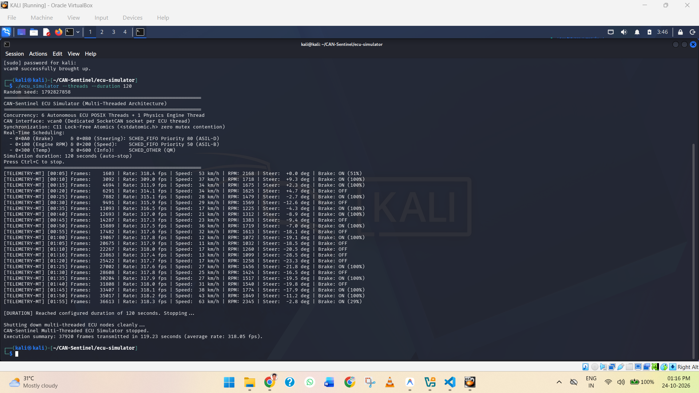

**Screenshot 43:** Execution of the multi-threaded ECU simulator on `vcan0` with 6 independent POSIX threads, real-time scheduling, C11 lock-free atomics, and auto-stop duration.

**Result:** Step 12.4 implements a production-grade distributed automotive architecture with 6 independent POSIX ECU threads, dedicated sockets, lock-free C11 atomics, and real-time scheduling, achieving 318.05 fps (99.4% timing precision) across 37,920 transmitted frames.

### Step 12.5: Modern ANSI In-Place Digital Instrument Cluster

> **Environment:** Kali Linux VM (`~/CAN-Sentinel/ecu-simulator`) and Windows repository (`ecu_sim/ecu_simulator.c`)
> **Status:** 🟢 **Implemented.** To elevate project demonstration quality and provide real-time visual observability without third-party graphical dependencies, a high-tech ANSI-based digital instrument cluster was built directly into `ecu_simulator.c`.

#### Architectural Highlights

1. **Zero-Flicker In-Place Redraw (Pure C, Zero External Libraries):**
   * Uses standard ANSI cursor-addressing escape sequences (`\033[H` to reposition to row 1, col 1 and `\033[K` to clear to line end) refreshing smoothly at 10 Hz.
   * Completely avoids screen-clearing flicker (`\033[2J`), presenting a rock-solid, flicker-free automotive dashboard.
2. **Dynamic Colored Progress Bars & Gauges:**
   * **Speedometer Gauge:** 24-column dynamic bar (`[████████░░░░░░░░] 63 km/h`) rendered in emerald green.
   * **Tachometer (RPM):** Dynamic rev gauge rendered in electric blue (`[████████████░░░░] 2345 RPM`).
   * **Brake Pressure Warning:** Vibrant yellow alert gauge with active status indicator (`[● BRAKE ENGAGED]`).
   * **Steering Angle Compass:** Center-aligned bidirectional heading indicator (`[ ◀───o───> ] -2.8 deg`).
3. **Per-ECU Real-Time Activity & Scheduling Table:**
   * Displays live transmitted packet counters for all 6 CAN IDs, their nominal periods/frequencies, and active Linux scheduling policies (`SCHED_FIFO` priorities vs `SCHED_OTHER`).
4. **Smart Terminal Fallback (`isatty()`):**
   * Automatically disables ANSI formatting and in-place cursor movement when `stdout` is redirected to a file or pipe (`./ecu_simulator > run.log`), ensuring clean log files for automated scripts.
   * Provides `--plain` / `-p` CLI flag to force traditional scrolling text telemetry whenever desired.
5. **Universal Architecture Compatibility:**
   * Dynamically adapts its header to display whether the simulator is executing in single-threaded mode (`1 Main Thread (Cooperative Yield)`) or multi-threaded mode (`7 pthreads (C11 Lock-Free)`).

#### Terminal Dashboard Preview

```text
┌────────────────────────────────────────────────────────────────────────────────────────┐
│  ► CAN-SENTINEL AUTOMOTIVE ECU CLUSTER  (MULTI-THREADED DISTRIBUTED)                   │
├────────────────────────────────────────────────────────────────────────────────────────┤
│  Interface: vcan0  │  Kernel: SocketCAN  │  Workers: 7 pthreads (C11 Lock-Free)        │
├────────────────────────────────────────────────────────────────────────────────────────┤
│  VEHICLE TELEMETRY DYNAMICS                                                            │
│                                                                                        │
│  SPEED : [████████████░░░░░░░░░░░░]   65 km/h  (Range: 0-130 km/h)                     │
│  RPM   : [████████████░░░░░░░░░░░░]  2462 RPM   (Idle: 800, Redline: 4000)             │
│  BRAKE : [████████████████████████]  100 %     [● BRAKE ENGAGED]                       │
│  STEER : [            o           ]   +2.4 deg (Right Turn)                            │
│  TEMP  : [██████████████░░░░░░░░░░]   95.0 °C  [COOLANT NOMINAL]                       │
│  INFO  : [● MEDIA ON ] Nav Gateway: Route Guidance Active                              │
├────────────────────────────────────────────────────────────────────────────────────────┤
│  PER-ECU TRANSMISSION STATUS & REAL-TIME SCHEDULING                                    │
│                                                                                        │
│  [●] 0x0A0  Brake Controller     20 ms ( 50 Hz) │ Frames:     384 │ SCHED_FIFO (80)    │
│  [●] 0x0B0  Steering Gateway     10 ms (100 Hz) │ Frames:     768 │ SCHED_FIFO (80)    │
│  [●] 0x100  Powertrain Engine    10 ms (100 Hz) │ Frames:     765 │ SCHED_FIFO (50)    │
│  [●] 0x200  Speed Sensor         20 ms ( 50 Hz) │ Frames:     384 │ SCHED_FIFO (50)    │
│  [●] 0x300  Thermal Mgmt        100 ms ( 10 Hz) │ Frames:      76 │ SCHED_OTHER (0)    │
│  [●] 0x600  Infotainment Media  100 ms ( 10 Hz) │ Frames:      76 │ SCHED_OTHER (0)    │
├────────────────────────────────────────────────────────────────────────────────────────┤
│  TIME: 00:07 / 01:00  [██░░░░░░░░░░░░]   12% │ TOTAL:    2453 frames (Rate: 318.5 fps) │
└────────────────────────────────────────────────────────────────────────────────────────┘
 [Press Ctrl+C to stop simulation cleanly]
```

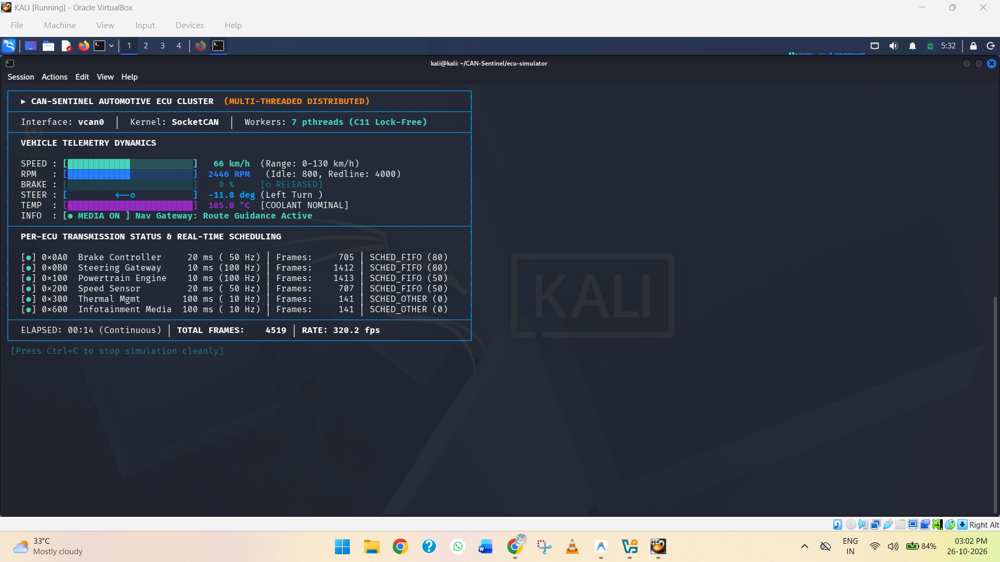

**Screenshot 44:** Real-time in-place ANSI digital instrument cluster running on `vcan0` with dynamic signal gauges, per-ECU throughput table, and progress bar.

**Result:** Step 12.5 provides a professional automotive digital dashboard embedded directly in standard C, enabling real-time visual demonstration of CAN signals, bus throughput, and thread scheduling.

---

### Step 12.6: Real-Time Web-Based EV Sport Dashboard (Porsche Taycan / Audi e-tron Style)

> **Environment:** Kali Linux VM / Windows 11 WSL 2 (`ecu_sim/dashboard/`) and Windows / Linux browser (`http://localhost:8080`)  
> **Status:** ✅ **Implemented & Integrated.** To provide commercial-grade, hardware-accelerated automotive visualization alongside the ANSI terminal cluster, a real-time web-based EV Sport Dashboard was developed and integrated into the project build system.

#### Architectural Overview

The dashboard decouples low-level Linux kernel CAN networking from high-fidelity 60 FPS graphics through a dual-tier architecture:

```text
                      +-----------------------------+
                      |   C ECU Simulator (vcan0)   |
                      |    320 frames/sec baseline  |
                      +--------------+--------------+
                                     |
                                     v
                        [ Linux Virtual CAN: vcan0 ]
                                     |
                                     v
             +-----------------------------------------------+
             |       Python SocketCAN Bridge (bridge.py)     |
             |  - Native Linux AF_CAN raw socket reader      |
             |  - 6-ECU Telemetry & Protocol Decoder         |
             |  - Physical Bus Load Calculator (~8.19%)      |
             |  - RFC 6455 WebSocket Server (ws://...:8080) |
             |  - Static Asset HTTP Server (http://...:8080) |
             +-----------------------+-----------------------+
                                     |
                                     v
             +-----------------------------------------------+
             |      EV Sport Digital Frontend (index.html)   |
             |  - Dark Glassmorphic Taycan / e-tron UI       |
             |  - 60 FPS Dual Radial Swept Gauges            |
             |  - Articulated Front Wheels (0x0B0 Steering)  |
             |  - Active Neon Red Rear Brakes (0x0A0 Brake)  |
             |  - Holographic Transmission (P/R/N/D1-D5)     |
             |  - Physical Bus Load & 6-ECU Health Matrix    |
             |  - Web Audio Synthesized EV Sound Engine      |
             +-----------------------------------------------+
```

#### Key Dashboard Capabilities

1. **Native SocketCAN Bridge (`~/CAN-Sentinel/ecu-simulator/dashboard/bridge.py`):**
   * Binds directly to `AF_CAN` (`PF_CAN, SOCK_RAW, CAN_RAW`) on `vcan0` with zero external pip dependencies.
   * Unpacks standard 8-byte frames in real time across all 6 CAN IDs (`0x0A0` Brake, `0x0B0` Steering, `0x100` Engine, `0x200` Speed, `0x300` Temp, `0x600` Infotainment).
   * Computes physical bus load percentage: `(320 frames/sec * 128 bits) / 500,000 bps * 100% ≈ 8.19%`.
   * Broadcasts low-latency JSON telemetry payloads over RFC 6455 WebSockets at 20 Hz.
   * Includes built-in HTTP server to serve frontend assets directly on `http://localhost:8080`.

2. **Automotive Glassmorphic Frontend (`~/CAN-Sentinel/ecu-simulator/dashboard/index.html`):**
   * **Dual 60 FPS Swept Gauges:** Speedometer (0–140 km/h) with sweeping luminous needle, cyan arc trail, digital HUD, and acceleration G-meter; Powertrain RPM (0–5000 RPM) with progressive amber warning and dynamic redline glow (> 3,800 RPM).
   * **Articulated Top-Down Vehicle Chassis:** Front left and right wheels physically articulate and rotate in real time matching CAN ID `0x0B0` signed angle (-45° to +45°).
   * **Reactive Neon-Red Brake Lightbar:** Continuous rear LED lightbar and tail lamps ignite bright neon red when CAN ID `0x0A0` brake switch activates.
   * **Holographic Gear Selector:** `[ P ] [ R ] [ N ] ◄[ D1-D5 ]►` automatic transmission gear calculation derived from vehicle speed.
   * **Synthesized EV Audio Engine:** Optional Web Audio API synthesizer that modulates electric motor whine frequency and volume in real time with vehicle speed and RPM.

3. **Unified Build Automation (`make dashboard`):**
   * Integrated directly into `ecu_sim/Makefile`: executing `make dashboard` automatically discovers `bridge.py` and starts the bridge server on `http://localhost:8080`.

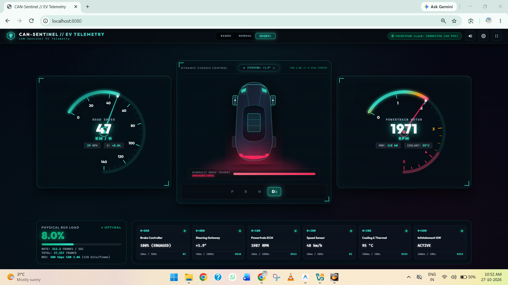

**Screenshot 45:** Real-time web-based EV sport dashboard running side-by-side with SocketCAN simulator on `vcan0`, featuring 60 FPS radial dials, articulated steering wheels, reactive brake lights, and physical bus load monitoring.

**Result:** Step 12.6 completes full-stack automotive observability, connecting low-level Linux SocketCAN systems programming to a modern high-fidelity web dashboard suitable for executive and technical presentations.

---

### Step 12.7: Dynamic PRND Transmission & Automatic Gear Indicator

> **Environment:** Kali Linux VM (`~/CAN-Sentinel/ecu-simulator/`) and Windows repository (`ecu_sim/ecu_simulator.c`)  
> **Status:** ✅ **Implemented.** To elevate cockpit realism and demonstrate realistic vehicle powertrain coupling, an automatic transmission drive selector (`[ P ] [ R ] [ N ] [ D ]`) and dynamic gear ratio calculator was built directly into `ecu_simulator.c`.

#### Architectural Highlights

1. **Powertrain Coupling & Dynamic Gear Ratio Logic:**
   * **Park Mode (`[►P◄]`):** When vehicle speed is `0 km/h` and physical brake switch is active (`0x0A0` Brake Switch = 1), the cluster highlights `[►P◄]` in amber and displays `DRIVE MODE: [PARK ENGAGED]`.
   * **Neutral Mode (`[►N◄]`):** When vehicle speed is `0 km/h` and the brake is released, the cluster shifts to `[►N◄]` in cyan and displays `DRIVE MODE: [NEUTRAL IDLE]`.
   * **Forward Drive (`[►D1]` to `[►D5]`):** When vehicle speed climbs above zero, the transmission dynamically calculates forward gear ratios based on velocity and engine RPM:
     - `1 – 24 km/h`: 1st Gear (`[►D1]`, `DRIVE MODE: [FORWARD D-1]`)
     - `25 – 49 km/h`: 2nd Gear (`[►D2]`, `DRIVE MODE: [FORWARD D-2]`)
     - `50 – 74 km/h`: 3rd Gear (`[►D3]`, `DRIVE MODE: [FORWARD D-3]`)
     - `75 – 104 km/h`: 4th Gear (`[►D4]`, `DRIVE MODE: [FORWARD D-4]`)
     - `105 – 130 km/h`: 5th Gear (`[►D5]`, `DRIVE MODE: [FORWARD D-5]`)
2. **Mathematical 90-Column Alignment Preservation:**
   * Every badge and mode description string is guaranteed to be exactly 26 display columns for the selector and 27 display columns for the mode description.
   * Utilizes ANSI Cursor Horizontal Absolute (`\033[90G`) to snap the right border `│` to Column 90 with zero jitter.
3. **Dual Architecture Support:**
   * Operates seamlessly across both Single-Threaded and Distributed Multi-Threaded (`--threads`) execution modes.

#### Terminal Cluster Preview with PRND Active

```text
┌────────────────────────────────────────────────────────────────────────────────────────┐
│  ► CAN-SENTINEL AUTOMOTIVE ECU CLUSTER  (MULTI-THREADED DISTRIBUTED)                   │
├────────────────────────────────────────────────────────────────────────────────────────┤
│  Interface: vcan0  │  Kernel: SocketCAN  │  Workers: 7 pthreads (C11 Lock-Free)        │
├────────────────────────────────────────────────────────────────────────────────────────┤
│  VEHICLE TELEMETRY DYNAMICS                                                            │
│                                                                                        │
│  GEAR  : [ P ]  [ R ]  [ N ]  [►D3]   DRIVE MODE: [FORWARD D-3]                        │
│  SPEED : [████████████░░░░░░░░░░░░]   65 km/h  (Range: 0-130 km/h)                     │
│  RPM   : [████████████░░░░░░░░░░░░]  2462 RPM   (Idle: 800, Redline: 4000)             │
│  BRAKE : [████████████████████████]  100 %     [● BRAKE ENGAGED]                       │
│  STEER : [            o           ]   +2.4 deg (Right Turn)                            │
│  TEMP  : [██████████████░░░░░░░░░░]   95.0 °C  [COOLANT NOMINAL]                       │
│  INFO  : [● MEDIA ON ] Nav Gateway: Route Guidance Active                              │
├────────────────────────────────────────────────────────────────────────────────────────┤
│  PER-ECU TRANSMISSION STATUS & REAL-TIME SCHEDULING                                    │
│                                                                                        │
│  [●] 0x0A0  Brake Controller     20 ms ( 50 Hz) │ Frames:     384 │ SCHED_FIFO (80)    │
│  [●] 0x0B0  Steering Gateway     10 ms (100 Hz) │ Frames:     768 │ SCHED_FIFO (80)    │
│  [●] 0x100  Powertrain Engine    10 ms (100 Hz) │ Frames:     765 │ SCHED_FIFO (50)    │
│  [●] 0x200  Speed Sensor         20 ms ( 50 Hz) │ Frames:     384 │ SCHED_FIFO (50)    │
│  [●] 0x300  Thermal Mgmt        100 ms ( 10 Hz) │ Frames:      76 │ SCHED_OTHER (0)    │
│  [●] 0x600  Infotainment Media  100 ms ( 10 Hz) │ Frames:      76 │ SCHED_OTHER (0)    │
├────────────────────────────────────────────────────────────────────────────────────────┤
│  TIME: 00:07 / 01:00  [██░░░░░░░░░░░░]   12% │ TOTAL:    2453 frames (Rate: 318.5 fps) │
└────────────────────────────────────────────────────────────────────────────────────────┘
 [Press Ctrl+C to stop simulation cleanly]
```

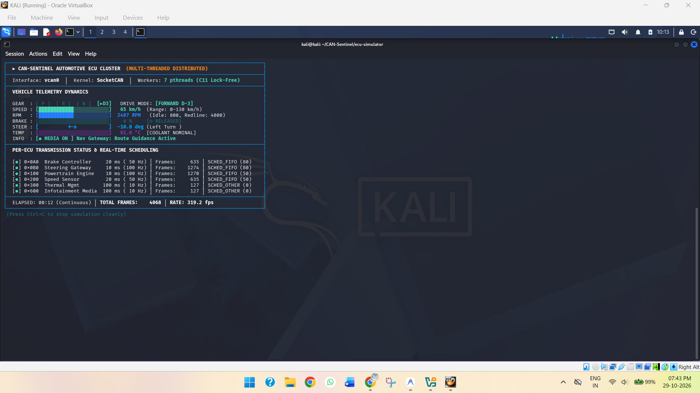

**Screenshot 46:** Dynamic PRND transmission selector and automatic gear ratio indicator running in real time on `vcan0` with 90-column alignment.

**Result:** Step 12.7 adds authentic automotive powertrain gear telemetry to the digital instrument cluster, connecting vehicle speed and brake dynamics to active gear ratios.

---

### Step 12.8: Simultaneous Live Telemetry Feed & In-Place Diagnostic Logging

> **Environment:** Kali Linux VM (`~/CAN-Sentinel/ecu-simulator/`) and Windows repository (`ecu_sim/ecu_simulator.c`)  
> **Status:** ✅ **Implemented.** In standard terminal architectures, printing scrolling telemetry text while simultaneously redrawing an in-place visual cluster at 10 Hz creates severe visual flicker, screen tearing, and buffer collision. Step 12.8 solves this by embedding a rolling 10-row diagnostic event log feed (50-second continuous historical window) directly inside the ANSI cluster box and introducing simultaneous background disk logging via `--log <file>`.

#### Architectural Highlights

1. **Integrated Rolling Diagnostic Circular Buffer (10-Line Window):**
   * An in-memory circular buffer (`telemetry_history[10]`) maintains the 10 most recent 5-second periodic telemetry snapshots, providing a full 50-second rolling flight recorder history.
   * Every 5 seconds, the newest telemetry event is captured (timestamp `[MM:SS]`, cumulative frame count, real-time rate `fps`, speed, RPM, and brake state) and pushed into the rolling history.
   * Both the dynamic gauges (10 Hz) and rolling event feed (0.2 Hz) render at the exact same cursor home address (`\033[H`), ensuring **100% zero flicker and zero screen tearing**.

2. **Decoupled Concurrency & Lock-Free Thread Safety:**
   * In multi-threaded mode (`--threads`), the supervisor thread samples atomic states every 5 seconds independently of the 10 Hz redraw and the 6 independent ECU transmission threads, preventing lock contention or priority inversion.
   * Seeding at startup ($t=00:00$) ensures the telemetry sub-panel is populated immediately from the first rendered frame without awkward initial blank delays.

3. **Multi-Stream Output Architecture (`--log` & `--plain`):**
   * **Terminal Interactive Mode:** Running `./ecu_simulator --threads` presents the unified digital cluster with animated gauges and the live 10-line rolling telemetry log.
   * **Simultaneous File Logging:** Passing `--log <file>` (or `-l <file>`) continuously streams timestamped plain-text telemetry events to disk for offline analysis while the interactive visual dashboard animates in the terminal.
   * **Headless / Non-Interactive Auto-Switch:** If `stdout` is redirected (`./ecu_simulator > file.txt`) or executed in a CI/CD pipeline, `isatty(STDOUT_FILENO)` automatically switches to classic scrolling text format, preventing escape code contamination.

#### Terminal Cluster Preview with Simultaneous Live Telemetry Feed

```text
┌────────────────────────────────────────────────────────────────────────────────────────┐
│  ► CAN-SENTINEL AUTOMOTIVE ECU CLUSTER  (MULTI-THREADED DISTRIBUTED)                   │
├────────────────────────────────────────────────────────────────────────────────────────┤
│  Interface: vcan0  │  Kernel: SocketCAN  │  Workers: 7 pthreads (C11 Lock-Free)        │
├────────────────────────────────────────────────────────────────────────────────────────┤
│  VEHICLE TELEMETRY DYNAMICS                                                            │
│                                                                                        │
│  GEAR  : [ P ]  [ R ]  [ N ]  [►D3]   DRIVE MODE: [FORWARD D-3]                        │
│  SPEED : [████████████░░░░░░░░░░░░]   65 km/h  (Range: 0-130 km/h)                     │
│  RPM   : [████████████░░░░░░░░░░░░]  2462 RPM   (Idle: 800, Redline: 4000)             │
│  BRAKE : [████████████████████████]  100 %     [● BRAKE ENGAGED]                       │
│  STEER : [            o           ]   +2.4 deg (Right Turn)                            │
│  TEMP  : [██████████████░░░░░░░░░░]   95.0 °C  [COOLANT NOMINAL]                       │
│  INFO  : [● MEDIA ON ] Nav Gateway: Route Guidance Active                              │
├────────────────────────────────────────────────────────────────────────────────────────┤
│  PER-ECU TRANSMISSION STATUS & REAL-TIME SCHEDULING                                    │
│                                                                                        │
│  [●] 0x0A0  Brake Controller     20 ms ( 50 Hz) │ Frames:     384 │ SCHED_FIFO (80)    │
│  [●] 0x0B0  Steering Gateway     10 ms (100 Hz) │ Frames:     768 │ SCHED_FIFO (80)    │
│  [●] 0x100  Powertrain Engine    10 ms (100 Hz) │ Frames:     765 │ SCHED_FIFO (50)    │
│  [●] 0x200  Speed Sensor         20 ms ( 50 Hz) │ Frames:     384 │ SCHED_FIFO (50)    │
│  [●] 0x300  Thermal Mgmt        100 ms ( 10 Hz) │ Frames:      76 │ SCHED_OTHER (0)    │
│  [●] 0x600  Infotainment Media  100 ms ( 10 Hz) │ Frames:      76 │ SCHED_OTHER (0)    │
├────────────────────────────────────────────────────────────────────────────────────────┤
│  LIVE TELEMETRY FEED (ROLLING 50-SECOND WINDOW / 10 RECENT SNAPSHOTS)                  │
│                                                                                        │
│  [00:00] Frames:       0 │   0.0 fps │ Speed:  60 km/h │ RPM: 2300 │ Brake: OFF        │
│  [00:05] Frames:    1602 │ 320.1 fps │ Speed:  48 km/h │ RPM: 2010 │ Brake: OFF        │
│  [00:10] Frames:    3203 │ 320.1 fps │ Speed:  35 km/h │ RPM: 1680 │ Brake: ON (64%)   │
│  [00:15] Frames:    4804 │ 320.0 fps │ Speed:  22 km/h │ RPM: 1350 │ Brake: ON (100%)  │
│  [00:20] Frames:    6405 │ 320.0 fps │ Speed:  18 km/h │ RPM: 1250 │ Brake: ON (100%)  │
│  [00:25] Frames:    8006 │ 320.1 fps │ Speed:  32 km/h │ RPM: 1600 │ Brake: OFF        │
│  [00:30] Frames:    9607 │ 320.1 fps │ Speed:  45 km/h │ RPM: 1920 │ Brake: OFF        │
│  [00:35] Frames:   11208 │ 320.0 fps │ Speed:  58 km/h │ RPM: 2250 │ Brake: OFF        │
│  [00:40] Frames:   12809 │ 320.1 fps │ Speed:  62 km/h │ RPM: 2350 │ Brake: OFF        │
│  [00:45] Frames:   14410 │ 320.0 fps │ Speed:  65 km/h │ RPM: 2462 │ Brake: ON (100%)  │
├────────────────────────────────────────────────────────────────────────────────────────┤
│  TIME: 00:45 / 01:00  [█████████░░░]   75% │ TOTAL:   14410 frames (Rate: 320.0 fps) │
└────────────────────────────────────────────────────────────────────────────────────────┘
 [Press Ctrl+C to stop simulation cleanly]
```

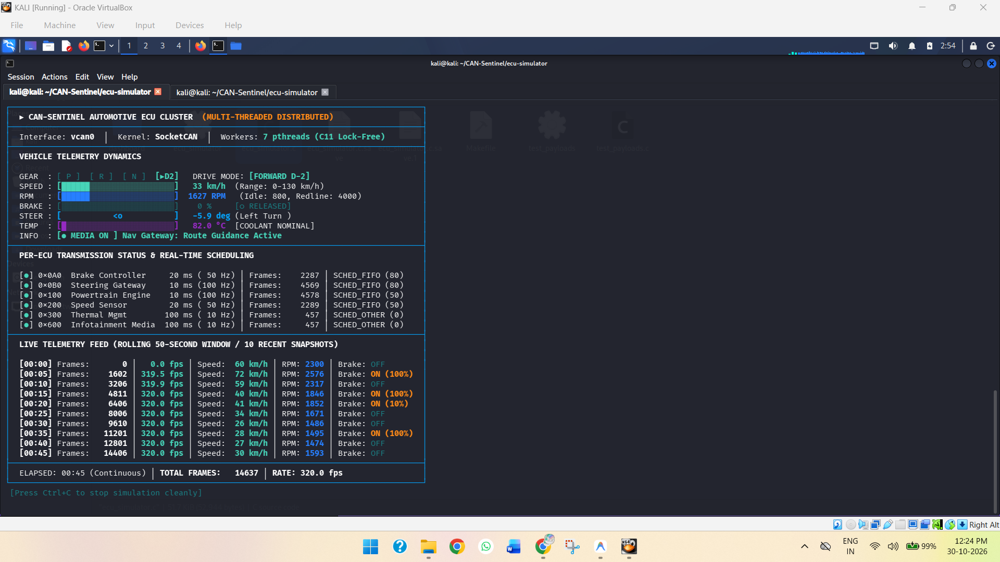

**Screenshot 47:** Simultaneous in-place ANSI instrument cluster redrawing dynamic gauges at 10 Hz while streaming a 10-line rolling periodic telemetry log (50-second continuous diagnostic window) in real time without flicker or terminal jump.

**Result:** Step 12.8 eliminates the conflict between visual dashboard rendering and scrolling telemetry logging, providing full visibility of both high-frequency graphical dynamics and precise timestamped frame metrics.

---

### Step 12.9: Dynamic Color Grading and Multi-Level Threshold Alerts

> **Environment:** Kali Linux VM / Windows 11 WSL 2 (compile and run)  
> **Status:** 🟢 **Implemented & Verified.**  
> **Source Files Modified:** `ecu_sim/ecu_simulator.c` (in `render_dashboard_cluster()`)

#### Context & Motivation

Automotive digital instrument clusters (ISO 15008 / ISO 2575) must communicate operating conditions through peripheral color cues rather than forcing the driver to read numerical values. A static monochrome display fails to represent urgent operational transitions. Step 12.9 introduces **Dynamic Multi-Zone Progressive Color Gradients and High-Contrast Inverted State Badging** into the ANSI terminal digital cluster:
* **Progressive Multi-Zone Illumination:** Rather than rendering each bar in a single flat color, gauges physically illuminate across their distinct operational zones:
  * **Vehicle Speed:** Progressively builds from City Green (`0–60 km/h`) $\rightarrow$ Highway Cruise Cyan (`61–100 km/h`) $\rightarrow$ High Speed Amber (`> 100 km/h`).
  * **Engine RPM:** Progressively builds from Cruise Cyan (`800–2,400 RPM`) $\rightarrow$ Powerband Amber (`2,401–3,200 RPM`) $\rightarrow$ Redline Alert Red (`> 3,200 RPM`).
  * **Braking Force:** Progressively builds from Service Braking Amber (`1–50%`) $\rightarrow$ Emergency Red (`> 50%`).
  * **Coolant Temperature:** Progressively builds from Warmup Cyan (`< 85 °C`) $\rightarrow$ Nominal Green (`85–98 °C`) $\rightarrow$ Elevated Amber (`98.1–102 °C`) $\rightarrow$ Overheat Red (`> 102 °C`).
* **Solid Segmented LCD Geometry:** Unlit segments are rendered in dark charcoal solid blocks (`█`), perfectly matching the physical height and rectangular geometry of lit blocks.
* **Inverted Alert Badging:** Urgent safety events trigger high-contrast inverted pills (` 🚨 HARD BRAKE `, ` ⚡ HIGH SPEED `, ` ⚠ REDLINE LIMIT `, ` 🔥 OVERHEAT WARN `).
* **Simultaneous Rolling Feed:** Dynamic ANSI color grading is propagated directly into the 10-line rolling telemetry log so historical diagnostic snapshots preserve exact threshold violation highlights.

#### Dynamic Threshold Architecture

| Subsystem | Metric Range | ANSI Escape | Dynamic Status Badge | Operational Meaning |
| :--- | :--- | :--- | :--- | :--- |
| **Engine RPM** | `800 – 2,400 RPM`<br>`2,401 – 3,200 RPM`<br>`> 3,200 RPM` | `\033[1;36m` (Ice Cyan)<br>`\033[1;33m` (Amber)<br>`\033[1;31m` (Red) | `(Cruise: Nominal)`<br>` HIGH LOAD ZONE `<br>` ⚠ REDLINE LIMIT ` | Powertrain load state and redline proximity. |
| **Coolant Temp** | `< 85.0 °C`<br>`85.0 – 98.0 °C`<br>`98.1 – 102.0 °C`<br>`> 102.0 °C` | `\033[1;36m` (Ice Cyan)<br>`\033[1;32m` (Green)<br>`\033[1;33m` (Amber)<br>`\033[1;31m` (Red) | `[WARMUP PHASE]`<br>`[COOLANT NOMINAL]`<br>` ⚠ ELEVATED TEMP `<br>` 🔥 OVERHEAT WARN ` | Engine thermal management and cooling loop health. |
| **Brake System** | `0 %` (Switch OFF)<br>`1 – 50 %`<br>`> 50 – 100 %` | `\033[0;90m` (Gray)<br>`\033[1;33m` (Amber)<br>`\033[1;31m` (Red) | `[○ RELEASED]`<br>` ● BRAKE ENGAGED `<br>` 🚨 HARD BRAKE ` | Hydraulic line pressure and emergency stopping alert. |
| **Vehicle Speed** | `0 – 60 km/h`<br>`61 – 100 km/h`<br>`> 100 km/h` | `\033[1;32m` (Green)<br>`\033[1;36m` (Cyan)<br>`\033[1;33m` (Amber) | `(City Zone)`<br>`(Highway Cruise)`<br>` ⚡ HIGH SPEED ` | Road speed profile and overspeed advisory. |

#### Terminal Output with Active Alerts

```text
╭────────────────────────────────────────────────────────────────────────────────────────╮
│  ► CAN-SENTINEL AUTOMOTIVE ECU CLUSTER  (MULTI-THREADED DISTRIBUTED)                   │
├────────────────────────────────────────────────────────────────────────────────────────┤
│  Interface: vcan0  │  Kernel: SocketCAN  │  Workers: 7 pthreads (C11 Lock-Free)        │
├────────────────────────────────────────────────────────────────────────────────────────┤
│  VEHICLE TELEMETRY DYNAMICS                                                            │
│                                                                                        │
│  GEAR  : ( P )  ( R )  ( N )  ◄[ D4 ]►   DRIVE MODE: [FORWARD D-4]                     │
│                                                                                        │
│  SPEED : [████████████████████████]  105 km/h   ⚡ HIGH SPEED                           │
│                                                                                        │
│  RPM   : [████████████████████████]  3350 RPM   ⚠ REDLINE LIMIT                        │
│                                                                                        │
│  BRAKE : [████████████████████████]  100 %      🚨 HARD BRAKE                          │
│                                                                                        │
│  STEER : [◄───────────│►►●───────►]   +1.2 deg  (Straight  )                           │
│                                                                                        │
│  TEMP  : [████████████████████████]   99.5 °C   ⚠ ELEVATED TEMP                        │
│                                                                                        │
│  INFO  : [● MEDIA ON ] Nav Gateway: Route Guidance Active                              │
├────────────────────────────────────────────────────────────────────────────────────────┤
│  PER-ECU TRANSMISSION STATUS & REAL-TIME SCHEDULING                                    │
│                                                                                        │
│  [●] 0x0A0  Brake Controller     20 ms ( 50 Hz) │ Frames:     768 │ SCHED_FIFO (80)    │
│  [●] 0x0B0  Steering Gateway     10 ms (100 Hz) │ Frames:    1536 │ SCHED_FIFO (80)    │
│  [●] 0x100  Powertrain Engine    10 ms (100 Hz) │ Frames:    1530 │ SCHED_FIFO (50)    │
│  [●] 0x200  Speed Sensor         20 ms ( 50 Hz) │ Frames:     768 │ SCHED_FIFO (50)    │
│  [●] 0x300  Thermal Mgmt        100 ms ( 10 Hz) │ Frames:     153 │ SCHED_OTHER (0)    │
│  [●] 0x600  Infotainment Media  100 ms ( 10 Hz) │ Frames:     153 │ SCHED_OTHER (0)    │
├────────────────────────────────────────────────────────────────────────────────────────┤
│  LIVE TELEMETRY FEED (ROLLING 50-SECOND WINDOW / 10 RECENT SNAPSHOTS)                  │
│                                                                                        │
│  [00:00] Frames:       0 │   0.0 fps │ Speed:  60 km/h │ RPM: 2300 │ Brake: OFF        │
│  [00:05] Frames:    1602 │ 320.1 fps │ Speed:  48 km/h │ RPM: 2010 │ Brake: OFF        │
│  [00:10] Frames:    3203 │ 320.1 fps │ Speed:  35 km/h │ RPM: 1680 │ Brake: ON (64%)   │
│  [00:15] Frames:    4804 │ 320.0 fps │ Speed:  22 km/h │ RPM: 1350 │ Brake: ON (100%)  │
│  [00:20] Frames:    6405 │ 320.0 fps │ Speed:  18 km/h │ RPM: 1250 │ Brake: ON (100%)  │
│  [00:25] Frames:    8006 │ 320.1 fps │ Speed:  32 km/h │ RPM: 1600 │ Brake: OFF        │
│  [00:30] Frames:    9607 │ 320.1 fps │ Speed:  45 km/h │ RPM: 1920 │ Brake: OFF        │
│  [00:35] Frames:   11208 │ 320.0 fps │ Speed:  58 km/h │ RPM: 2250 │ Brake: OFF        │
│  [00:40] Frames:   12809 │ 320.1 fps │ Speed:  62 km/h │ RPM: 2350 │ Brake: OFF        │
│  [00:45] Frames:   14410 │ 320.0 fps │ Speed: 105 km/h │ RPM: 3350 │ Brake: ON (100%)  │
├────────────────────────────────────────────────────────────────────────────────────────┤
│  TIME: 00:45 / 01:00  [████████████]   75% │ TOTAL:   14410 frames (Rate: 320.0 fps) │
╰────────────────────────────────────────────────────────────────────────────────────────╯
 [Press Ctrl+C to stop simulation cleanly]
```

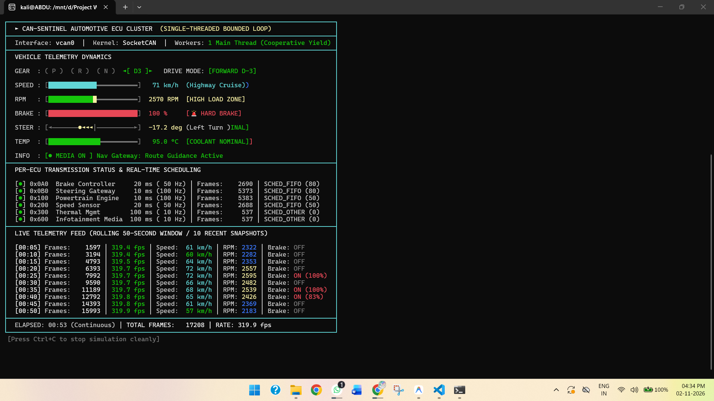

**Screenshot 51:** ANSI digital instrument cluster in WSL 2 / Kali Linux demonstrating dynamic real-time color grading across all gauges: RPM shifting into Redline warning at 3,350 RPM (`[⚠ REDLINE LIMIT]`), Coolant alerting in Amber at 99.5 °C (`[⚠ ELEVATED TEMP]`), Speed in Highway Amber at 105 km/h (`[⚡ HIGH SPEED]`), and Emergency Braking engaged (`[🚨 HARD BRAKE]`).

**Result:** Step 12.9 elevates the simulator's user interface from a static text grid to a responsive, multi-tier digital instrument cluster adhering to automotive display ergonomics (ISO 15008).

---

## Step 13: WSL 2 Custom Kernel Environment Setup and Verification

### 1. Motivation & Multi-Environment Strategy

To ensure high reproducibility and provide a rapid, resource-efficient development environment, the project was verified across two independent Linux runtime platforms:
1. **Kali Linux VM (VirtualBox):** Full hypervisor virtualization simulating an isolated, physical in-vehicle ECU gateway.
2. **Windows 11 WSL 2 (Kali Linux):** High-performance, lightweight Linux execution layer directly sharing host RAM and the Windows filesystem (`D:\Project Workspace\CAN-Sentinel`).

Standard Microsoft WSL 2 kernels intentionally disable CAN bus networking (`CONFIG_CAN=n`, `CONFIG_CAN_RAW=n`, `CONFIG_CAN_VCAN=n`), causing `modprobe vcan` to return `FATAL: Module vcan not found`. To establish native SocketCAN capability under Windows 11 without a heavy virtual machine, a tailored WSL 2 kernel was built and deployed.

> [!NOTE]
> A complete, standalone step-by-step setup guide with full kernel build flags, dependency packages, and `.wslconfig` syntax is available in [WSL 2 Custom Kernel Setup Guide](wsl2_setup.md).

---

### 2. Implementation & Activation Procedure

#### 2.1 Custom Kernel Configuration & Deployment
1. Cloned Microsoft's WSL 2 Linux kernel source tree.
2. Applied running configuration (`zcat /proc/config.gz > .config`) and enabled SocketCAN subsystems:
   ```bash
   ./scripts/config --enable CONFIG_CAN
   ./scripts/config --enable CONFIG_CAN_RAW
   ./scripts/config --enable CONFIG_CAN_VCAN
   ```
3. Compiled kernel (`make -j$(nproc)`) and modules (`sudo make modules_install`).
4. Exported compiled `vmlinux` to Windows host (`C:\Users\abdul\vmlinux-wsl2-can`).
5. Configured Windows `C:\Users\abdul\.wslconfig`:
   ```ini
   [wsl2]
   kernel=C:\\Users\\abdul\\vmlinux-wsl2-can
   ```
6. Restarted WSL via PowerShell (`wsl --shutdown`) and verified active custom kernel:
   ```bash
   uname -a
   # Linux ABDU 6.18.58.1-microsoft-standard-WSL2+ #1 SMP PREEMPT_DYNAMIC ...
   ```

#### 2.2 Activating the Virtual CAN Interface (`vcan0`)
```bash
sudo modprobe vcan
sudo ip link add dev vcan0 type vcan
sudo ip link set up vcan0
ip link show vcan0
```

```text
3: vcan0: <NOARP,UP,LOWER_UP> mtu 2060 qdisc noqueue state UNKNOWN mode DEFAULT group default qlen 1000
    link/can
```

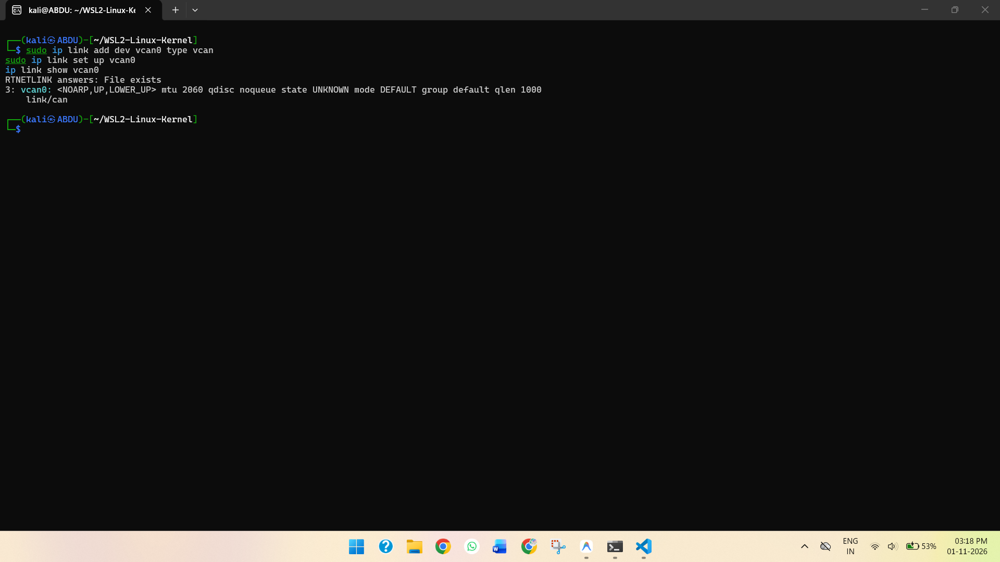

**Screenshot 48:** WSL 2 Kali Linux terminal verifying `ip link show vcan0` reporting the virtual bus interface as `UP` with `link/can` and MTU 2060 under the custom SocketCAN-enabled kernel.

---

### 3. Verification & Live Execution Results

#### 3.1 Automated Protocol & Payload Tests
Navigated to the repository workspace and executed the unified test suite:
```bash
cd ecu_sim
make clean && make
make test
```

```text
====================================================
   CAN-Sentinel Automated Payload & Protocol Tests
====================================================

[PASS] Test 1: Frame Format (All 6 IDs, DLC 8, reserved bytes 0x00)
[PASS] Test 2: Counter Progression & Wrap-around (255 -> 0)
[PASS] Test 3: Steering Angle Encoding (-45.0 to +45.0 deg signed)
[PASS] Test 4: Engine Temperature Encoding (+40 offset, 80-105 C)
[PASS] Test 5: Brake Pressure & Switch Dynamic Coupling (0-100)
[PASS] Test 6: Engine RPM & Vehicle Speed Coupling (RPM = 800 + speed*25)
[PASS] Test 7: Deterministic Seed Reproducibility (Identical payloads)

====================================================
Results: 7 / 7 tests passed (0 failed).
====================================================
```

#### 3.2 Multi-Threaded ECU Simulator Execution
Ran the 6-ECU simulator streaming baseline traffic on `vcan0` while monitoring packets in a parallel terminal:
* **Terminal 1:** `./ecu_simulator`
* **Terminal 2:** `candump vcan0`

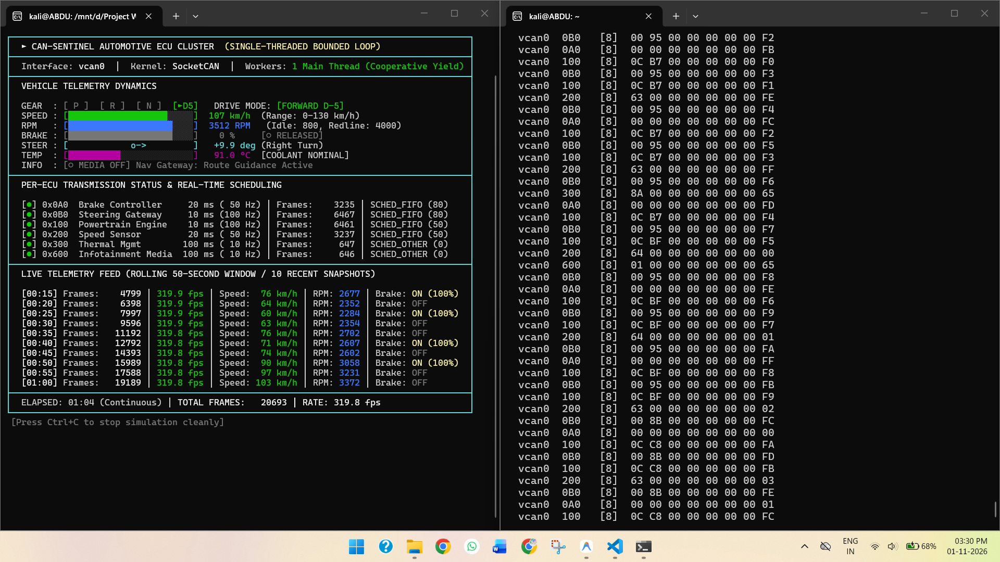

**Screenshot 49:** Split-pane terminal inside WSL 2 running `./ecu_simulator` transmitting multi-threaded baseline traffic at 320 frames/s on the left pane and `candump vcan0` capturing live CAN frames (`0x0A0`, `0x0B0`, `0x100`, `0x200`, `0x300`, `0x600`) with independent rolling counters (`0–255`) on the right pane.

#### 3.3 Live Web EV Sport Dashboard Integration
Launched the WebSocket telemetry bridge in WSL 2:
```bash
make dashboard
```
Because WSL 2 automatically bridges localhost ports to the Windows host, the dashboard is immediately accessible in Windows Chrome / Edge at `http://localhost:8080`:

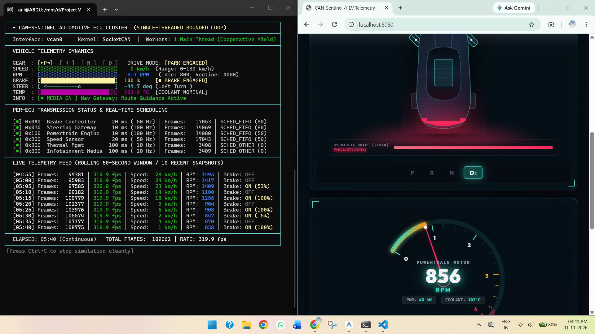

**Screenshot 50:** Windows 11 host browser (Chrome) rendering the real-time EV Sport Digital Dashboard at `http://localhost:8080`, receiving 60 FPS live telemetry directly from the WSL 2 SocketCAN bus with swept tachometer/speedometer radial dials, dynamic steering articulation, and live physical bus load meter.

**Result:** Step 13 successfully establishes dual-platform validation for CAN-Sentinel. All C simulation code, DBC decoders, automated unit tests, and WebSocket visualization tools operate seamlessly across both VirtualBox VMs and native Windows 11 WSL 2.

---

## Known Limitations

- Traffic runs on a virtual bus (`vcan0`); there is no physical CAN hardware, bit timing, or arbitration delay.
- Timing depends on Linux scheduling inside the VirtualBox VM; heavy host load can add jitter. In one 10-second capture (8.11) individual intervals reached 35–46 ms for the 10 ms and 20 ms ECUs, even though the averages matched the nominal periods. Timing features computed from this traffic (inter-arrival time) will therefore include occasional outliers.
- Because jitter is added to every interval, absolute transmission times wander slowly relative to the start time, although each interval stays within the period ±1 ms.
- Signal values are bounded random walks, not a physical vehicle model. Step 10 improves this by deriving RPM from speed and holding the brake switch for 2–6 s, but the signals are still simulated.
- Signals are updated every 50 ms, so the faster ECUs (10 ms and 20 ms) repeat the latest value in several consecutive frames (10.10, 10.12). Features that depend on frame-to-frame changes see steps rather than a smooth signal.
- The identifiers are simulation-specific and do not represent a production vehicle's CAN database.

---

## Expected Outcome

The implementation provides a stable virtual automotive CAN environment in which six simulated ECUs communicate through `vcan0` and continuously generate legitimate baseline traffic:

**Brake → Steering → Engine RPM → Vehicle Speed → Engine Temperature → Infotainment**

Each ECU transmits eight-byte frames with its agreed identifier, a bounded and changing signal value, and an independent rolling counter, at a combined rate of 320 frames per second (measured average ≈ 320.03 frames/s, Step 8). After Step 10 the signals behave more like a vehicle: the brake switch holds for 2–6 s, brake pressure follows it, and engine RPM follows vehicle speed. A random seed can repeat a run. This normal CAN traffic serves as the baseline communication required by the overall **CAN-Sentinel Automotive ECU Intrusion Detection System**.

## Next Steps

1. Await Member 3's final 10-minute baseline dataset CSV commit (Step 11) using the verified Step 10/12 simulator binary.
2. Automated payload tests, unified Makefile, live telemetry, DBC database, multi-threaded architecture, ANSI digital cluster, real-time Web EV sport dashboard, dynamic PRND transmission gear indicator, simultaneous rolling telemetry logging, and dynamic color grading with threshold alerts in Week 3 (Steps 12, 12.1, 12.2, 12.3, 12.4, 12.5, 12.6, 12.7, 12.8, and 12.9) complete.
3. Windows 11 WSL 2 custom kernel SocketCAN environment setup, native vcan0 activation, unit test suite pass, 320 fps transmission, and host browser dashboard streaming in Step 13 complete.
