# Phase 1: Linux Environment and Virtual CAN (SocketCAN) Setup

## Overview

This phase describes the implementation of the CAN-Sentinel Member 1 module, focusing on the configuration of a Linux development environment and the establishment of a virtual Controller Area Network (CAN) environment.

The implementation uses **Kali Linux, Oracle VirtualBox, Linux SocketCAN, and the Virtual CAN (`vcan0`) interface**. This environment provides a platform for configuring CAN communication, transmitting and receiving CAN frames, and verifying communication without requiring physical CAN hardware.

The phase begins with configuring the Kali Linux development environment and installing the necessary CAN utilities and compilation tools. It then covers the creation and verification of the `vcan0` virtual CAN interface, followed by testing CAN communication using the available CAN utilities.

These initial configurations establish the foundation for the subsequent ECU simulator development phase, in which C-based programs will simulate vehicle Electronic Control Units (ECUs) and generate CAN traffic.

The following subsections document each implementation stage, including the commands executed, their purpose, verification results, and corresponding screenshots.

## Implementation Steps

The Linux environment and Virtual CAN setup are organized into the following stages:

1. **Configure Kali Linux on VirtualBox** — Establish and verify the Linux development environment.
2. **Install Required Packages** — Install `can-utils`, GCC, and Make for CAN communication and C program development.
3. **Create and Configure the Virtual CAN Interface** — Load the `vcan` kernel module and create the `vcan0` interface.
4. **Verify the Virtual CAN Interface Details** — Confirm the interface configuration and operational state.
5. **Test CAN Communication** — Transmit and receive test CAN frames using `cansend` and `candump`.

Each stage is documented in detail in the following subsections.

## Step 1: Configure Kali Linux on VirtualBox

The CAN-Sentinel Member 1 module is developed using **Kali Linux Rolling** running inside **Oracle VirtualBox**. The virtual machine provides an isolated Linux environment for implementing the **SocketCAN-based virtual CAN network**, developing the **C-based ECU simulators**, generating normal CAN traffic, and performing CAN traffic monitoring.

The virtual machine is configured with sufficient CPU, memory, and storage resources to support CAN network simulation, C compilation, traffic generation, packet monitoring, and integration with the other CAN-Sentinel modules.

### System Configuration

The Kali Linux virtual machine is configured approximately as follows:

* **Operating System:** Kali GNU/Linux Rolling
* **Kali Version:** 2026.3
* **Kernel:** 7.1.5+kali-amd64
* **Architecture:** x86_64
* **Platform:** Oracle VirtualBox
* **CPU:** 2+ cores
* **RAM:** 4 GB or more
* **Storage:** 40 GB or more
* **Network:** NAT
* **Terminal:** Kali Linux Terminal
* **Compiler:** GCC
* **CAN Framework:** Linux SocketCAN


**Screenshot 1:** Kali Linux virtual machine running in Oracle VirtualBox with the configured development environment.

### Step 1.1: Open the Kali Terminal

After starting the Kali Linux virtual machine, open the Kali Linux terminal.

Navigate to:

**Applications → System Tools → Terminal**

The terminal will be used throughout the Member 1 implementation to configure the virtual CAN interface, compile the C-based ECU simulator programs, generate CAN traffic, and perform system-level verification.

### Step 1.2: Verify the Linux Kernel and System Architecture

First, verify the currently running Linux kernel and system architecture:

```bash
uname -a
```

This command displays information about the Linux kernel, hostname, kernel build, and system architecture.

Example output:

```text
Linux kali 7.1.5+kali-amd64 #1 SMP PREEMPT_DYNAMIC Kali 7.1.5-1kali1 (2026-07-29) x86_64 GNU/Linux
```

The output confirms that the system is running the expected Kali Linux kernel on an **x86_64** architecture.

### Step 1.3: Verify the Kali Linux Operating System

Next, verify the installed Kali Linux distribution and version:

```bash
cat /etc/os-release
```

This command displays the operating system identification and release information.

Example output:

```text
PRETTY_NAME="Kali GNU/Linux Rolling"
NAME="Kali GNU/Linux"
VERSION_ID="2026.3"
VERSION="2026.3"
VERSION_CODENAME=kali-rolling
ID=kali
ID_LIKE=debian
```

This confirms that the development environment is based on **Kali GNU/Linux Rolling**.

### Step 1.4: Verify the GCC Compiler

Finally, verify that the GCC compiler is installed:

```bash
gcc --version
```

GCC is required to compile the C-based ECU simulator programs developed for the CAN-Sentinel Member 1 module.

Example output:

```text
gcc (Debian 16.2.0-3) 16.2.0
```

The successful GCC version output confirms that the C compilation environment is available.


**Screenshot 2:** Terminal showing the Linux kernel, Kali Linux operating system, and GCC compiler verification.

### Step 1 Completion

The Kali Linux development environment has been successfully configured and verified. The system is ready for the next stage of the CAN-Sentinel Member 1 implementation, including **SocketCAN configuration, virtual CAN interface creation, and C-based ECU simulator development**.

## Step 2: Install Required Packages

After configuring the Kali Linux virtual machine, install the packages required for the **SocketCAN-based virtual CAN network** and **C-based ECU simulator development**. These packages provide the CAN utilities and development tools required to create, compile, test, and monitor the CAN traffic generated during the CAN-Sentinel Member 1 implementation.

The required packages are installed using the Kali Linux package manager. The installation includes **can-utils** for working with CAN interfaces, **GCC** for compiling C-based ECU simulator programs, and **Make** for supporting automated compilation.

### Step 2.1: Update the Package Repository

First, update the Kali Linux package repository information:

```bash
sudo apt update
```

This command refreshes the local package index and ensures that the latest available package information is used when installing the required tools.

### Step 2.2: Install the Required Packages

Install the required CAN utilities, GCC compiler, and Make build tool:

```bash
sudo apt install -y can-utils gcc make
```

The installed packages provide the following functionality:

* **can-utils** — Provides utilities such as `candump`, `cansend`, and `cangen` for monitoring, transmitting, and generating CAN traffic.
* **GCC** — Compiles the C-based ECU simulator programs developed for the CAN-Sentinel Member 1 module.
* **Make** — Supports automated compilation and management of the ECU simulator build process.

### Step 2.3: Verify the GCC Compiler

After installation, verify that GCC is available:

```bash
gcc --version
```

The installed GCC version was successfully verified:

```text
gcc (Debian 16.2.0-3) 16.2.0
```

The successful version output confirms that the C compiler required for developing the ECU simulator programs is installed and available.


**Screenshot 3:** Terminal showing the installed GCC version and confirming the C compiler is available.

### Step 2.4: Verify the CAN Utilities

Next, verify that the `candump` utility provided by the **can-utils** package is available:

```bash
candump --help
```

On this system, `candump` reports an invalid option for `--help` and subsequently displays its usage information and available options. This confirms that the `candump` utility is installed correctly and can be executed from the terminal.

The `candump` utility will later be used to monitor CAN frames transmitted through the `vcan0` virtual CAN interface.


**Screenshot 4:** Terminal showing the `candump` usage information and available options, confirming that the `can-utils` package is installed.

### Step 2 Completion

The required CAN and development tools have been successfully installed and verified. The Kali Linux environment now contains **can-utils**, **GCC**, and **Make**, providing the necessary tools for CAN communication, C-based ECU simulator development, compilation, and CAN traffic monitoring.

The environment is now ready for the next stage of the CAN-Sentinel Member 1 implementation: **creating and configuring the `vcan0` virtual CAN interface**.

## Step 3: Create and Configure the Virtual CAN Interface

After installing the required CAN utilities and development tools, the next step is to create the **virtual CAN interface** required for the CAN-Sentinel Member 1 implementation.

Linux **SocketCAN** provides the framework for CAN communication, while the **Virtual CAN (`vcan`)** driver allows CAN communication to be simulated without requiring physical CAN hardware. The `vcan0` interface will serve as the virtual CAN bus on which the C-based ECU simulators will later generate and exchange CAN frames.

### Step 3.1: Load the Virtual CAN Kernel Module

First, load the **Virtual CAN (`vcan`) kernel module**:

```bash
sudo modprobe vcan
```

The `modprobe` command loads the `vcan` kernel module into the running Linux kernel. This enables the system to create virtual CAN network interfaces.

### Step 3.2: Create the `vcan0` Interface

Create a virtual CAN interface named `vcan0`:

```bash
sudo ip link add dev vcan0 type vcan
```

This command creates a new virtual CAN network interface using the Linux `vcan` driver.

The interface is named **`vcan0`** and will be used as the virtual CAN bus for the CAN-Sentinel ECU simulation environment.

### Step 3.3: Bring the `vcan0` Interface Up

Enable the newly created virtual CAN interface:

```bash
sudo ip link set up vcan0
```

This command changes the state of the `vcan0` interface to **UP**, allowing it to participate in CAN communication.

### Step 3.4: Verify the Virtual CAN Interface

Finally, verify that the `vcan0` interface has been created and configured successfully:

```bash
ip link show vcan0
```

The verification command produced the following output:

```text
3: vcan0: <NOARP,UP,LOWER_UP> mtu 2060 qdisc noqueue state UNKNOWN mode DEFAULT group default qlen 1000
    link/can
```

The output confirms that:

* The **`vcan` kernel module** was loaded successfully.
* The **`vcan0` virtual CAN interface** was created successfully.
* The interface is **UP** and ready for CAN communication.
* Linux recognizes `vcan0` as a **CAN interface**.
* The virtual CAN bus is ready for subsequent ECU simulation and CAN traffic generation.


**Screenshot 5:** Terminal showing the `vcan0` interface configuration and verification using `ip link show vcan0`.

### Step 3.5: `vcan0` Persistence and Recreation

The `vcan0` virtual CAN interface is created at runtime and is **not persistent by default**. Therefore, the interface will normally disappear when the Kali Linux virtual machine is rebooted. It can also be removed if the interface is manually deleted.

The following command creates the `vcan0` interface:

```bash
sudo ip link add dev vcan0 type vcan
```

This creates the virtual CAN interface only for the current running Linux session. Linux does not automatically recreate the interface after a system reboot.

### Recreate `vcan0` After Reboot

For the CAN-Sentinel development environment, this behavior is not a problem. If the `vcan0` interface is no longer available after restarting the Kali Linux virtual machine, it can be recreated manually using:

```bash
sudo modprobe vcan
sudo ip link add dev vcan0 type vcan
sudo ip link set up vcan0
```

After executing these commands, the `vcan0` interface will be available again for CAN-Sentinel development and testing.

### Optional: Automatic Recreation After Reboot

The `vcan0` interface can also be configured to be **automatically recreated during system startup**. This avoids manually creating the interface after every Kali Linux reboot.

For CAN-Sentinel, this can be implemented using a **systemd service**. The service can load the `vcan` kernel module, create the `vcan0` interface, and bring it up automatically during system boot.

The service can execute the following commands:

```bash
sudo modprobe vcan
sudo ip link add dev vcan0 type vcan
sudo ip link set up vcan0
```

Once the corresponding systemd service has been created, it can be enabled to start automatically during boot:

```bash
sudo systemctl enable vcan0.service
```

After the Kali Linux virtual machine is restarted, the systemd service can automatically recreate and activate the `vcan0` interface.

**Note:** Automatic recreation is optional for the CAN-Sentinel development environment. The interface can also be recreated manually whenever required.

### Step 3 Completion

The **`vcan` kernel module** has been loaded successfully, and the **`vcan0` virtual CAN interface** has been created and brought up.

The SocketCAN virtual CAN environment is now ready for the next stage of the CAN-Sentinel Member 1 implementation: **developing the C-based ECU simulator programs and generating CAN traffic through `vcan0`**.

## Step 4: Verify the Virtual CAN Interface Details

After creating and enabling the `vcan0` virtual CAN interface, its detailed configuration was verified to ensure that the interface is correctly recognized and configured by the Linux SocketCAN framework.

Two verification commands were used. The first command displays detailed configuration information for `vcan0`, while the second specifically identifies interfaces using the Virtual CAN (`vcan`) driver.

### Step 4.1: Display Detailed `vcan0` Configuration

First, display the detailed configuration of the `vcan0` interface:

```bash
ip -details link show vcan0
```

This command provides detailed information about the network interface, including its interface state, CAN link type, queue configuration, and Virtual CAN driver parameters.

The command produced the following output:

```text
3: vcan0: <NOARP,UP,LOWER_UP> mtu 2060 qdisc noqueue state UNKNOWN mode DEFAULT group default qlen 1000
    link/can promiscuity 0 allmulti 0 minmtu 0 maxmtu 0
    vcan addrgenmode eui64 numtxqueues 1 numrxqueues 1 gso_max_size 65536 gso_max_segs 65535 tso_max_size 65535 tso_max_segs 65535 gro_max_size 65536 gso_ipv4_max_size 65536 gro_ipv4_max_size 65536
```

The output shows that the interface is using the **CAN link type** and the **`vcan` driver**. The `UP` state confirms that the interface is enabled and available for CAN communication.


**Screenshot 6:** Detailed `vcan0` interface configuration displayed using `ip -details link show vcan0`.
### Step 4.2: Verify the Virtual CAN Interface Type

Next, verify all interfaces recognized specifically as Virtual CAN interfaces:

```bash
ip link show type vcan
```

The command produced the following output:

```text
3: vcan0: <NOARP,UP,LOWER_UP> mtu 2060 qdisc noqueue state UNKNOWN mode DEFAULT group default qlen 1000
    link/can
```

This confirms that `vcan0` is recognized by Linux as a **Virtual CAN (`vcan`) interface**.

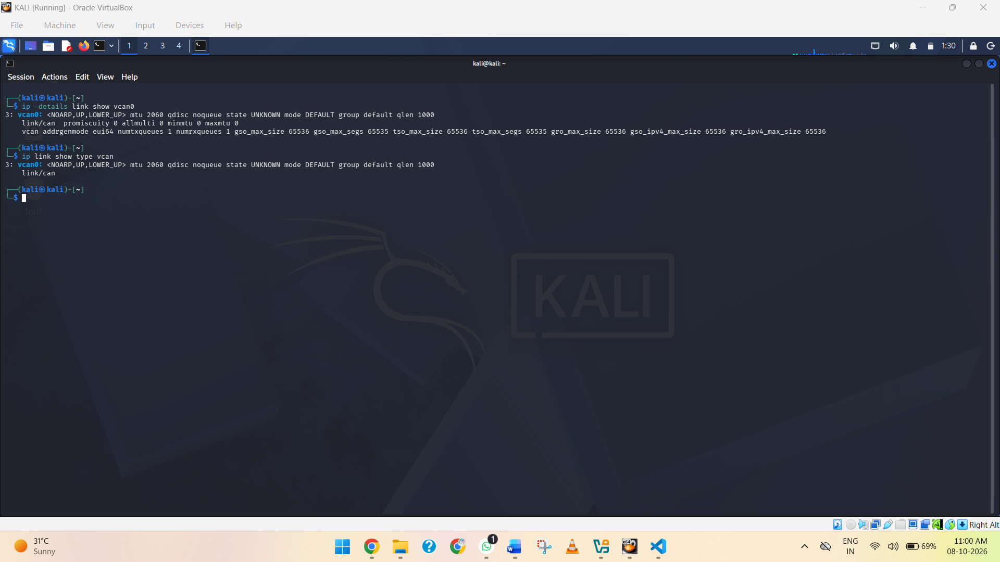

**Screenshot 7:** Virtual CAN interface verification using `ip link show type vcan`.

### Step 4 Completion

The `vcan0` interface has been successfully verified using both detailed interface information and Virtual CAN type filtering.

The verification confirms that:

* **`vcan0` exists** and is active.
* The interface is in the **UP** state.
* Linux recognizes `vcan0` as a **Virtual CAN (`vcan`) interface**.
* The interface is ready for **CAN frame transmission and reception**.
* The SocketCAN virtual CAN environment is correctly configured for the next stage of CAN-Sentinel development.

## Step 5: Test CAN Communication

After creating and verifying the `vcan0` virtual CAN interface, the next step is to test whether the interface can successfully **transmit and receive CAN frames**.

The CAN communication test uses two Kali Linux terminals. One terminal monitors CAN traffic using `candump`, while the second terminal transmits a test CAN frame using `cansend`.

Successful reception of the transmitted frame confirms that the `vcan0` virtual CAN interface is operational and that CAN communication is functioning correctly.

### Step 5.1: Start CAN Traffic Monitoring

Open a Kali Linux terminal and start monitoring CAN traffic on the `vcan0` interface:

```bash
candump vcan0
```

Leave this command running in the first terminal.

The `candump` utility continuously listens for CAN frames received through the specified interface and displays them in the terminal.

### Step 5.2: Transmit a Test CAN Frame

Open a second Kali Linux terminal and transmit a test CAN frame using:

```bash
cansend vcan0 123#1122334455667788
```

The `cansend` utility transmits the specified CAN frame through the `vcan0` interface.

The test frame uses:

* **CAN ID:** `0x123`
* **Data Length:** 8 bytes
* **Data:** `11 22 33 44 55 66 77 88`

The command completed successfully without displaying an error.

### Step 5.3: Verify the Received CAN Frame

The transmitted frame was successfully received in the first terminal running `candump vcan0`.

The received output was:

```text
vcan0  123   [8]  11 22 33 44 55 66 77 88
```

The output confirms that the CAN frame transmitted from the second terminal was received correctly by the `vcan0` interface.


**Screenshot 8:** Terminal 1 showing the received CAN frame using `candump vcan0`.


**Screenshot 9:** Terminal 2 showing the `cansend` command used to transmit the test CAN frame.

### Step 5 Completion

The `vcan0` virtual CAN interface successfully transmitted and received a test CAN frame.

The communication test confirms that:

* The **`vcan0` interface is operational**.
* A CAN frame with **CAN ID `0x123`** was transmitted successfully.
* The frame contained **8 data bytes**.
* The transmitted data `11 22 33 44 55 66 77 88` was received correctly.
* CAN communication through the **SocketCAN virtual CAN interface** was successfully verified.

The `vcan0` interface is now ready for the next stage of the CAN-Sentinel Member 1 implementation, where the **C-based ECU simulator programs** will be developed and used to generate CAN traffic.

# Phase 2: ECU Simulator Development

## Overview

This phase focuses on the initial development and verification of the C-based Electronic Control Unit (ECU) simulator for the CAN-Sentinel project. The simulator represents six vehicle subsystems, each associated with a unique CAN identifier and an initial parameter value.

The implementation is carried out using **Kali Linux, GCC, and the C programming language** within the project development environment established in Phase 1. The existing Linux SocketCAN framework and `vcan0` virtual CAN interface provide the foundation for subsequent CAN frame transmission and communication testing.

The development begins by creating a dedicated directory for the ECU simulator source files and compiled executables. A C source file is then created to define the initial parameters and CAN identifiers of six simulated ECUs. The program is compiled using GCC and executed to verify that the ECU information is displayed correctly in the terminal.

The six simulated ECUs represent the following vehicle subsystems:

1. **Engine RPM ECU** — Represents engine rotational speed.
2. **Speed ECU** — Represents vehicle speed.
3. **Temperature ECU** — Represents engine temperature.
4. **Brake ECU** — Represents brake pressure.
5. **Steering ECU** — Represents steering angle.
6. **Infotainment ECU** — Represents infotainment system status.

At this initial stage, the simulator displays the ECU parameters and their assigned CAN identifiers. Actual CAN frame transmission and dynamic ECU behavior are not yet implemented and will be addressed in subsequent development steps.

The following subsections document the creation of the simulator directory, source code implementation, compilation, execution, and verification, along with the corresponding terminal outputs and screenshots.

## Implementation Steps

The ECU simulator development is organized into the following stages:

* **Step 2.1: Create the ECU Simulator Directory** — Create and verify the directory for the C source files and compiled executables.
* **Step 2.2: Create the Six-ECU Simulator Source File** — Define the six simulated ECUs, their CAN identifiers, and initial parameter values.
* **Step 2.3: Compile and Run the ECU Simulator** — Compile the C source file using GCC and verify the program output.

These steps establish the initial six-ECU simulator implementation and prepare the project for subsequent development of CAN frame transmission through the `vcan0` virtual CAN interface.

## Step 6: Create the ECU Simulator Directory

After successfully testing CAN communication through the `vcan0` virtual CAN interface, the next step is to create a dedicated directory for the **C-based Electronic Control Unit (ECU) simulator programs**.

This directory will organize the source code and compiled executables developed for the CAN-Sentinel Member 1 module. The ECU simulators will later generate CAN frames representing vehicle subsystem data and transmit them through the `vcan0` interface.

### Step 6.1: Create the ECU Simulator Directory

First, create the directory for the ECU simulator programs:

```bash
mkdir -p ~/CAN-Sentinel/ecu-simulator
```

The `mkdir -p` command creates the specified directory and any required parent directories. If the directory already exists, the command does not report an error.

### Step 6.2: Navigate to the Directory

Move into the newly created ECU simulator directory:

```bash
cd ~/CAN-Sentinel/ecu-simulator
```

This command changes the current working directory to the location where the ECU simulator source files and compiled programs will be stored.

### Step 6.3: Verify the Current Working Directory

Verify that the terminal is located in the correct directory:

```bash
pwd
```

The command produced the following output:

```text
/home/kali/CAN-Sentinel/ecu-simulator
```

This confirms that the current working directory is the ECU simulator directory created for the CAN-Sentinel project.

### Step 6.4: Verify the Directory Contents

List all files, including hidden entries, to verify the initial state of the directory:

```bash
ls -la
```

The command produced the following output:

```text
total 8
drwxrwxr-x 2 kali kali 4096 Oct  9 01:39 .
drwxrwxr-x 3 kali kali 4096 Oct  9 01:39 ..
```

The output shows that the directory contains no source files or compiled executables at this stage. The `.` entry represents the current directory, while `..` represents its parent directory.

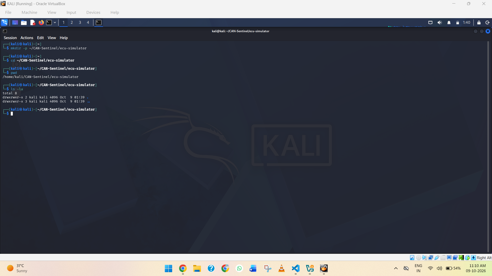

**Screenshot 10:** Terminal showing the ECU simulator directory creation, working directory verification using `pwd`, and initial directory listing using `ls -la`.

### Step 6 Completion

The `ecu-simulator` directory has been successfully created at:

`/home/kali/CAN-Sentinel/ecu-simulator`

The working directory and its initial contents have been verified. This directory is now ready to store the **C source files and compiled executables** required for ECU simulation and CAN traffic generation in the CAN-Sentinel project.

## Step 7: Create the Six-ECU Simulator Source File

After creating the ECU simulator directory, the next step is to create the initial C source file for the **six-ECU simulator** in the CAN-Sentinel project.

The program defines six vehicle Electronic Control Units (ECUs), each with an assigned CAN identifier and an initial parameter value. These ECUs represent the engine RPM, vehicle speed, engine temperature, brake pressure, steering angle, and infotainment system.

At this stage, the program displays the ECU information in the terminal. CAN frame transmission and dynamic ECU simulation will be implemented in subsequent steps.

### Step 7.1: Navigate to the ECU Simulator Directory

First, navigate to the directory created in Step 6:

```bash
cd ~/CAN-Sentinel/ecu-simulator
```

This ensures that the source file is created in the correct location.

### Step 7.2: Create the C Source File

Open the Nano text editor to create the C source file:

```bash
nano ecu_simulator.c
```

Enter the following initial program:

```c
#include <stdio.h>
#include <unistd.h>

int main(void)
{
    int rpm = 1500;
    int speed = 60;
    int temperature = 90;
    int brake_pressure = 50;
    int steering_angle = 0;
    int infotainment_status = 1;

    printf("CAN-Sentinel ECU Simulator Started\n\n");

    printf("Engine RPM ECU (CAN ID: 0x100)\n");
    printf("Engine RPM: %d\n\n", rpm);

    printf("Speed ECU (CAN ID: 0x200)\n");
    printf("Vehicle Speed: %d km/h\n\n", speed);

    printf("Temperature ECU (CAN ID: 0x300)\n");
    printf("Engine Temperature: %d C\n\n", temperature);

    printf("Brake ECU (CAN ID: 0x400)\n");
    printf("Brake Pressure: %d\n\n", brake_pressure);

    printf("Steering ECU (CAN ID: 0x500)\n");
    printf("Steering Angle: %d degrees\n\n", steering_angle);

    printf("Infotainment ECU (CAN ID: 0x600)\n");
    printf("System Status: %d\n", infotainment_status);

    return 0;
}
```

The program includes the standard input/output header for terminal output and the `unistd.h` header for POSIX functions that may be used in later development.

The initial ECU parameters and assigned CAN IDs are summarized below:

| ECU              | CAN ID  | Parameter          | Initial Value |
| ---------------- | ------- | ------------------ | ------------- |
| Engine RPM ECU   | `0x100` | Engine RPM         | 1500 RPM      |
| Speed ECU        | `0x200` | Vehicle Speed      | 60 km/h       |
| Temperature ECU  | `0x300` | Engine Temperature | 90 °C         |
| Brake ECU        | `0x400` | Brake Pressure     | 50            |
| Steering ECU     | `0x500` | Steering Angle     | 0 degrees     |
| Infotainment ECU | `0x600` | System Status      | 1             |

To save the file and exit Nano:

1. Press **Ctrl + O** to save the file.
2. Press **Enter** to confirm the filename.
3. Press **Ctrl + X** to exit the editor.

### Step 7.3: Verify the Source File

After saving the program, verify that the source file exists:

```bash
ls -l
```

The command produced the following output:

```text
total 4
-rw-rw-r-- 1 kali kali 887 Oct  9 01:50 ecu_simulator.c
```

This confirms that `ecu_simulator.c` was created in the ECU simulator directory.

### Step 7.4: Display and Verify the Source Code

Display the saved source code in the terminal:

```bash
cat ecu_simulator.c
```

The displayed source code was verified against the initial six-ECU program entered in Step 7. It contains the six ECU parameter variables, their assigned CAN IDs, and the corresponding `printf()` statements.

This verification ensures that the source file was saved and is ready for compilation in a subsequent step.

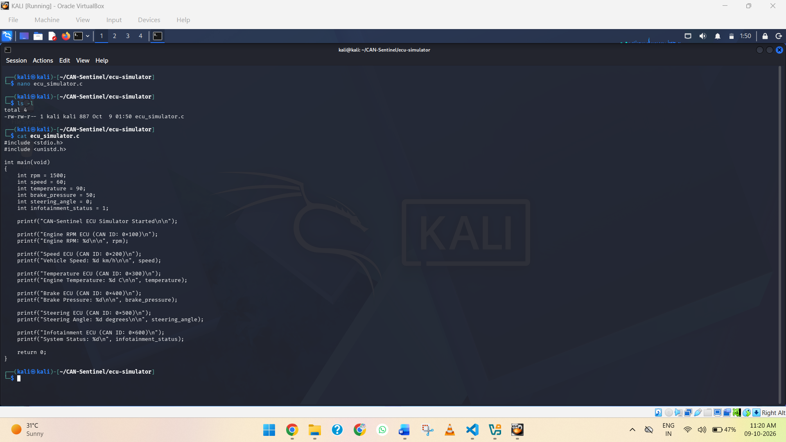

**Screenshot 11:** Terminal showing the `ecu_simulator.c` file listing and its saved source code.

### Step 7 Completion

The initial `ecu_simulator.c` source file has been created and verified successfully.

The program defines the initial parameters and CAN IDs for all six ECUs in the CAN-Sentinel project.

**Note:** This version only displays ECU information in the terminal. It does not yet transmit CAN frames through `vcan0`. CAN frame transmission and dynamic ECU simulation will be implemented in subsequent steps.

## Step 8: Compile and Run the ECU Simulator

After creating and verifying the `ecu_simulator.c` source file, the next step is to compile the program using **GCC** and verify that it executes successfully.

The compiler is invoked with the `-Wall` and `-Wextra` flags to enable additional compiler warnings. This helps identify potential issues in the source code during development. After compilation, the generated executable is verified and run to confirm that the initial parameters for all six ECUs are displayed correctly.

### Step 8.1: Navigate to the ECU Simulator Directory

First, navigate to the directory containing the C source file:

```bash
cd ~/CAN-Sentinel/ecu-simulator
```

This ensures that the compilation command is executed from the correct project directory.

### Step 8.2: Compile the C Source File

Compile the ECU simulator using GCC:

```bash
gcc -Wall -Wextra -o ecu_simulator ecu_simulator.c
```

The command uses the following options:

* **`-Wall`** — Enables a broad set of common compiler warnings.
* **`-Wextra`** — Enables additional compiler warnings.
* **`-o ecu_simulator`** — Specifies the name of the generated executable.
* **`ecu_simulator.c`** — Specifies the C source file to compile.

The compilation completed without displaying any warnings or errors, indicating that the source code compiled successfully.

### Step 8.3: Verify the Compiled Executable

After compilation, verify that the executable was created:

```bash
ls -l
```

The command produced the following output:

```text
total 20
-rwxrwxr-x 1 kali kali 16008 Oct  9 01:54 ecu_simulator
-rw-rw-r-- 1 kali kali   887 Oct  9 01:50 ecu_simulator.c
```

The output confirms that both `ecu_simulator.c` and the compiled `ecu_simulator` executable are present in the directory.

The executable permissions shown for `ecu_simulator` indicate that the program can be run directly from the terminal.

### Step 8.4: Run the ECU Simulator

Execute the compiled program:

```bash
./ecu_simulator
```

The program produced the following output:

```text
CAN-Sentinel ECU Simulator Started

Engine RPM ECU (CAN ID: 0x100)
Engine RPM: 1500

Speed ECU (CAN ID: 0x200)
Vehicle Speed: 60 km/h

Temperature ECU (CAN ID: 0x300)
Engine Temperature: 90 C

Brake ECU (CAN ID: 0x400)
Brake Pressure: 50

Steering ECU (CAN ID: 0x500)
Steering Angle: 0 degrees

Infotainment ECU (CAN ID: 0x600)
System Status: 1
```

The output confirms that the program starts successfully and displays the initial parameters associated with all six ECUs:

* **Engine RPM ECU:** CAN ID `0x100`, initial RPM of 1500.
* **Speed ECU:** CAN ID `0x200`, vehicle speed of 60 km/h.
* **Temperature ECU:** CAN ID `0x300`, engine temperature of 90 °C.
* **Brake ECU:** CAN ID `0x400`, brake pressure of 50.
* **Steering ECU:** CAN ID `0x500`, steering angle of 0 degrees.
* **Infotainment ECU:** CAN ID `0x600`, system status of 1.


**Screenshot 12:** Terminal showing the GCC compilation command, executable verification using `ls -l`, and successful execution of the six-ECU simulator.

### Step 8 Completion

The `ecu_simulator.c` source file has been **compiled successfully using GCC**, and the resulting executable has been verified and run without errors.

The program correctly displays the initial parameters and assigned CAN IDs for all six ECUs, confirming that the initial simulator implementation is functional.

**Note:** This step verifies compilation and program execution only. The current version displays ECU information in the terminal but does not yet transmit CAN frames through `vcan0`. CAN frame transmission will be implemented and tested in a subsequent step.

## Step 9: Verify SocketCAN and Back Up the ECU Simulator

Before modifying the existing ECU simulator to support CAN communication, the virtual CAN interface and required Linux SocketCAN header files were verified. A backup of the working Step 8 source code was then created to preserve the original implementation.

These preparations ensure that the environment is ready for the next stage of development, where the ECU simulator will be updated to transmit CAN frames through the `vcan0` interface.

### Step 9.1: Verify `vcan0` and SocketCAN Headers

First, verify that the virtual CAN interface exists and is active.

Run the following command:

```bash
ip link show vcan0
```

**Output:**

```text
3: vcan0: <NOARP,UP,LOWER_UP> mtu 2060 qdisc noqueue state UNKNOWN mode DEFAULT group default qlen 1000
    link/can
```

The output confirms that the `vcan0` interface exists and is up. It is configured as a virtual CAN network interface and is available for local CAN communication testing.

Next, verify that the Linux SocketCAN header files required for CAN communication are available.

```bash
ls /usr/include/linux/can.h /usr/include/linux/can/raw.h
```

**Output:**

```text
/usr/include/linux/can.h
/usr/include/linux/can/raw.h
```

Both header files are present:

- **`can.h`** — Provides core CAN data structures, constants, and definitions.
- **`can/raw.h`** — Provides definitions for raw CAN sockets used to send and receive CAN frames.

These checks confirm that the virtual CAN interface and the required SocketCAN header files are available for implementing CAN communication in the ECU simulator.

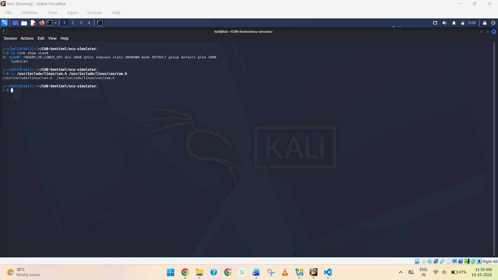

**Screenshot 13:** Terminal showing the active `vcan0` interface and the availability of the required SocketCAN header files.

### Step 9.2: Back Up the Existing ECU Simulator

Before modifying the source code, create a backup of the working Step 8 implementation. This preserves the original six-ECU simulator and allows it to be restored if necessary.

Navigate to the ECU simulator directory:

```bash
cd ~/CAN-Sentinel/ecu-simulator
```

Create a backup of the existing source file:

```bash
cp ecu_simulator.c ecu_simulator_step8_backup.c
```

Verify that the original source file, backup, and compiled executable are present:

```bash
ls -l
```

**Output:**

```text
total 24
-rwxrwxr-x 1 kali kali 16008 Oct  9 01:54 ecu_simulator
-rw-rw-r-- 1 kali kali   887 Oct  9 01:50 ecu_simulator.c
-rw-rw-r-- 1 kali kali   887 Oct 10 02:12 ecu_simulator_step8_backup.c
```

The output confirms that `ecu_simulator_step8_backup.c` was created successfully. Both the original source file and its backup have a size of 887 bytes, consistent with the original Step 8 implementation.

The existing compiled executable, `ecu_simulator`, is also present in the directory. The backup preserves the original source code independently of any subsequent changes made to `ecu_simulator.c`.

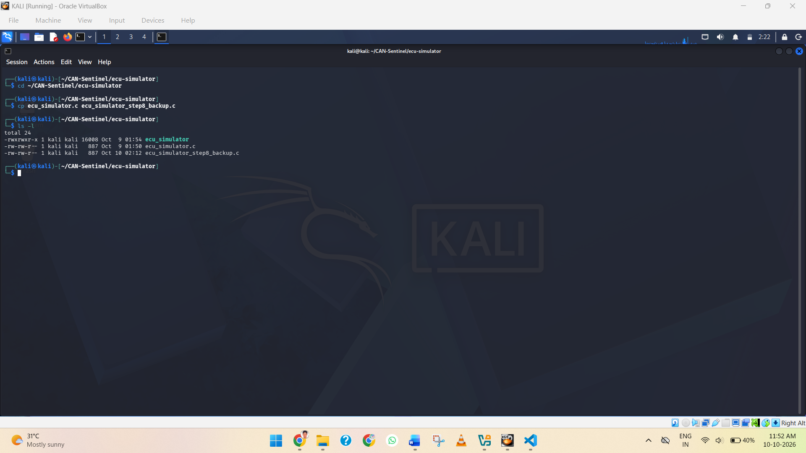

**Screenshot 14:** Terminal showing the original ECU simulator source file, the successfully created backup, and the compiled executable in the directory listing.

### Step 9 Completion

The SocketCAN environment has been verified, and the original ECU simulator source code has been backed up successfully.

The following preparations are complete:

- The `vcan0` virtual CAN interface exists and is up.
- The required Linux SocketCAN header files are available.
- The original `ecu_simulator.c` source file has been preserved as `ecu_simulator_step8_backup.c`.
- The existing compiled `ecu_simulator` executable is present.


The environment is now ready for the next stage: updating `ecu_simulator.c` to initialize a SocketCAN socket, bind it to `vcan0`, and transmit CAN frames for all six ECUs.

**Note:** This step verifies the environment and preserves the existing source code. It does not yet implement or verify CAN frame transmission.

## Step 10: Update the ECU Simulator for SocketCAN

After verifying the `vcan0` virtual CAN interface and backing up the original ECU simulator source code, the next step is to update `ecu_simulator.c` to support CAN frame transmission using Linux SocketCAN.

The updated implementation is designed to create a raw CAN socket, bind it to the `vcan0` interface, and transmit one CAN frame for each of the six simulated Electronic Control Units (ECUs). Each frame contains the ECU's assigned CAN identifier and its corresponding parameter encoded as a four-byte integer.

### Step 10.1: Open the ECU Simulator Source File

First, navigate to the ECU simulator directory:

```bash
cd ~/CAN-Sentinel/ecu-simulator
```

Open the existing C source file using the Nano text editor:

```bash
nano ecu_simulator.c
```

The `ecu_simulator.c` file contains the original six-ECU simulator implementation developed in Step 8. This file will be updated to implement SocketCAN communication.

The original source code has been preserved in `ecu_simulator_step8_backup.c`. This backup must remain unchanged so that the previous implementation can be restored if necessary.

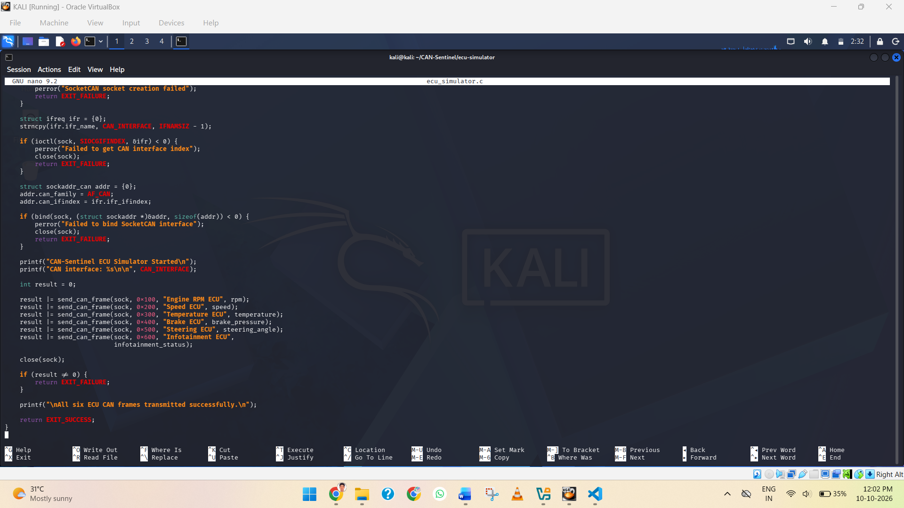

**Screenshot 15:** Terminal showing navigation to the ECU simulator directory and opening `ecu_simulator.c` in Nano.

### Step 10.2: Update the Source Code for SocketCAN
Replace the existing contents of `ecu_simulator.c` with the updated SocketCAN implementation.

```c
#include <stdio.h>
#include <stdlib.h>
#include <string.h>
#include <unistd.h>
#include <stdint.h>
#include <errno.h>
#include <sys/socket.h>
#include <sys/ioctl.h>
#include <net/if.h>
#include <linux/can.h>
#include <linux/can/raw.h>

#define CAN_INTERFACE "vcan0"

static int send_can_frame(int sock, canid_t can_id,
                          const char *ecu_name, int value)
{
    struct can_frame frame = {0};

    frame.can_id = can_id;
    frame.can_dlc = 4;

    frame.data[0] = (uint8_t)((value >> 24) & 0xFF);
    frame.data[1] = (uint8_t)((value >> 16) & 0xFF);
    frame.data[2] = (uint8_t)((value >> 8) & 0xFF);
    frame.data[3] = (uint8_t)(value & 0xFF);

    ssize_t bytes_sent = write(sock, &frame, sizeof(frame));

    if (bytes_sent != sizeof(frame)) {
        if (bytes_sent < 0) {
            perror("CAN frame transmission failed");
        } else {
            fprintf(stderr, "Incomplete CAN frame transmission\n");
        }
        return -1;
    }

    printf("%s | CAN ID: 0x%03X | Value: %d\n",
           ecu_name, can_id, value);

    return 0;
}

int main(void)
{
    int rpm = 1500;
    int speed = 60;
    int temperature = 90;
    int brake_pressure = 50;
    int steering_angle = 0;
    int infotainment_status = 1;

    int sock = socket(PF_CAN, SOCK_RAW, CAN_RAW);

    if (sock < 0) {
        perror("SocketCAN socket creation failed");
        return EXIT_FAILURE;
    }

    struct ifreq ifr = {0};
    strncpy(ifr.ifr_name, CAN_INTERFACE, IFNAMSIZ - 1);

    if (ioctl(sock, SIOCGIFINDEX, &ifr) < 0) {
        perror("Failed to get CAN interface index");
        close(sock);
        return EXIT_FAILURE;
    }

    struct sockaddr_can addr = {0};
    addr.can_family = AF_CAN;
    addr.can_ifindex = ifr.ifr_ifindex;

    if (bind(sock, (struct sockaddr *)&addr, sizeof(addr)) < 0) {
        perror("Failed to bind SocketCAN interface");
        close(sock);
        return EXIT_FAILURE;
    }

    printf("CAN-Sentinel ECU Simulator Started\n");
    printf("CAN interface: %s\n\n", CAN_INTERFACE);

    int result = 0;

    result |= send_can_frame(sock, 0x100, "Engine RPM ECU", rpm);
    result |= send_can_frame(sock, 0x200, "Speed ECU", speed);
    result |= send_can_frame(sock, 0x300, "Temperature ECU", temperature);
    result |= send_can_frame(sock, 0x400, "Brake ECU", brake_pressure);
    result |= send_can_frame(sock, 0x500, "Steering ECU", steering_angle);
    result |= send_can_frame(sock, 0x600, "Infotainment ECU",
                             infotainment_status);

    close(sock);

    if (result != 0) {
        return EXIT_FAILURE;
    }

    printf("\nAll six ECU CAN frames transmitted successfully.\n");

    return EXIT_SUCCESS;
}
```

The program uses Linux CAN headers and socket programming functions to initialize communication with the `vcan0` interface. It then prepares and transmits CAN frames for all six ECUs.

The following table summarizes the ECUs and their assigned CAN identifiers.

| ECU | CAN ID | Parameter |
|---|---|---|
| Engine RPM ECU | `0x100` | Engine RPM |
| Speed ECU | `0x200` | Vehicle speed |
| Temperature ECU | `0x300` | Engine temperature |
| Brake ECU | `0x400` | Brake pressure |
| Steering ECU | `0x500` | Steering angle |
| Infotainment ECU | `0x600` | System status |

The updated implementation performs the following operations:

- **Socket creation:** Creates a raw CAN socket using `socket()` with `PF_CAN`, `SOCK_RAW`, and `CAN_RAW`.
- **Interface identification:** Uses `ioctl()` to retrieve the interface index of `vcan0`.
- **Socket binding:** Binds the socket to the selected virtual CAN interface using `bind()`.
- **CAN frame preparation:** Assigns the appropriate CAN ID and encodes each ECU parameter into four data bytes.
- **Frame transmission:** Uses `write()` to transmit one CAN frame for each ECU.
- **Error handling:** Checks for socket creation, interface lookup, binding, and transmission failures.
- **Resource cleanup:** Closes the socket after attempting to transmit the six frames.

The initial ECU parameter values remain consistent with the original implementation:

| ECU | Initial value |
|---|---:|
| Engine RPM | 1500 RPM |
| Vehicle speed | 60 km/h |
| Engine temperature | 90 °C |
| Brake pressure | 50 |
| Steering angle | 0 degrees |
| Infotainment system status | 1 |

This version is designed to transmit six CAN frames and then terminate. It does not yet continuously generate changing vehicle parameters.

### Step 10.3: Save the Updated Source File

After replacing the existing code in Nano, save the file and exit the editor.

Use the following keyboard shortcuts:

1. Press `Ctrl + O` to write the changes to the file.
2. Press `Enter` to confirm the filename.
3. Press `Ctrl + X` to exit Nano.

Next, verify that the updated source file and the original backup are present in the directory:

```bash
ls -l ecu_simulator.c ecu_simulator_step8_backup.c
```

**Output:**

```text
-rw-rw-r-- 1 kali kali 2701 Oct 10 02:29 ecu_simulator.c
-rw-rw-r-- 1 kali kali  887 Oct 10 02:12 ecu_simulator_step8_backup.c
```

The output confirms that `ecu_simulator.c` has been updated and that `ecu_simulator_step8_backup.c` remains available.

The updated source file is 2701 bytes, while the backup remains 887 bytes. These file sizes are consistent with the updated implementation being saved separately from the original Step 8 source code.

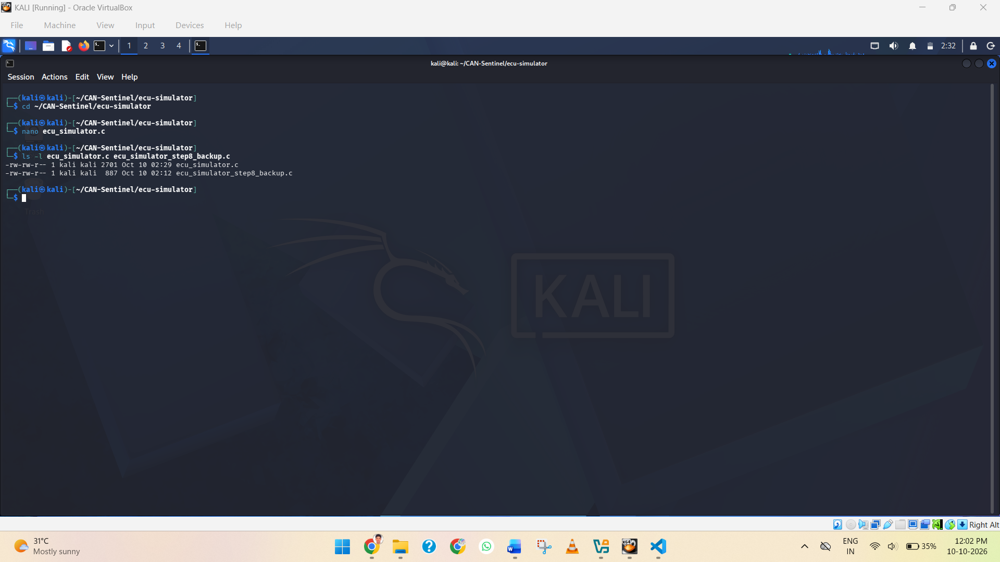

**Screenshot 16:** Nano editor displaying the updated `ecu_simulator.c` source code with SocketCAN support for all six ECUs.

### Step 10 Completion

The ECU simulator source file has been updated to implement the SocketCAN functionality required for transmitting CAN frames through the `vcan0` virtual CAN interface.

The following tasks are complete:

- The original ECU simulator source file was opened for modification.
- The source code was updated to support raw SocketCAN communication.
- The six ECUs retain their assigned CAN IDs and initial parameter values.
- The updated source file was saved successfully.
- The original Step 8 source code remains preserved in `ecu_simulator_step8_backup.c`.

**Note:** This step verifies that the updated source file has been saved and that the backup remains preserved. The updated program has not yet been confirmed to compile or transmit CAN frames successfully. Compilation and transmission testing will be performed in the next step.

## Step 11: Compile the SocketCAN ECU Simulator

After updating the `ecu_simulator.c` source file with the SocketCAN implementation, the next step is to compile the program using **GCC** and verify that the source code compiles successfully.

The compiler is invoked with the `-Wall` and `-Wextra` flags to enable additional compiler warnings. This helps identify potential issues in the source code during development. The generated executable will be used in the following step to run the updated ECU simulator and verify its behavior.

### Step 11.1: Navigate to the ECU Simulator Directory

First, navigate to the directory containing the C source file:

```bash
cd ~/CAN-Sentinel/ecu-simulator
```

This ensures that the compilation command is executed from the correct project directory.

### Step 11.2: Compile the C Source File**

Compile the SocketCAN ECU simulator using GCC:

```bash
gcc -Wall -Wextra -o ecu_simulator ecu_simulator.c
```

The command uses the following options:

- **`-Wall`** — Enables a broad set of common compiler warnings.
- **`-Wextra`** — Enables additional compiler warnings.
- **`-o ecu_simulator`** — Specifies the name of the generated executable.
- **`ecu_simulator.c`** — Specifies the C source file to compile.

### Step 11.3: Verify the Compilation Result

The compilation command produced no warnings or errors. The terminal returned to the command prompt, indicating that the compiler completed the operation successfully.

The following commands were executed:

```bash
cd ~/CAN-Sentinel/ecu-simulator
gcc -Wall -Wextra -o ecu_simulator ecu_simulator.c
```

The output confirms that the compilation command completed without displaying any compiler warnings or errors. The executable is expected to be named `ecu_simulator`, as specified by the `-o` option. Its presence and execution will be verified in the following steps.

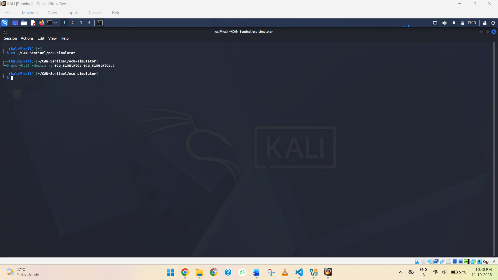

**Screenshot 12:** Terminal showing the GCC compilation command and its successful completion without warnings or errors.

### Step 11 Completion

The updated `ecu_simulator.c` source file has been **compiled successfully using GCC** with the `-Wall` and `-Wextra` warning flags.

This step confirms that the compiler reported no warnings or errors. The next step will verify and execute the compiled SocketCAN ECU simulator.

**Note:** This step verifies compilation only. It does not yet confirm that the executable runs successfully or transmits CAN frames through `vcan0`. Those checks will be performed in the subsequent steps.

## Step 12: Verify and Run the SocketCAN ECU Simulator

After compiling the SocketCAN ECU simulator in Step 11, the next step is to verify that the generated executable exists and run it to confirm that the program starts and processes the configured ECU messages.

### Step 12.1: Verify the Compiled Executable

Navigate to the ECU simulator directory and verify that the compiled executable exists:

```bash
cd ~/CAN-Sentinel/ecu-simulator
ls -l ecu_simulator
```

The terminal displayed the following output:

```text
-rwxrwxr-x 1 kali kali 16480 Oct 11 13:10 ecu_simulator
```

This confirms that the `ecu_simulator` executable exists in the project directory. The file permissions indicate that the owner, group, and other users have execute permission.

### Step 12.2: Execute the ECU Simulator

Run the compiled executable:

```bash
./ecu_simulator
```

The program produced the following output:

```text
CAN-Sentinel ECU Simulator Started

CAN interface: vcan0

Engine RPM ECU | CAN ID: 0x100 | Value: 1500

Speed ECU | CAN ID: 0x200 | Value: 60

Temperature ECU | CAN ID: 0x300 | Value: 90

Brake ECU | CAN ID: 0x400 | Value: 50

Steering ECU | CAN ID: 0x500 | Value: 0

Infotainment ECU | CAN ID: 0x600 | Value: 1

All six ECU CAN frames transmitted successfully.
```

The output indicates that the simulator started, identified `vcan0` as its CAN interface, and reported successful transmission of frames for all six configured ECUs: Engine RPM, Speed, Temperature, Brake, Steering, and Infotainment.

The program returned to the terminal prompt after displaying the output.


**Screenshot 13:** Terminal showing the executable verification, simulator startup, configured CAN interface, all six ECU messages, and the completion message.

### Step 12 Completion

The compiled ECU simulator executable was verified, and the program ran to completion without displaying an error in the captured terminal output.

The simulator reported successful transmission of all six ECU CAN frames through its configured `vcan0` interface. However, this output alone does not independently confirm that the frames were received on the virtual CAN interface. That will be verified in the next step using `candump`.

## Step 13: Verify CAN Frames Using `candump`

After executing the SocketCAN ECU simulator in Step 12, the next step is to independently verify whether the generated CAN frames are visible on the `vcan0` virtual CAN interface. The `candump` utility from the SocketCAN tools is used to capture and display CAN traffic received by the interface.

### Step 13.1: Start the CAN Frame Capture

Open a Kali Linux terminal and execute:

```bash
candump vcan0
```

This command listens for CAN frames on the `vcan0` interface and displays each received frame, including its CAN identifier, data length code (DLC), and payload bytes.

### Step 13.2: Run the ECU Simulator

In a separate terminal, navigate to the ECU simulator directory and execute the program:

```bash
cd ~/CAN-Sentinel/ecu-simulator
./ecu_simulator
```

While the simulator runs, observe the terminal running `candump vcan0` to verify whether the frames are received.

### Step 13.3: Verify the Captured CAN Frames

The `candump` terminal displayed the following output:

```text
vcan0  100   [4]  00 00 05 DC
vcan0  200   [4]  00 00 00 3C
vcan0  300   [4]  00 00 00 5A
vcan0  400   [4]  00 00 00 32
vcan0  500   [4]  00 00 00 00
vcan0  600   [4]  00 00 00 01
```

The captured output confirms that six CAN frames were observed on `vcan0`, corresponding to the six configured ECUs.

The captured identifiers and decoded payload values are summarized below:

| ECU | CAN ID | DLC | Payload value |
|---|---|---|---|
| Engine RPM | `0x100` | 4 | 1500 |
| Speed | `0x200` | 4 | 60 |
| Temperature | `0x300` | 4 | 90 |
| Brake | `0x400` | 4 | 50 |
| Steering | `0x500` | 4 | 0 |
| Infotainment | `0x600` | 4 | 1 |

The payload values are represented as four-byte, big-endian integers. For example, `00 00 05 DC` corresponds to decimal 1500, while `00 00 00 3C` corresponds to decimal 60.

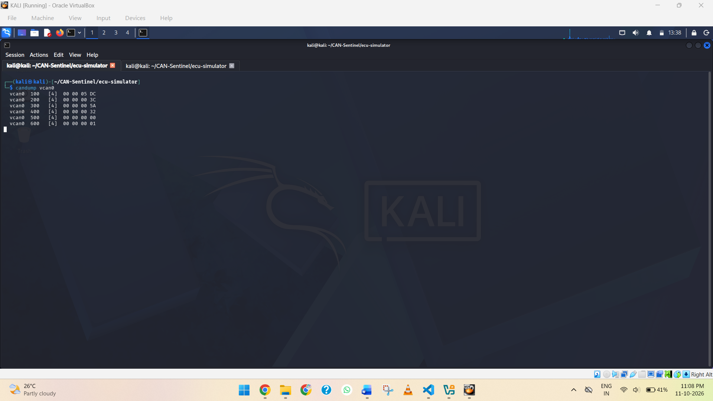

**Screenshot 14:** Terminal displaying the six CAN frames captured using `candump vcan0`, including their CAN identifiers, DLC values, and payload bytes.

**Note:** The captured frames currently use a DLC of 4. The finalized protocol in Step 15 requires a DLC of 8, with the rolling counter stored in byte 7. The current Brake and Steering identifiers (`0x400` and `0x500`) will also be updated to match the team lead's specification.

### Step 13 Completion

The `candump` verification successfully demonstrated that the simulator's six CAN frames were observable on the `vcan0` virtual CAN interface. The captured identifiers and payloads matched the values reported by the current simulator.

This establishes a working baseline for CAN frame transmission and reception. The message format, DLC, rolling counter, transmission periods, and final ECU identifiers will be aligned with the Week 1 design specification in the subsequent development steps.


## Step 14: Organize the ECU Simulator and Document Build/Run Instructions

In this step, the ECU simulator source code is organized under the `ecu_sim/` directory, and build and run instructions are documented for reproducibility. A dedicated README file is maintained inside `ecu_sim/` to explain the simulator prerequisites, compilation, execution, and verification. The Member 1 documentation records the directory structure and links to the simulator guide.

### Step 14.1: Verify the ECU Simulator Directory Structure

The `ecu_sim/` directory was checked to confirm that the ECU simulator source file is present in the expected location within the CAN-Sentinel repository.

#### Step 14.1.1: Navigate to the CAN-Sentinel Repository

The following command was executed in Windows PowerShell to navigate to the local repository:

```powershell
cd D:\Study\Projects\CAN-Sentinel
```

#### Step 14.1.2: Verify the ECU Simulator Source File

The following command was used to list the contents of the `ecu_sim/` directory:

```powershell
Get-ChildItem .\ecu_sim
```

The command produced the following output:

```text
Directory: D:\Study\Projects\CAN-Sentinel\ecu_sim

Mode                 LastWriteTime         Length Name
----                 -------------         ------ ----
-a----         06-10-2026  11:14 PM              0 .gitkeep
-a----         11-10-2026  11:23 PM           2701 ecu_simulator.c
```

The output confirms that `ecu_simulator.c` exists in the `ecu_sim/` directory. The directory also contains `.gitkeep`, which is retained.

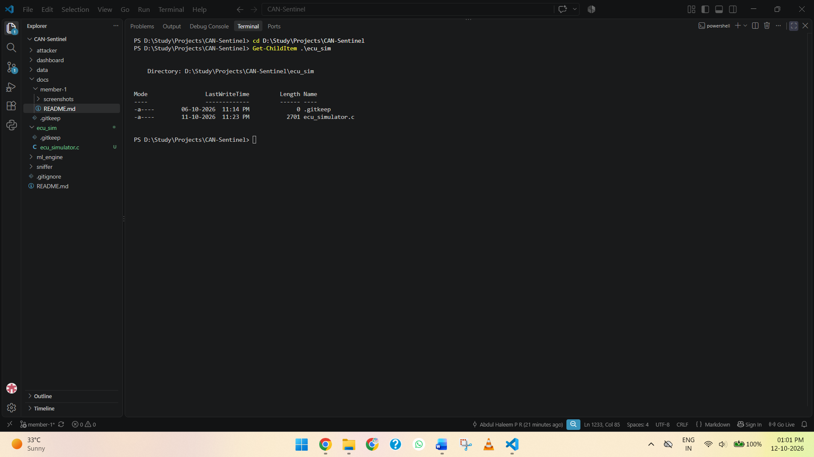

Screenshot 15: PowerShell output confirming that `ecu_simulator.c` is present in the `ecu_sim/` directory.

**Result**

The ECU simulator source file is present in the expected directory. The source file will be updated in place during the subsequent CAN protocol implementation step.

### Step 14.2: Verify the ECU Simulator Source File

The existing ECU simulator source file was opened in Visual Studio Code to confirm that it is accessible for future development and modification.

#### Step 14.2.1: Locate the Source File

The source file is located at the following path within the CAN-Sentinel repository:

```text
ecu_sim/ecu_simulator.c
```

#### Step 14.2.2: Open the Source File in Visual Studio Code

The `ecu_simulator.c` file was opened in Visual Studio Code, and the existing C source code was displayed in the editor.

No changes were made to the source code during this step.

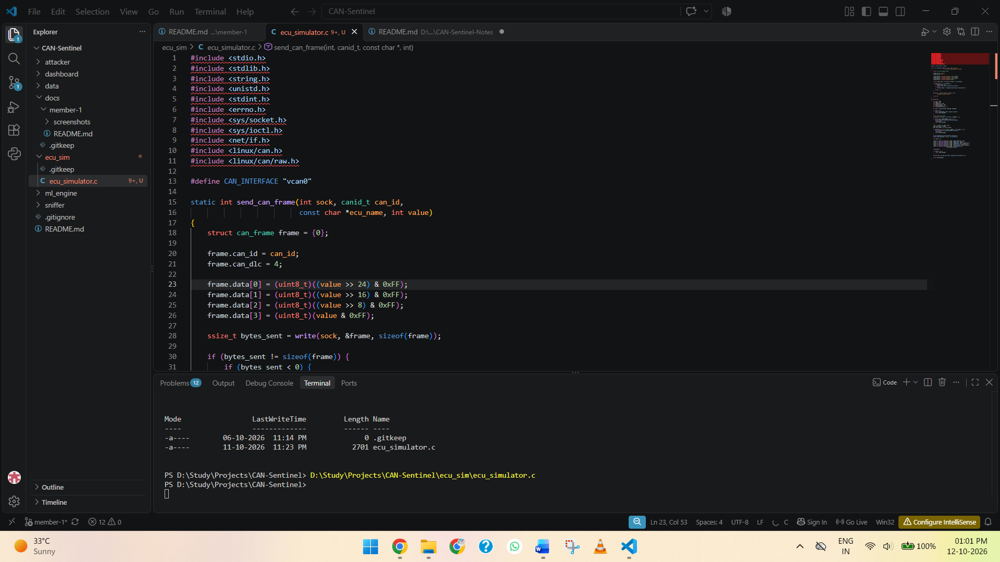

Screenshot 16: Visual Studio Code displaying the existing `ecu_simulator.c` source file, ready for the CAN protocol implementation.

**Result**

The ECU simulator source file was successfully opened in Visual Studio Code and is ready for modification during Step 15, when the finalized CAN protocol will be implemented.

### Step 14.3: Verify the Git Working Tree

Before creating the ECU simulator build and run documentation, the Git working tree was checked to identify any modified or untracked files in the local CAN-Sentinel repository.

#### Step 14.3.1: Navigate to the Repository

The following command was executed in the VS Code PowerShell terminal:

```powershell
cd D:\Study\Projects\CAN-Sentinel
```

#### Step 14.3.2: Check the Git Status

The following command was used to inspect the working tree:

```powershell
git status --short
```

The command produced the following output:

```text
?? ecu_sim/ecu_simulator.c
```

The output indicates that `ecu_simulator.c` is an untracked file in the local Git working tree. The file has not yet been staged or committed.

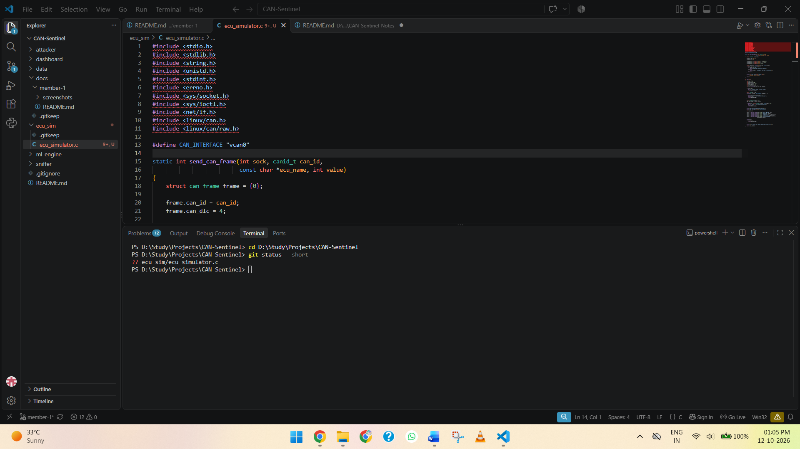

Screenshot 17: VS Code PowerShell terminal displaying the Git working tree status and identifying `ecu_simulator.c` as an untracked file.

**Result**

The repository status was checked before proceeding with the remaining Step 14 tasks to help ensure that only the intended files are included in the relevant Git commit.

### Step 14.4: Create the ECU Simulator Build and Run Guide

A dedicated `README.md` file will be created inside the `ecu_sim/` directory to document the prerequisites, compilation, execution, and verification of the ECU simulator. The Member 1 README update is reserved for Step 19.

#### Step 14.4.1: Create `README.md`

In Visual Studio Code Explorer, perform the following actions:

1. Locate the `ecu_sim/` directory.
2. Right-click the directory and select **New File**.
3. Enter the filename `README.md`.

#### Step 14.4.2: Verify the Directory Structure

After creating the file, the directory structure should be:

```text
ecu_sim/
├── .gitkeep
├── ecu_simulator.c
└── README.md
```

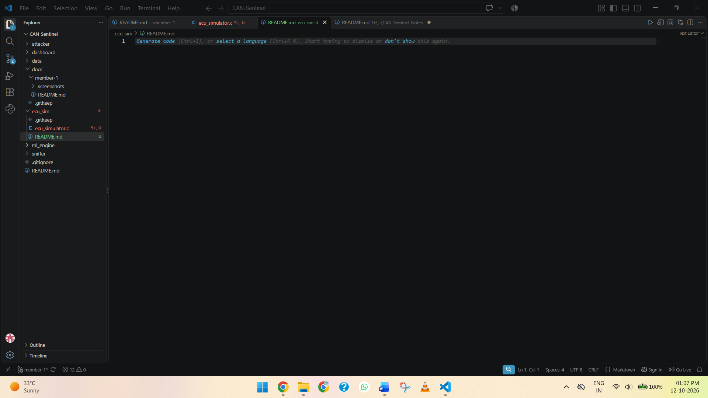

Screenshot 18: VS Code Explorer displaying the `ecu_sim/` directory with `.gitkeep`, `ecu_simulator.c`, and the newly created `README.md` file.

Do not modify `ecu_simulator.c` during this step. The CAN protocol will be updated in Step 15.

**Result**

The dedicated ECU simulator documentation file will provide reproducible build and run instructions independently of the main Member 1 README. The main documentation will be updated later in Step 19, as planned.

### Step 14.5: Add the ECU Simulator Build and Run Instructions

A dedicated `README.md` file was created inside the `ecu_sim/` directory to document the prerequisites, compilation, execution, and CAN-frame verification procedures for the ECU simulator.

#### Step 14.5.1: Document the Prerequisites

The README lists the required environment and tools:

- Kali Linux or another Linux distribution with SocketCAN support
- GCC compiler
- `can-utils` package
- Configured and active `vcan0` virtual CAN interface

#### Step 14.5.2: Document the Virtual CAN Interface Setup

The instructions include commands to configure the virtual CAN interface when it does not already exist:

```bash
sudo modprobe vcan
sudo ip link add dev vcan0 type vcan
sudo ip link set up vcan0
```

If the interface already exists, the `ip link add` command should not be executed again. The guide also includes the following command to verify the interface:

```bash
ip link show vcan0
```

#### Step 14.5.3: Document Compilation and Execution

The README provides the following command to compile the ECU simulator from the root directory of the CAN-Sentinel repository:

```bash
gcc -Wall -Wextra -o ecu_sim/ecu_simulator ecu_sim/ecu_simulator.c
```

The compiled executable can then be launched from the repository root using:

```bash
./ecu_sim/ecu_simulator
```

The simulator working directory for these commands is the **root directory of the CAN-Sentinel repository**, not the `ecu_sim/` directory.

The compilation command specifies the source file at `ecu_sim/ecu_simulator.c` and generates the executable at `ecu_sim/ecu_simulator`.

#### Step 14.5.4: Document CAN-Frame Verification

The guide explains how to monitor CAN traffic from a separate Kali Linux terminal using:

```bash
candump vcan0
```

This allows the user to inspect the frames transmitted by the ECU simulator through the virtual CAN interface.

#### Step 14.5.5: Save the Documentation

The updated `ecu_sim/README.md` file was saved in Visual Studio Code.

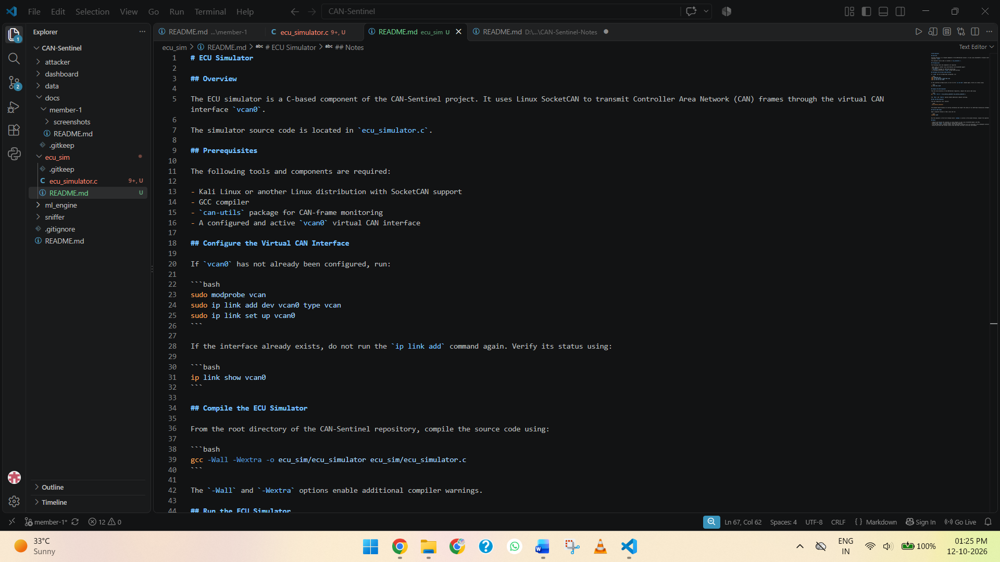

Screenshot 19: Visual Studio Code displaying the ECU simulator README with the prerequisites, virtual CAN interface setup, compilation, execution, and CAN-frame verification instructions.

**Result**

The build and run instructions have been documented in `ecu_sim/README.md` for subsequent validation in Kali Linux. The CAN protocol implementation and runtime verification remain separate tasks for the following steps.

## Step 14.6: Verify the ECU Simulator Documentation

After creating the ECU simulator build and run guide, the `ecu_sim/` directory and Git working tree were checked to confirm that the source file and documentation are present.

### Step 14.6.1: Verify the Directory Contents

The following command was executed in the VS Code PowerShell terminal:

```powershell
Get-ChildItem .\ecu_sim
```

The command produced the following output:

```text
Directory: D:\Study\Projects\CAN-Sentinel\ecu_sim

Mode                 LastWriteTime         Length Name
----                 -------------         ------ ----
-a----         06-10-2026  11:14 PM              0 .gitkeep
-a----         11-10-2026  11:23 PM           2701 ecu_simulator.c
-a----         12-10-2026  01:34 PM           2065 README.md
```

The output confirms that the directory contains `ecu_simulator.c` and the newly created `README.md`.

### Step 14.6.2: Check the Git Working Tree

The following command was used to inspect the repository status:

```powershell
git status --short
```

The command produced the following output:

```text
?? ecu_sim/README.md
?? ecu_sim/ecu_simulator.c
```

The output confirms that Git recognizes both files as untracked. They have not yet been staged or committed.

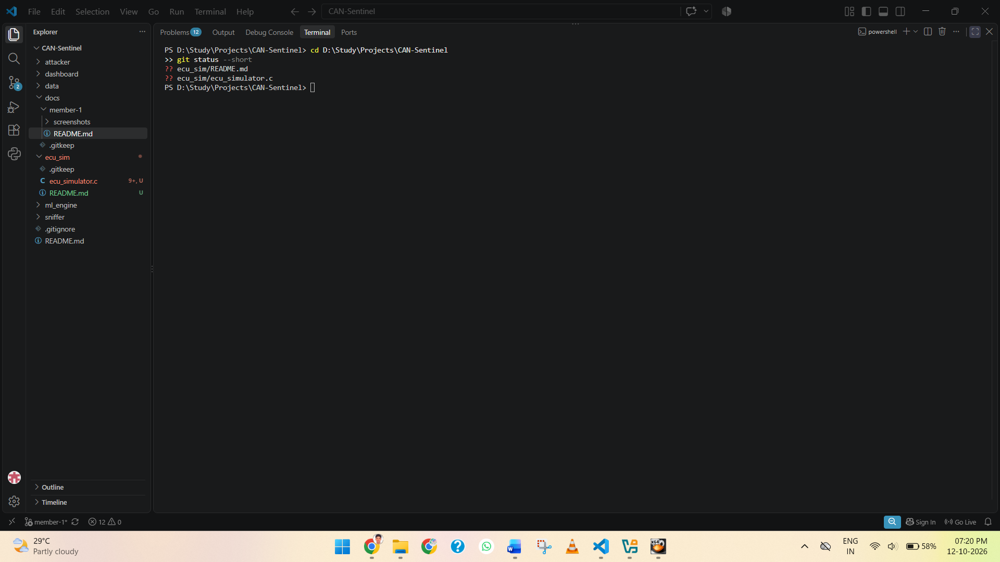

Screenshot 21: VS Code PowerShell displaying the Git working tree status for the ECU simulator source file and documentation.

### Result

The ECU simulator source file and build/run documentation are present in the expected directory. Git identifies both files as untracked, meaning they have not yet been staged or committed. They will be reviewed before the Step 14 changes are committed.

## Step 14.7: Review the ECU Simulator Build and Run Guide

The `ecu_sim/README.md` file was reviewed to prepare for the subsequent compilation and runtime verification of the ECU simulator in Kali Linux.

### Step 14.7.1: Display the README Content

The following command was used in the VS Code PowerShell terminal to display the documentation:

```powershell
Get-Content .\ecu_sim\README.md
```

### Step 14.7.2: Review the Build and Run Instructions

The documentation review focuses on the following items:

- Required software and SocketCAN prerequisites
- Virtual CAN interface configuration using `vcan0`
- GCC compilation command
- ECU simulator execution command
- CAN-frame monitoring using `candump vcan0`


Screenshot 22: VS Code PowerShell displaying the `ecu_sim/README.md` content for review of the build and run instructions.

### Result

The README review step was performed in preparation for testing the documented commands in Kali Linux. Compilation and runtime behavior must be verified in the Linux environment before they are reported as successful.

## Step 14.8: Inspect the Existing ECU Simulator Source Code in Kali Linux

Before proceeding with the CAN protocol implementation, the existing ECU simulator source code was inspected in Kali Linux to establish the current implementation as a baseline.

### Step 14.8.1: Navigate to the ECU Simulator Directory

The following command was used to navigate to the existing ECU simulator directory:

```bash
cd ~/CAN-Sentinel/ecu-simulator
```

### Step 14.8.2: Display the Source Code

The following command was executed to display the contents of `ecu_simulator.c`:

```bash
sed -n '1,240p' ecu_simulator.c
```

The command displayed the existing C source code, including the following components:

- Linux SocketCAN header files and interface configuration for `vcan0`
- A function for creating and transmitting CAN frames
- Initial values for the six simulated ECUs
- Socket creation, CAN interface lookup, and interface binding
- Transmission of six CAN frames using the existing identifiers
- Error handling and socket cleanup

The current implementation transmits each frame once, uses a data length code (DLC) of 4, and encodes each signal value as a four-byte integer. It uses the existing CAN identifiers `0x100`, `0x200`, `0x300`, `0x400`, `0x500`, and `0x600`.

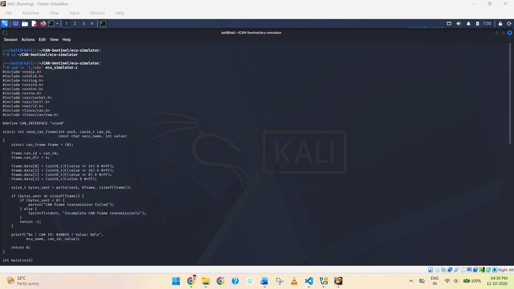

Screenshot 23: Kali Linux terminal displaying the existing `ecu_simulator.c` source code for baseline inspection before the CAN protocol implementation.

### Result

The existing source code was inspected successfully in Kali Linux. This establishes the baseline for the subsequent CAN protocol implementation. The source code has not been modified during this inspection step.

## Step 14.9: Verify the Virtual CAN Interface in Kali Linux

Before compiling and testing the ECU simulator, the status of the virtual CAN interface was checked in Kali Linux to confirm that `vcan0` exists and is active.

### Step 14.9.1: Execute the Interface Verification Command

The following command was executed in the Kali Linux terminal:

```bash
ip link show vcan0
```

The command produced the following output:

```text
3: vcan0: <NOARP,UP,LOWER_UP> mtu 2060 qdisc noqueue state UNKNOWN mode DEFAULT group default qlen 1000
    link/can
```
### Result

The output confirms that the `vcan0` interface exists and has the `UP` and `LOWER_UP` flags. The virtual CAN interface is available for the subsequent ECU simulator compilation and runtime verification. No files were modified or moved during this step.

## Step 14.10: Compile the ECU Simulator in Kali Linux

After verifying the existing source code and confirming that the `vcan0` interface was active, the ECU simulator was compiled using GCC in Kali Linux.

### Step 14.10.1: Navigate to the ECU Simulator Directory

The following command was executed to navigate to the existing ECU simulator directory:

```bash
cd ~/CAN-Sentinel/ecu-simulator
```

### Step 14.10.2: Compile the ECU Simulator

The following command was used to compile the C source file:

```bash
gcc -Wall -Wextra -o ecu_simulator ecu_simulator.c
```

The compilation command completed and returned to the terminal prompt without displaying any errors or warnings.

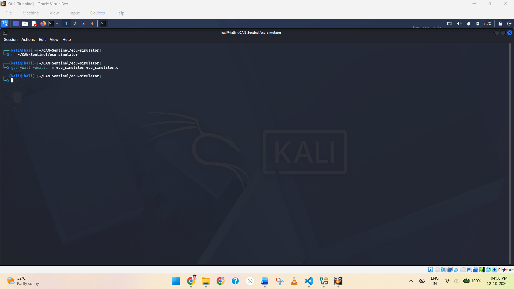

Screenshot 24: Kali Linux terminal showing the GCC compilation command and the return to the terminal prompt without errors or warnings.

### Result

The ECU simulator source code compiled without any reported errors or warnings. The executable will be checked in the next step to confirm that the compilation output was generated successfully.

## Step 14.11: Verify the Compiled ECU Simulator Executable

After compiling the ECU simulator, the generated executable was verified in Kali Linux to confirm that the compilation output existed and was recognized as a valid executable file.

### Step 14.11.1: Navigate to the ECU Simulator Directory

The following command was executed to navigate to the existing ECU simulator directory:

```bash
cd ~/CAN-Sentinel/ecu-simulator
```

### Step 14.11.2: Check the Executable File

The following commands were executed to verify the executable's file size, permissions, file format, and architecture:

```bash
ls -lh ecu_simulator
file ecu_simulator
```

The terminal returned the following output:

```text
-rwxrwxr-x 1 kali kali 17K Oct 12 07:13 ecu_simulator

ecu_simulator: ELF 64-bit LSB pie executable, x86-64, version 1 (SYSV), dynamically linked, interpreter /lib64/ld-linux-x86-64.so.2, BuildID[sha1]=ad7e9eedb60624f7739086404cb38767d1f812b4, for GNU/Linux 3.2.0, not stripped
```

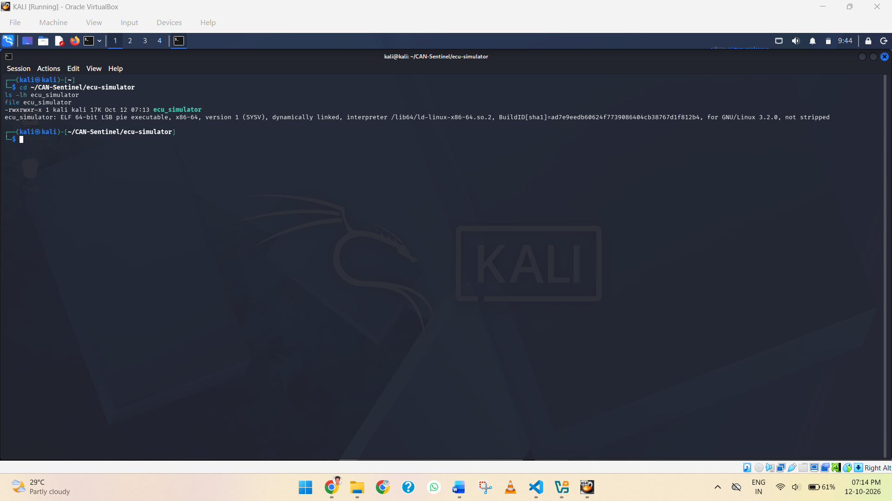

Screenshot 25: Kali Linux terminal displaying the executable's file permissions, size, ELF format, and x86-64 architecture.

### Result

The verification confirmed that the `ecu_simulator` executable was generated successfully. The file is a 64-bit ELF executable for the x86-64 architecture, and its permissions allow the owner, group, and other users to execute it.

The executable is ready for the next stage of testing.

## Step 14.12: Run the ECU Simulator in Kali Linux

After verifying the compiled executable, the ECU simulator was executed in Kali Linux to confirm that it started successfully and transmitted the six ECU CAN frames through the `vcan0` interface.

### Step 14.12.1: Execute the ECU Simulator

The following commands were executed to navigate to the ECU simulator directory and run the compiled executable:

```bash
cd ~/CAN-Sentinel/ecu-simulator
./ecu_simulator
```

### Step 14.12.2: Verify the Execution Output

The simulator produced the following terminal output:

```text
CAN-Sentinel ECU Simulator Started

CAN interface: vcan0

Engine RPM ECU | CAN ID: 0x100 | Value: 1500

Speed ECU | CAN ID: 0x200 | Value: 60

Temperature ECU | CAN ID: 0x300 | Value: 90

Brake ECU | CAN ID: 0x400 | Value: 50

Steering ECU | CAN ID: 0x500 | Value: 0

Infotainment ECU | CAN ID: 0x600 | Value: 1

All six ECU CAN frames transmitted successfully.
```

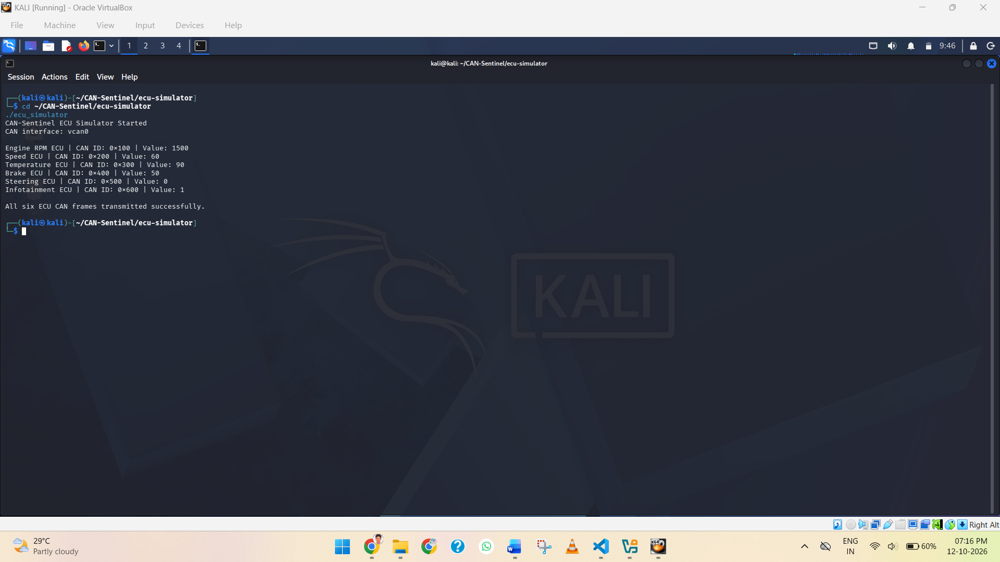

Screenshot 26: Kali Linux terminal showing the ECU simulator startup message, configured CAN identifiers, signal values, and transmission status.

### Result

The ECU simulator started successfully and reported successful transmission of all six ECU CAN frames through `vcan0`. The output confirms that the current implementation executed without reporting a transmission error.

This was a preliminary execution test using the existing implementation. The CAN IDs, payload lengths, transmission intervals, and signal encoding will be updated in Step 15 to match the finalized team-lead protocol.

## Step 14.13: Verify CAN Frames Using candump

In this step, the CAN frames transmitted by the ECU simulator were monitored using `candump` on the `vcan0` interface to verify that the frames were visible on the virtual CAN bus.

### Step 14.13.1: Monitor CAN Traffic

The following command was executed in the Kali Linux terminal:

```bash
candump -n 6 vcan0
```

The command listened for six CAN frames on the `vcan0` interface and displayed the following output:

```text
vcan0  100   [4]  00 00 05 DC
vcan0  200   [4]  00 00 00 3C
vcan0  300   [4]  00 00 00 5A
vcan0  400   [4]  00 00 00 32
vcan0  500   [4]  00 00 00 00
vcan0  600   [4]  00 00 00 01
```

### Step 14.13.2: Verify the Received Frames

The `candump` output confirmed that all six CAN frames were observable on `vcan0`.

| CAN ID | Payload | Interpreted Value |
|---|---|---:|
| `0x100` | `00 00 05 DC` | 1500 |
| `0x200` | `00 00 00 3C` | 60 |
| `0x300` | `00 00 00 5A` | 90 |
| `0x400` | `00 00 00 32` | 50 |
| `0x500` | `00 00 00 00` | 0 |
| `0x600` | `00 00 00 01` | 1 |

Each received frame contained four data bytes, as indicated by `[4]` in the output.

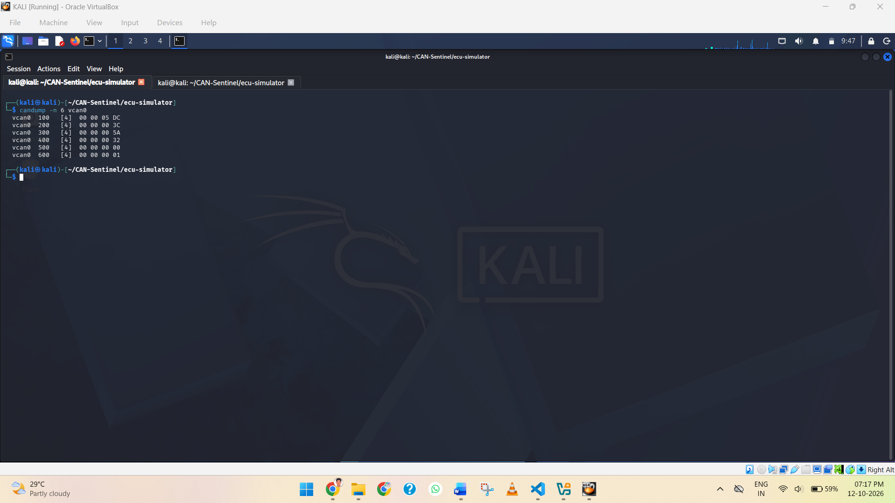

Screenshot 27: Kali Linux terminal displaying the six CAN frames captured on `vcan0` using `candump -n 6 vcan0`.

### Result

The preliminary CAN communication test was successful. All six frames from the existing ECU simulator were visible on the `vcan0` virtual CAN interface, and their payloads matched the values configured in the source code.

The current implementation still uses the earlier CAN IDs and four-byte payloads. These will be updated in Step 15 to follow the finalized CAN protocol.

## Step 14.14: Verify the ECU Simulator Files

In this step, the ECU simulator source file, compiled executable, and backup source file were checked to confirm that the expected files were present in the Kali Linux development directory.

### Step 14.14.1: List the ECU Simulator Files

The following commands were executed:

```bash
cd ~/CAN-Sentinel/ecu-simulator
ls -lh ecu_simulator.c ecu_simulator ecu_simulator_step8_backup.c
```

The terminal returned the following output:

```text
-rwxrwxr-x 1 kali kali  17K Oct 12 07:13 ecu_simulator
-rw-rw-r-- 1 kali kali 2.7K Oct 10 02:29 ecu_simulator.c
-rw-rw-r-- 1 kali kali  887 Oct 10 02:12 ecu_simulator_step8_backup.c
```

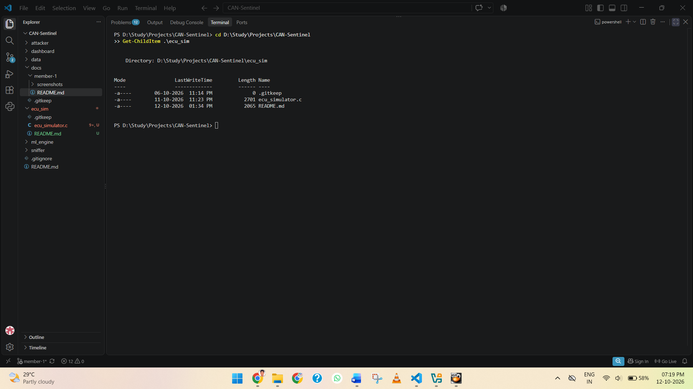

Screenshot 28: Kali Linux terminal showing the source file, compiled executable, and preserved backup file with their sizes and permissions.

### Result

The verification confirmed that all three expected files were present:

- `ecu_simulator.c` — the current ECU simulator source file.
- `ecu_simulator` — the compiled executable.
- `ecu_simulator_step8_backup.c` — the backup source file preserved from the earlier implementation.

The source file will be updated to implement the finalized CAN protocol in Step 15. The backup file will be retained as a reference.

## Step 14.15: Verify the ECU Simulator Directory Structure

In this step, the contents of the `ecu_sim/` directory in the local CAN-Sentinel repository were verified using Windows PowerShell.

### Step 14.15.1: List the Directory Contents

The following commands were executed from the local repository:

```powershell
cd D:\Study\Projects\CAN-Sentinel
Get-ChildItem .\ecu_sim
```

The terminal returned the following output:

```text
Directory: D:\Study\Projects\CAN-Sentinel\ecu_sim

Mode                 LastWriteTime         Length Name
----                 -------------         ------ ----
-a----         06-10-2026  11:14 PM              0 .gitkeep
-a----         11-10-2026  11:23 PM           2701 ecu_simulator.c
-a----         12-10-2026  01:34 PM           2065 README.md
```


Screenshot 29: Windows PowerShell showing the contents of the local `ecu_sim/` directory, including `.gitkeep`, `ecu_simulator.c`, and `README.md`.

### Result

The verification confirmed that the Windows `ecu_sim/` directory contains the following files:

- `.gitkeep` — preserves the directory in Git.
- `ecu_simulator.c` — the ECU simulator source file.
- `README.md` — contains the build and run instructions.

The directory structure is in place. The source file will be updated to match the finalized CAN protocol before the final implementation is transferred and validated.

## Step 14.16: Verify the Git Working Tree

In this step, the Git working tree was checked to identify untracked or modified files in the local CAN-Sentinel repository.

### Step 14.16.1: Check the Repository Status

The following commands were executed in Windows PowerShell:

```powershell
cd D:\Study\Projects\CAN-Sentinel
git status --short
```

The terminal returned the following output:

```text
?? ecu_sim/README.md
?? ecu_sim/ecu_simulator.c
```


Screenshot 30: Windows PowerShell displaying the Git working tree status, with `ecu_sim/README.md` and `ecu_sim/ecu_simulator.c` listed as untracked files.

### Result

Git identified two untracked files:

- `ecu_sim/README.md` — the ECU simulator build and run guide.
- `ecu_sim/ecu_simulator.c` — the ECU simulator source file.

The `??` status indicates that these files are not yet tracked by Git. No modified tracked files were reported by this command.

These files will be reviewed and committed separately according to the project's Git workflow. The final protocol implementation will be updated and validated before the source file is considered ready.

## Step 15: Finalize the CAN Protocol

The purpose of this step is to finalize the CAN identifiers, transmission periods, payload layouts, and data lengths used by the six ECU simulators in the CAN-Sentinel project.

The protocol is based on the ECU baseline table defined in `docs/week1_design.md` on the team's `main` branch. The finalized configuration will be implemented in the C-based SocketCAN ECU simulator running on Kali Linux.

### Step 15.1: Open the CAN-Sentinel Repository in Visual Studio Code

Open the existing CAN-Sentinel repository in Visual Studio Code on Windows.

Repository location:

```text
D:\Study\Projects\CAN-Sentinel
```

Open the integrated terminal and verify the current working directory and Git branch.

Execute:

```powershell
git branch --show-current
git status --short
```

The current branch must be `member-1`. All project changes for this task must remain on the member's own branch.

Output:

```text
member-1
?? ecu_sim/README.md
?? ecu_sim/ecu_simulator.c
```

The status output above records the untracked files observed during this verification. The exact output of `git status --short` may change as files are added or committed.

### Step 15.2: Fetch the Latest Remote Repository Information

Fetch the latest branch information from GitHub so that the remote-tracking reference for the team's `main` branch is up to date.

Execute:

```powershell
git fetch origin
```

Expected output:

```text
From https://github.com/abinayafranciscaep/CAN-Sentinel
   ...
```

The commit identifiers and branch-update details depend on the remote repository state. A successful fetch updates the local remote-tracking information without switching branches or merging changes into the current branch.

### Step 15.3: Retrieve the Team's CAN Protocol Design

Display the team's CAN protocol design document directly from the remote `main` branch.

Execute:

```powershell
git show origin/main:docs/week1_design.md
```

This command displays the version of `docs/week1_design.md` available on `origin/main`, even if the file has not been checked out into the local working tree.

To locate the ECU baseline table specifically, execute:

```powershell
git show origin/main:docs/week1_design.md | Select-String -Pattern '^## 2\.' -Context 0,40
```

The retrieved ECU baseline table specifies the following identifiers, periods, data lengths, and payload layouts:

| CAN ID | ECU / Signal | Period | DLC | Payload layout |
|---|---|---|---:|---|
| `0x0A0` | Brake | 20 ms | 8 | Byte 0: brake pressure (0–100); Byte 1: brake switch (0/1); Byte 7: rolling counter |
| `0x0B0` | Steering | 10 ms | 8 | Bytes 0–1: signed steering angle in 0.1-degree units; Byte 7: rolling counter |
| `0x100` | Engine RPM | 10 ms | 8 | Bytes 0–1: RPM (0–8000); Byte 7: rolling counter |
| `0x200` | Vehicle speed | 20 ms | 8 | Byte 0: speed in km/h (0–250); Byte 7: rolling counter |
| `0x300` | Engine temperature | 100 ms | 8 | Byte 0: coolant temperature encoded with a −40°C offset; Byte 7: rolling counter |
| `0x600` | Infotainment heartbeat | 100 ms | 8 | Byte 0: status; Byte 7: rolling counter |

The design document also specifies the following diagnostic identifier:

| CAN ID | ECU / Signal | Period | DLC | Payload layout |
|---|---|---|---:|---|
| `0x7DF` | Diagnostic request | Event-driven | 8 | Standard OBD-II / UDS diagnostic request format |

The `0x7DF` diagnostic identifier is event-driven and is not one of the six periodic ECU frames in the normal-traffic simulator. It will therefore not be included in the six-frame periodic baseline.

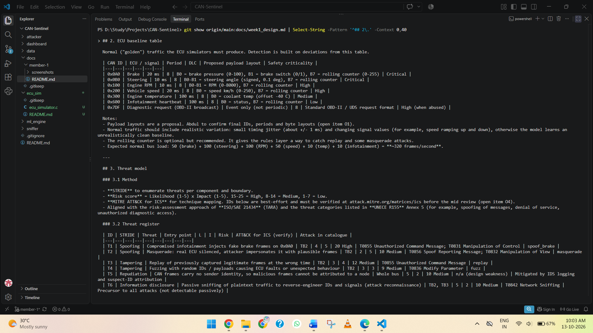

Screenshot 31: Terminal displaying the ECU baseline table retrieved from `origin/main:docs/week1_design.md`, including CAN identifiers, transmission periods, DLC values, and payload layouts.

### Result

The CAN protocol requirements were identified from the team's Week 1 design document. The six periodic ECU messages must use the specified CAN identifiers, transmission intervals, and DLC of 8, with their signal payloads encoded according to Section 2 and rolling counters stored in byte 7.

The brake (`0x0A0`) and steering (`0x0B0`) messages have the lowest identifiers among the six periodic ECU messages, giving them higher CAN arbitration priority than messages with higher identifiers.

The `0x7DF` diagnostic request remains separate from the six-message periodic baseline. These requirements will guide the ECU simulator implementation and subsequent verification.

### Step 15.4: Review the Existing Simulator Implementation

Before modifying the C source code, the existing implementation was reviewed in Kali Linux.

The following commands were executed in the Kali Linux terminal:

```bash
cd ~/CAN-Sentinel/ecu-simulator
ls -lh
```

The existing directory contains the ECU simulator source file, its previously compiled executable, and an earlier backup.

The previous implementation transmitted six CAN frames using the identifiers `0x100`, `0x200`, `0x300`, `0x400`, `0x500`, and `0x600`. Those frames used a four-byte payload and were transmitted once rather than at the periodic intervals required by the team's finalized protocol.

Consequently, the previous implementation does not match the finalized baseline. The source code must be updated to use the agreed CAN identifiers, eight-byte payloads, rolling counters, and transmission periods.

### Step 15.5: Define the Finalized CAN Protocol Requirements

The following requirements will govern the updated ECU simulator:

1. Use the six periodic CAN identifiers specified in the team's baseline design.
2. Set the data length code (DLC) to 8 for all six ECU frames.
3. Transmit brake frames every 20 ms.
4. Transmit steering frames every 10 ms.
5. Transmit engine RPM frames every 10 ms.
6. Transmit vehicle-speed frames every 20 ms.
7. Transmit engine-temperature frames every 100 ms.
8. Transmit infotainment heartbeat frames every 100 ms.
9. Place the rolling counter in byte 7 of every periodic ECU frame, incrementing it from 0 to 255 and wrapping back to 0.
10. Encode multibyte steering-angle and RPM values in bytes 0 and 1 according to the implementation's defined byte order.
11. Encode engine temperature using a −40°C offset. For example, a temperature of 90°C is represented by a raw byte value of 130.
12. Keep the diagnostic identifier `0x7DF` outside the periodic normal-traffic baseline because it is intended for event-driven diagnostic requests.

The brake and steering ECUs use the lower CAN identifiers `0x0A0` and `0x0B0`, respectively. In CAN arbitration, a lower numerical identifier has higher priority when competing frames are transmitted simultaneously.

Realistic signal variation, timing jitter, and final transmission-rate tuning will be handled in the following development steps.

### Step 15.6: Confirm the Final CAN Protocol

The following table summarizes the protocol to be implemented in the updated C-based SocketCAN simulator.

| ECU | CAN ID | Transmission period | DLC | Payload definition |
|---|---|---|---:|---|
| Brake | `0x0A0` | 20 ms | 8 | Byte 0: pressure (0–100); Byte 1: switch (0/1); Byte 7: counter |
| Steering | `0x0B0` | 10 ms | 8 | Bytes 0–1: signed steering angle in 0.1-degree units; Byte 7: counter |
| Engine RPM | `0x100` | 10 ms | 8 | Bytes 0–1: RPM (0–8000); Byte 7: counter |
| Vehicle speed | `0x200` | 20 ms | 8 | Byte 0: speed in km/h (0–250); Byte 7: counter |
| Engine temperature | `0x300` | 100 ms | 8 | Byte 0: temperature with −40°C offset; Byte 7: counter |
| Infotainment heartbeat | `0x600` | 100 ms | 8 | Byte 0: status; Byte 7: counter |

The six periodic transmission rates give the following baseline frame-rate calculation:

- Brake: 1,000 ms ÷ 20 ms = 50 frames per second
- Steering: 1,000 ms ÷ 10 ms = 100 frames per second
- Engine RPM: 1,000 ms ÷ 10 ms = 100 frames per second
- Vehicle speed: 1,000 ms ÷ 20 ms = 50 frames per second
- Engine temperature: 1,000 ms ÷ 100 ms = 10 frames per second
- Infotainment heartbeat: 1,000 ms ÷ 100 ms = 10 frames per second

Total expected baseline transmission rate:

\[
50 + 100 + 100 + 50 + 10 + 10 = 320
\]

The target is therefore **320 CAN frames per second** across the six periodic ECU messages.

### Result

The protocol specification has been confirmed for the six periodic ECU messages, including their CAN identifiers, transmission intervals, eight-byte payloads, and rolling counters in byte 7.

The diagnostic identifier `0x7DF` remains outside the periodic normal-traffic baseline. The expected aggregate transmission rate is 320 frames per second under the specified nominal periods.

This step confirms the protocol specification. Successful compilation, frame transmission, DLC verification, and transmission-rate measurements must be recorded after the updated implementation has been tested in Kali Linux.

### Step 15.7: Back Up the Existing Source Code

Before modifying the ECU simulator, create a backup of the existing source file. This preserves the previous implementation and allows recovery if required.

Navigate to the ECU simulator directory in Kali Linux and execute:

```bash
cd ~/CAN-Sentinel/ecu-simulator
cp ecu_simulator.c ecu_simulator_pre_protocol.c
ls -lh ecu_simulator.c ecu_simulator_pre_protocol.c
```

The backup file `ecu_simulator_pre_protocol.c` preserves the source code that existed before the protocol update.

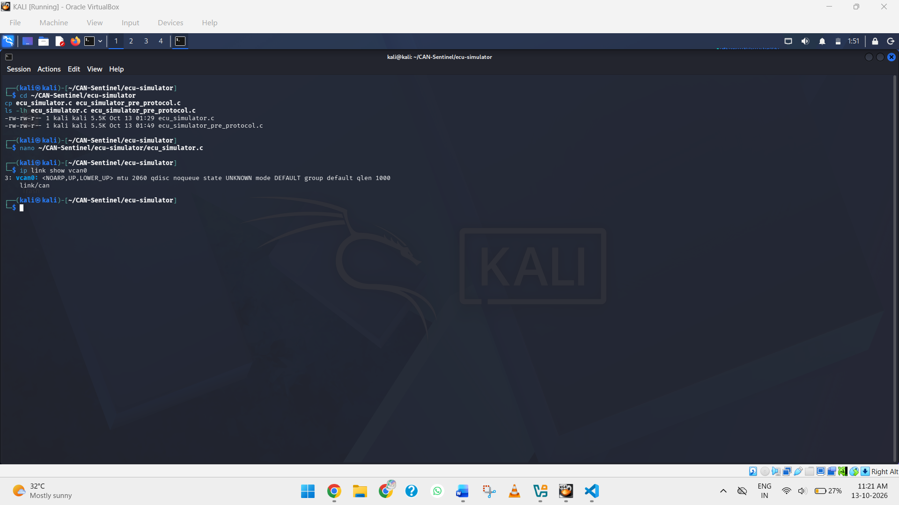

Screenshot 32: Verification of the original ECU simulator source file and its backup.

### Step 15.8: Open the Source Code for Editing

Open the ECU simulator source file using the Nano text editor:

```bash
nano ~/CAN-Sentinel/ecu-simulator/ecu_simulator.c
```

Replace the existing source code with the updated SocketCAN implementation that follows the finalized CAN protocol. Save the file using `Ctrl + O`, press Enter to confirm, and exit using `Ctrl + X`.

The updated implementation introduces the six agreed CAN identifiers, eight-byte CAN frames, periodic transmission, and rolling counters in byte 7.

### Step 15.9: Verify the Updated Source Code

Confirm that the updated protocol message is present in the source file.

Execute:

```bash
cd ~/CAN-Sentinel/ecu-simulator
grep -n "Protocol: six periodic ECU frames" ecu_simulator.c
```

Actual terminal output:

```text
165:    printf("Protocol: six periodic ECU frames, DLC 8\n");
```

This confirms that the source file contains the updated protocol startup message.

### Step 15.10: Compile the Updated ECU Simulator

Compile the updated C source code using GCC with additional compiler warning flags.

Execute:

```bash
cd ~/CAN-Sentinel/ecu-simulator
gcc -Wall -Wextra -o ecu_simulator ecu_simulator.c
```

Actual terminal output:

```text
┌──(kali㉿kali)-[~/CAN-Sentinel/ecu-simulator]
└─$ cd ~/CAN-Sentinel/ecu-simulator
gcc -Wall -Wextra -o ecu_simulator ecu_simulator.c
```

The command returned to the shell prompt without displaying compiler errors or warnings. This confirms that compilation completed successfully.

### Step 15.11: Execute the Updated ECU Simulator

Run the newly compiled executable:

```bash
./ecu_simulator
```

Actual terminal output:

```text
CAN-Sentinel ECU Simulator Started
CAN interface: vcan0
Protocol: six periodic ECU frames, DLC 8
Press Ctrl+C to stop.
```

The simulator remained running and continued transmitting periodic CAN frames instead of exiting after sending six frames.

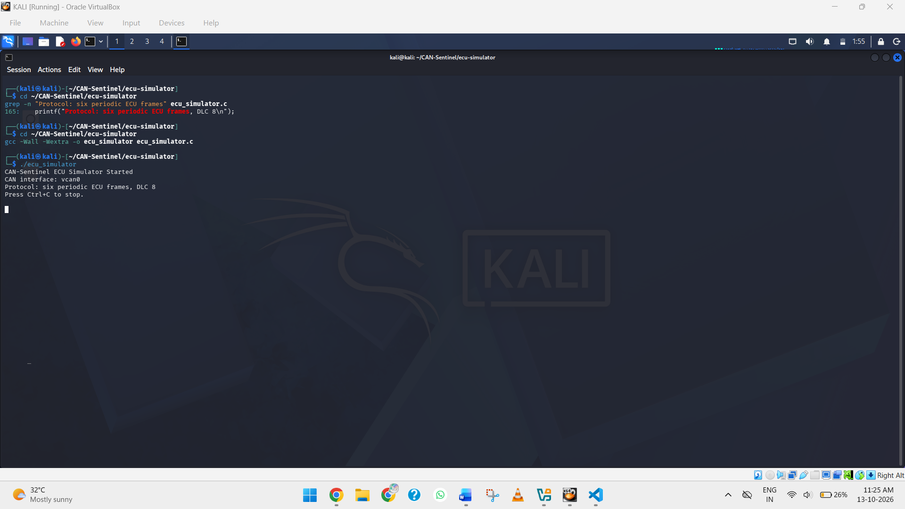

Screenshot 33: The updated ECU simulator starts on `vcan0`, reports the finalized protocol with DLC 8, and remains active for periodic CAN transmission.

### Step 15.12: Verify CAN Frame Transmission

Keep the ECU simulator running in one Kali Linux terminal. Open a second terminal and use `candump` to inspect the transmitted CAN traffic.

Execute:

```bash
candump -n 12 vcan0
```

Actual terminal output:

```text
vcan0  0A0   [8]  32 00 00 00 00 00 00 9D
vcan0  0B0   [8]  00 00 00 00 00 00 00 3A
vcan0  100   [8]  05 DC 00 00 00 00 00 3A
vcan0  200   [8]  3C 00 00 00 00 00 00 9D
vcan0  0B0   [8]  00 00 00 00 00 00 00 3B
vcan0  100   [8]  05 DC 00 00 00 00 00 3B
vcan0  0A0   [8]  32 00 00 00 00 00 00 9E
vcan0  0B0   [8]  00 00 00 00 00 00 00 3C
vcan0  100   [8]  05 DC 00 00 00 00 00 3C
vcan0  200   [8]  3C 00 00 00 00 00 00 9E
vcan0  0B0   [8]  00 00 00 00 00 00 00 3D
vcan0  100   [8]  05 DC 00 00 00 00 00 3D
```

The captured frames confirm that the brake, steering, engine RPM, and vehicle-speed ECUs are transmitting using their finalized CAN identifiers. All observed frames have a DLC of 8.

The final byte of the observed frames contains the rolling counter. For example, the steering and engine RPM counters increase from `0x3A` to `0x3D`, while the brake and vehicle-speed counters increase from `0x9D` to `0x9E`.

The engine RPM payload `05 DC` represents 1500 RPM, and the vehicle-speed payload `3C` represents 60 km/h.

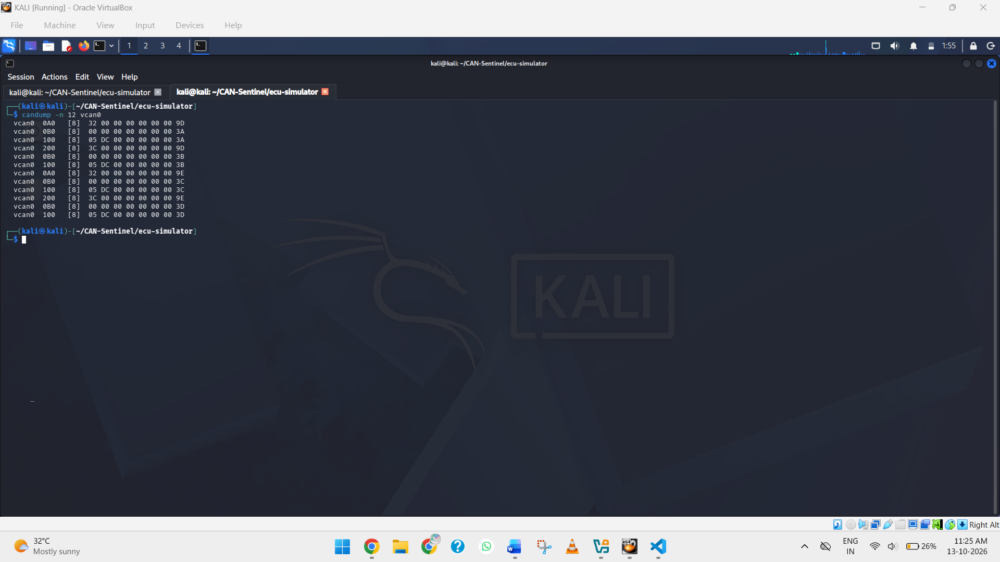

Screenshot 34: `candump` output showing the finalized CAN identifiers, eight-byte frames, payload values, and incrementing rolling counters.

### Step 15.13: Verify All Six ECU Frames

After starting the updated ECU simulator, verify that all six periodic ECU messages are transmitted using the finalized CAN identifiers and eight-byte payloads.

Keep the ECU simulator running in the first Kali Linux terminal. Open a second terminal and execute:

```bash
candump -n 40 vcan0
```

The `candump` utility captures up to 40 CAN frames from the `vcan0` virtual CAN interface. This allows the slower engine-temperature and infotainment messages, which are transmitted every 100 ms, to appear in the capture.

Actual terminal output:

```text
vcan0  0B0   [8]  00 00 00 00 00 00 00 13
vcan0  100   [8]  05 DC 00 00 00 00 00 13
vcan0  0A0   [8]  32 00 00 00 00 00 00 8A
vcan0  0B0   [8]  00 00 00 00 00 00 00 14
vcan0  100   [8]  05 DC 00 00 00 00 00 14
vcan0  200   [8]  3C 00 00 00 00 00 00 8A
vcan0  300   [8]  82 00 00 00 00 00 00 82
vcan0  600   [8]  01 00 00 00 00 00 00 82
vcan0  0B0   [8]  00 00 00 00 00 00 00 15
vcan0  100   [8]  05 DC 00 00 00 00 00 15
vcan0  0A0   [8]  32 00 00 00 00 00 00 8B
vcan0  0B0   [8]  00 00 00 00 00 00 00 16
vcan0  100   [8]  05 DC 00 00 00 00 00 16
vcan0  200   [8]  3C 00 00 00 00 00 00 8B
vcan0  0B0   [8]  00 00 00 00 00 00 00 17
vcan0  100   [8]  05 DC 00 00 00 00 00 17
vcan0  0A0   [8]  32 00 00 00 00 00 00 8C
vcan0  0B0   [8]  00 00 00 00 00 00 00 18
vcan0  100   [8]  05 DC 00 00 00 00 00 18
vcan0  200   [8]  3C 00 00 00 00 00 00 8C
vcan0  0B0   [8]  00 00 00 00 00 00 00 19
vcan0  100   [8]  05 DC 00 00 00 00 00 19
vcan0  0A0   [8]  32 00 00 00 00 00 00 8D
vcan0  0B0   [8]  00 00 00 00 00 00 00 1A
vcan0  100   [8]  05 DC 00 00 00 00 00 1A
vcan0  200   [8]  3C 00 00 00 00 00 00 8D
vcan0  0B0   [8]  00 00 00 00 00 00 00 1B
vcan0  100   [8]  05 DC 00 00 00 00 00 1B
vcan0  0A0   [8]  32 00 00 00 00 00 00 8E
vcan0  0B0   [8]  00 00 00 00 00 00 00 1C
vcan0  100   [8]  05 DC 00 00 00 00 00 1C
vcan0  200   [8]  3C 00 00 00 00 00 00 8E
vcan0  0B0   [8]  00 00 00 00 00 00 00 1D
vcan0  100   [8]  05 DC 00 00 00 00 00 1D
vcan0  0A0   [8]  32 00 00 00 00 00 00 8F
vcan0  0B0   [8]  00 00 00 00 00 00 00 1E
vcan0  100   [8]  05 DC 00 00 00 00 00 1E
vcan0  200   [8]  3C 00 00 00 00 00 00 8F
vcan0  300   [8]  82 00 00 00 00 00 00 83
vcan0  600   [8]  01 00 00 00 00 00 00 83
```

The captured traffic confirms that all six expected CAN identifiers are present.

| ECU | CAN ID | Expected DLC | Verification |
|---|---|---:|---|
| Brake | `0x0A0` | 8 | Confirmed |
| Steering | `0x0B0` | 8 | Confirmed |
| Engine RPM | `0x100` | 8 | Confirmed |
| Vehicle speed | `0x200` | 8 | Confirmed |
| Engine temperature | `0x300` | 8 | Confirmed |
| Infotainment heartbeat | `0x600` | 8 | Confirmed |

Every observed frame uses DLC 8. The final byte contains a rolling counter that increments independently for each ECU. For example, the steering and engine RPM counters increase from `0x13` to `0x1E`, while the brake and vehicle-speed counters increase from `0x8A` to `0x8F`. The temperature and infotainment counters increase from `0x82` to `0x83`.

The payloads also match the configured baseline values:

- **Brake:** `0x32` represents a pressure value of 50; byte 1 is `0`, indicating that the brake switch is off.
- **Steering:** `0x0000` represents a steering angle of 0.0 degrees.
- **Engine RPM:** `0x05DC` represents 1500 RPM.
- **Vehicle speed:** `0x3C` represents 60 km/h.
- **Engine temperature:** `0x82` represents a raw value of 130, corresponding to 90°C with the configured +40 encoding offset.
- **Infotainment:** `0x01` represents status 1.

The capture verifies that all six ECU messages are being transmitted with the expected CAN identifiers, DLC values, and rolling-counter placement. It confirms protocol-format compliance for the observed frames; precise transmission intervals and the aggregate rate of approximately 320 frames per second will be evaluated separately.

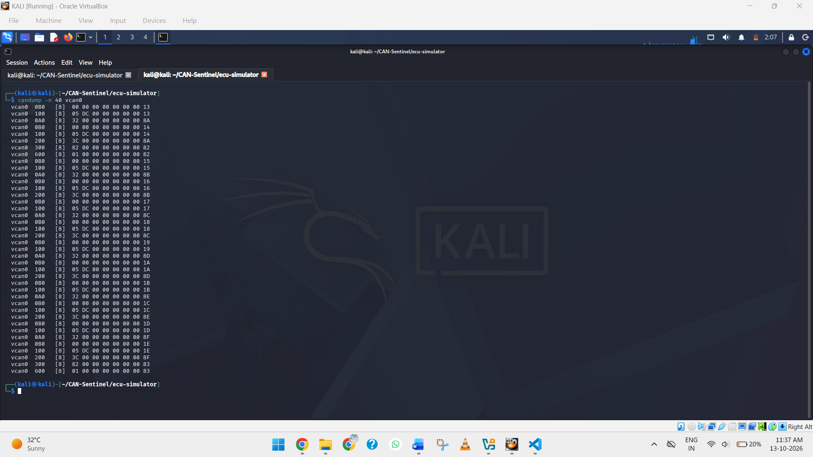

Screenshot 35: `candump` output showing all six finalized CAN identifiers, eight-byte frames, baseline payloads, and rolling counters.

### Step 15.13 Result

The verification was successful. All six periodic ECU frames were observed on `vcan0`, and every captured frame used the expected eight-byte payload format.

The finalized CAN protocol is now verified at the frame-format level. The next development step is to introduce realistic ECU signal variations and timing jitter.


## Step 16: Implement Realistic ECU Signal Values and Timing Jitter

After finalizing the CAN communication protocol in Step 15, the next step is to update the ECU simulator to generate more realistic vehicle signal values and introduce small timing variations. These improvements will help produce more representative normal CAN traffic for the CAN-Sentinel intrusion detection system.

The simulator retains the six agreed CAN identifiers, eight-byte data frames, rolling counters, and nominal transmission periods defined in `docs/week1_design.md`.

### Step 16.1: Preserve the Finalized Step 15 Implementation

Before modifying the source code, preserve a backup of the verified Step 15 implementation. This allows the finalized protocol version to be recovered if any problems occur during development.

Navigate to the simulator directory:

```bash
cd ~/CAN-Sentinel/ecu-simulator
```

Create a backup of the current source file:

```bash
cp ecu_simulator.c ecu_simulator_step15_backup.c
```

Verify that both files exist:

```bash
ls -lh ecu_simulator.c ecu_simulator_step15_backup.c
```

The backup preserves the Step 15 source code, while `ecu_simulator.c` remains the working file for Step 16.

### Step 16.2: Define the Realistic Signal Requirements

The simulator is updated to represent the following vehicle signals:

| CAN ID | ECU signal | Nominal period | Signal behavior |
|---|---|---:|---|
| `0x0A0` | Brake | 20 ms | Brake pressure and brake switch state |
| `0x0B0` | Steering | 10 ms | Signed steering angle |
| `0x100` | Engine RPM | 10 ms | Gradually changing engine speed |
| `0x200` | Vehicle speed | 20 ms | Gradually changing vehicle speed |
| `0x300` | Engine temperature | 100 ms | Coolant temperature with a +40 offset |
| `0x600` | Infotainment | 100 ms | Infotainment status |

All six messages use a DLC of 8 bytes, with the rolling counter stored in byte 7.

The simulator uses bounded signal values to avoid unrealistic or out-of-range values. Timing jitter of approximately ±1 ms is introduced around each ECU's nominal transmission period.

### Step 16.3: Open the ECU Simulator Source File

Open the existing source file in Nano:

```bash
nano ~/CAN-Sentinel/ecu-simulator/ecu_simulator.c
```

The existing source file is edited in place so that the finalized protocol implementation can be extended without changing the project directory structure.

### Step 16.4: Replace the Existing Code with the Updated Implementation

Replace the contents of `ecu_simulator.c` with the following complete C program.

```c
#include <errno.h>
#include <linux/can.h>
#include <linux/can/raw.h>
#include <net/if.h>
#include <signal.h>
#include <stdint.h>
#include <stdio.h>
#include <stdlib.h>
#include <string.h>
#include <sys/ioctl.h>
#include <sys/socket.h>
#include <time.h>
#include <unistd.h>

#define ECU_COUNT 6
#define DLC 8
#define JITTER_US 1000

typedef struct {
    canid_t can_id;
    long period_us;
    struct timespec next_send;
    uint8_t counter;
} ECU;

static volatile sig_atomic_t running = 1;

static ECU ecus[ECU_COUNT] = {
    {0x0A0,  20000, {0, 0}, 0},
    {0x0B0,  10000, {0, 0}, 0},
    {0x100,  10000, {0, 0}, 0},
    {0x200,  20000, {0, 0}, 0},
    {0x300, 100000, {0, 0}, 0},
    {0x600, 100000, {0, 0}, 0}
};

static int brake_pressure = 0;
static int brake_switch = 0;
static int steering_angle = 0;
static int engine_rpm = 1500;
static int vehicle_speed = 60;
static int engine_temp_c = 90;
static uint8_t infotainment_status = 1;

static void handle_signal(int signal_number)
{
    (void)signal_number;
    running = 0;
}

static long timespec_diff_us(const struct timespec *a,
                             const struct timespec *b)
{
    return (a->tv_sec - b->tv_sec) * 1000000L
         + (a->tv_nsec - b->tv_nsec) / 1000L;
}

static struct timespec add_us(struct timespec t, long us)
{
    t.tv_nsec += (us % 1000000L) * 1000L;
    t.tv_sec += us / 1000000L;

    if (t.tv_nsec >= 1000000000L) {
        t.tv_sec++;
        t.tv_nsec -= 1000000000L;
    }

    if (t.tv_nsec < 0) {
        t.tv_sec--;
        t.tv_nsec += 1000000000L;
    }

    return t;
}

static long random_jitter_us(void)
{
    return (long)(rand() % (2 * JITTER_US + 1)) - JITTER_US;
}

static int clamp_int(int value, int minimum, int maximum)
{
    if (value < minimum) return minimum;
    if (value > maximum) return maximum;
    return value;
}

static void update_signals(void)
{
    engine_rpm += (rand() % 101) - 50;
    engine_rpm = clamp_int(engine_rpm, 800, 4000);

    vehicle_speed += (rand() % 5) - 2;
    vehicle_speed = clamp_int(vehicle_speed, 0, 130);

    steering_angle += (rand() % 21) - 10;
    steering_angle = clamp_int(steering_angle, -450, 450);

    if (rand() % 100 < 8) {
        brake_switch = !brake_switch;
    }

    if (brake_switch) {
        brake_pressure += 5 + rand() % 11;
    } else {
        brake_pressure -= 2 + rand() % 9;
    }

    brake_pressure = clamp_int(brake_pressure, 0, 100);

    engine_temp_c += (rand() % 3) - 1;
    engine_temp_c = clamp_int(engine_temp_c, 80, 105);

    if (rand() % 1000 == 0) {
        infotainment_status = (uint8_t)(rand() % 2);
    }
}

static void prepare_frame(const ECU *ecu, struct can_frame *frame)
{
    memset(frame, 0, sizeof(*frame));
    frame->can_id = ecu->can_id;
    frame->can_dlc = DLC;

    switch (ecu->can_id) {
        case 0x0A0:
            frame->data[0] = (uint8_t)brake_pressure;
            frame->data[1] = (uint8_t)brake_switch;
            break;

        case 0x0B0: {
            int16_t angle = (int16_t)steering_angle;
            frame->data[0] =
                (uint8_t)(((uint16_t)angle >> 8) & 0xFF);
            frame->data[1] =
                (uint8_t)((uint16_t)angle & 0xFF);
            break;
        }

        case 0x100:
            frame->data[0] =
                (uint8_t)((engine_rpm >> 8) & 0xFF);
            frame->data[1] = (uint8_t)(engine_rpm & 0xFF);
            break;

        case 0x200:
            frame->data[0] = (uint8_t)vehicle_speed;
            break;

        case 0x300:
            frame->data[0] = (uint8_t)(engine_temp_c + 40);
            break;

        case 0x600:
            frame->data[0] = infotainment_status;
            break;

        default:
            break;
    }

    frame->data[7] = ecu->counter;
}

static int send_frame(int socket_fd, ECU *ecu)
{
    struct can_frame frame;
    prepare_frame(ecu, &frame);

    ssize_t bytes_sent = write(socket_fd, &frame, sizeof(frame));

    if (bytes_sent != (ssize_t)sizeof(frame)) {
        if (bytes_sent < 0) {
            perror("CAN frame transmission failed");
        } else {
            fprintf(stderr, "Incomplete CAN frame transmission\n");
        }
        return -1;
    }

    ecu->counter++;
    return 0;
}

int main(void)
{
    int socket_fd;
    struct ifreq interface_request;
    struct sockaddr_can address;

    srand((unsigned int)time(NULL));
    signal(SIGINT, handle_signal);
    signal(SIGTERM, handle_signal);

    socket_fd = socket(PF_CAN, SOCK_RAW, CAN_RAW);
    if (socket_fd < 0) {
        perror("Failed to create CAN socket");
        return EXIT_FAILURE;
    }

    memset(&interface_request, 0, sizeof(interface_request));
    strncpy(interface_request.ifr_name, "vcan0",
            sizeof(interface_request.ifr_name) - 1);

    if (ioctl(socket_fd, SIOCGIFINDEX, &interface_request) < 0) {
        perror("Failed to obtain vcan0 interface index");
        close(socket_fd);
        return EXIT_FAILURE;
    }

    memset(&address, 0, sizeof(address));
    address.can_family = AF_CAN;
    address.can_ifindex = interface_request.ifr_ifindex;

    if (bind(socket_fd, (struct sockaddr *)&address,
             sizeof(address)) < 0) {
        perror("Failed to bind CAN socket to vcan0");
        close(socket_fd);
        return EXIT_FAILURE;
    }

    struct timespec now;
    if (clock_gettime(CLOCK_MONOTONIC, &now) < 0) {
        perror("Failed to read monotonic clock");
        close(socket_fd);
        return EXIT_FAILURE;
    }

    for (int i = 0; i < ECU_COUNT; i++) {
        ecus[i].next_send = add_us(now, random_jitter_us());
    }

    printf("CAN-Sentinel ECU Simulator Started\n");
    printf("CAN interface: vcan0\n");
    printf("Protocol: six periodic ECU frames, DLC 8\n");
    printf("Signal simulation: enabled\n");
    printf("Timing jitter: approximately +/-1 ms\n");
    printf("Press Ctrl+C to stop.\n");
    fflush(stdout);

    while (running) {
        if (clock_gettime(CLOCK_MONOTONIC, &now) < 0) {
            perror("Failed to read monotonic clock");
            break;
        }

        for (int i = 0; i < ECU_COUNT && running; i++) {
            if (timespec_diff_us(&now, &ecus[i].next_send) >= 0) {
                update_signals();

                if (send_frame(socket_fd, &ecus[i]) < 0) {
                    running = 0;
                    break;
                }

                if (clock_gettime(CLOCK_MONOTONIC, &now) < 0) {
                    perror("Failed to read monotonic clock");
                    running = 0;
                    break;
                }

                long interval = ecus[i].period_us
                              + random_jitter_us();

                ecus[i].next_send = add_us(now, interval);
            }
        }

        if (running) {
            struct timespec earliest = ecus[0].next_send;

            for (int i = 1; i < ECU_COUNT; i++) {
                if (timespec_diff_us(&ecus[i].next_send,
                                     &earliest) < 0) {
                    earliest = ecus[i].next_send;
                }
            }

            if (clock_gettime(CLOCK_MONOTONIC, &now) < 0) {
                perror("Failed to read monotonic clock");
                break;
            }

            long wait_us = timespec_diff_us(&earliest, &now);

            if (wait_us > 0) {
                struct timespec delay = {
                    .tv_sec = wait_us / 1000000L,
                    .tv_nsec = (wait_us % 1000000L) * 1000L
                };

                while (nanosleep(&delay, &delay) < 0
                       && errno == EINTR && running) {
                    /* Resume sleep after an interrupt. */
                }
            }
        }
    }

    close(socket_fd);
    printf("\nCAN-Sentinel ECU Simulator stopped.\n");
    return EXIT_SUCCESS;
}
```

The implementation introduces the following changes:

- Dynamic brake pressure and brake switch state.
- Gradual changes in steering angle, engine RPM, and vehicle speed.
- Small coolant temperature variations and an infotainment status field.
- Per-ECU transmission scheduling with approximately ±1 ms jitter.
- Eight-byte CAN frames with independent rolling counters in byte 7.
- Graceful termination using `Ctrl+C`.

### Step 16.5: Save the Updated Source File

After replacing the code in Nano, save the file using these keys:

1. Press `Ctrl + O` to write the file.
2. Press Enter to confirm the filename.
3. Press `Ctrl + X` to exit Nano.

The updated source file is now ready for the next verification stage.

Verification status: The source code has been entered and saved. Compilation, signal behavior, CAN frame contents, and the actual transmission rate have not yet been verified. These checks must be completed before using the simulator to generate normal-traffic training datasets.

## Step 16.5: Verify the Updated Source File

After replacing the original simulator code, verify that the updated source file and the Step 15 backup exist. This confirms that the previous implementation is preserved before compilation and testing.

### Step 16.5.1: Verify the Source and Backup Files

Execute the following commands in Kali Linux:

```bash
cd ~/CAN-Sentinel/ecu-simulator
ls -lh ecu_simulator.c ecu_simulator_step15_backup.c
```

The terminal returned the following output:

```text
-rw-rw-r-- 1 kali kali 8.2K Oct 13 05:13 ecu_simulator.c
-rw-rw-r-- 1 kali kali 5.5K Oct 13 05:10 ecu_simulator_step15_backup.c
```

The output confirms that the updated `ecu_simulator.c` source file and the preserved `ecu_simulator_step15_backup.c` backup are present in the simulator directory.

### Step 16.5.2: Verify the CAN Protocol and Timing Configuration

Execute the following command to inspect the CAN identifiers, nominal transmission periods, jitter configuration, and signal-handling functions:

```bash
grep -nE '0x0A0|0x0B0|0x100|0x200|0x300|0x600|JITTER_US|update_signals|prepare_frame' ecu_simulator.c
```

The terminal returned the following output:

```text
19:#define JITTER_US 1000
31:    {0x0A0,  20000, {0, 0}, 0},  /* Brake */
32:    {0x0B0,  10000, {0, 0}, 0},  /* Steering */
33:    {0x100,  10000, {0, 0}, 0},  /* Engine RPM */
34:    {0x200,  20000, {0, 0}, 0},  /* Vehicle speed */
35:    {0x300, 100000, {0, 0}, 0},  /* Engine temperature */
36:    {0x600, 100000, {0, 0}, 0}   /* Infotainment */
80:    return (long)(rand() % (2 * JITTER_US + 1)) - JITTER_US;
90:static void update_signals(void)
127:static void prepare_frame(const ECU *ecu, struct can_frame *frame)
134:        case 0x0A0:
139:        case 0x0B0: {
146:        case 0x100:
151:        case 0x200:
155:        case 0x300:
160:        case 0x600:
174:    prepare_frame(ecu, &frame);
255:                update_signals();
```

The output confirms that the source contains all six finalized CAN identifiers, their configured nominal transmission periods, the jitter constant, and the functions responsible for updating signals and preparing CAN frames.

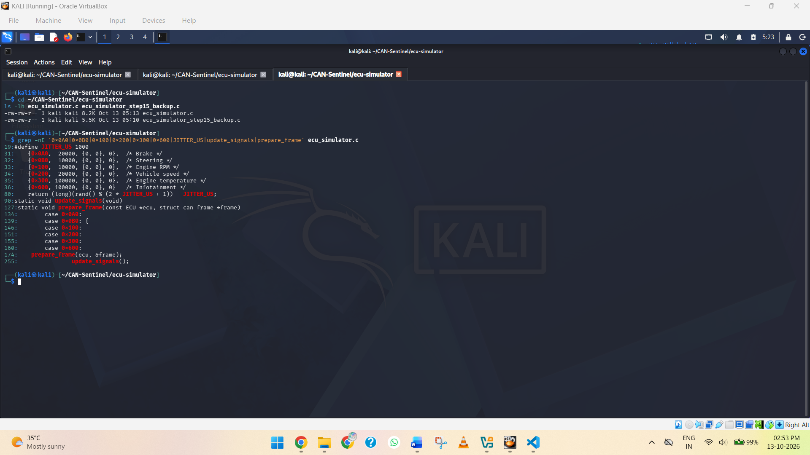

Screenshot 39: Terminal output showing the six CAN identifiers, nominal transmission periods, timing jitter configuration, and signal-processing functions in `ecu_simulator.c`.

At this stage, the source configuration has been inspected, but successful compilation and runtime behavior have not yet been verified.

## Step 16.5: Run the Updated ECU Simulator and Verify Signal Variation

After compiling the updated `ecu_simulator.c` source file successfully, run the simulator to verify that all six ECUs transmit eight-byte CAN frames with varying signal values and independent rolling counters.

### Step 16.5.1: Start the ECU Simulator

Navigate to the ECU simulator directory and execute the compiled program:

```bash
cd ~/CAN-Sentinel/ecu-simulator
./ecu_simulator
```

The simulator displays the following startup output:

```text
CAN-Sentinel ECU Simulator Started
CAN interface: vcan0
Protocol: six periodic ECU frames, DLC 8
Signal simulation: enabled
Timing jitter: approximately +/-1 ms
Press Ctrl+C to stop.
```

Keep the simulator running in this terminal.

### Step 16.5.2: Capture CAN Traffic

Open a second Kali Linux terminal and execute:

```bash
candump -n 40 vcan0
```

The command captures 40 CAN frames from the `vcan0` virtual CAN interface.

### Step 16.5.3: Verify the Captured Output

The following is the actual output captured during verification:

```text
vcan0  0B0   [8]  FF 4F 00 00 00 00 00 7F
vcan0  100   [8]  07 A6 00 00 00 00 00 7A
vcan0  0B0   [8]  FF 55 00 00 00 00 00 80
vcan0  100   [8]  07 7E 00 00 00 00 00 7B
vcan0  200   [8]  80 00 00 00 00 00 00 60
vcan0  0A0   [8]  4D 00 00 00 00 00 00 62
vcan0  0B0   [8]  FF 5F 00 00 00 00 00 81
vcan0  100   [8]  07 7D 00 00 00 00 00 7C
vcan0  0B0   [8]  FF 59 00 00 00 00 00 82
vcan0  0A0   [8]  47 00 00 00 00 00 00 63
vcan0  100   [8]  07 A4 00 00 00 00 00 7D
vcan0  200   [8]  81 00 00 00 00 00 00 61
vcan0  0B0   [8]  FF 57 00 00 00 00 00 83
vcan0  100   [8]  07 9C 00 00 00 00 00 7E
vcan0  0B0   [8]  FF 5B 00 00 00 00 00 84
vcan0  0A0   [8]  44 00 00 00 00 00 00 64
vcan0  200   [8]  80 00 00 00 00 00 00 62
vcan0  100   [8]  07 A5 00 00 00 00 00 7F
vcan0  0B0   [8]  FF 54 00 00 00 00 00 85
vcan0  100   [8]  07 97 00 00 00 00 00 80
vcan0  600   [8]  01 00 00 00 00 00 00 B3
vcan0  0A0   [8]  3C 00 00 00 00 00 00 65
vcan0  0B0   [8]  FF 52 00 00 00 00 00 86
vcan0  200   [8]  7F 00 00 00 00 00 00 63
vcan0  100   [8]  07 7A 00 00 00 00 00 81
vcan0  0B0   [8]  FF 5A 00 00 00 00 00 87
vcan0  300   [8]  89 00 00 00 00 00 00 B3
vcan0  100   [8]  07 4C 00 00 00 00 00 82
vcan0  0A0   [8]  47 01 00 00 00 00 00 66
vcan0  200   [8]  7F 00 00 00 00 00 00 64
vcan0  0B0   [8]  FF 58 00 00 00 00 00 88
vcan0  100   [8]  07 63 00 00 00 00 00 83
vcan0  0B0   [8]  FF 56 00 00 00 00 00 89
vcan0  100   [8]  07 3E 00 00 00 00 00 84
vcan0  0A0   [8]  56 01 00 00 00 00 00 67
vcan0  200   [8]  7F 00 00 00 00 00 00 65
vcan0  0B0   [8]  FF 5A 00 00 00 00 00 8A
vcan0  100   [8]  07 37 00 00 00 00 00 85
vcan0  0B0   [8]  FF 53 00 00 00 00 00 8B
vcan0  100   [8]  07 58 00 00 00 00 00 86
```

The captured output confirms that every frame has DLC `[8]` and that the brake, steering, engine RPM, and vehicle-speed payloads vary over time. The rolling counters in byte 7 also increment independently for each ECU.

All six identifiers (`0x0A0`, `0x0B0`, `0x100`, `0x200`, `0x300`, and `0x600`) were observed in the captured traffic.

### Step 16.5.4: Save the Verification Screenshot

Save a screenshot of the `candump` output in the repository at:

`docs/member-1/screenshots/step-16-signal-variation-verification.png`


Screenshot 39: `candump` output verifying all six ECU CAN identifiers, eight-byte frames, varying signal values, and independent rolling counters.

### Result

The updated ECU simulator compiled without warnings and successfully transmitted CAN frames with the expected identifiers and DLC. The captured output also demonstrated varying signal values and independent rolling counters. Precise timing jitter and the target rate of approximately 320 frames per second will be evaluated separately.