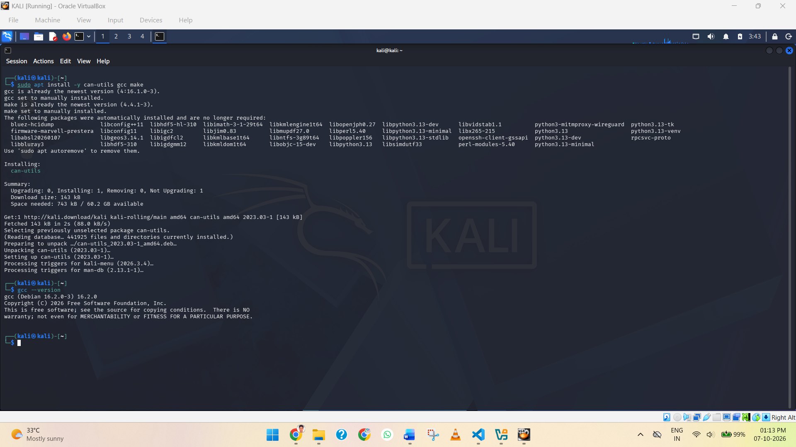
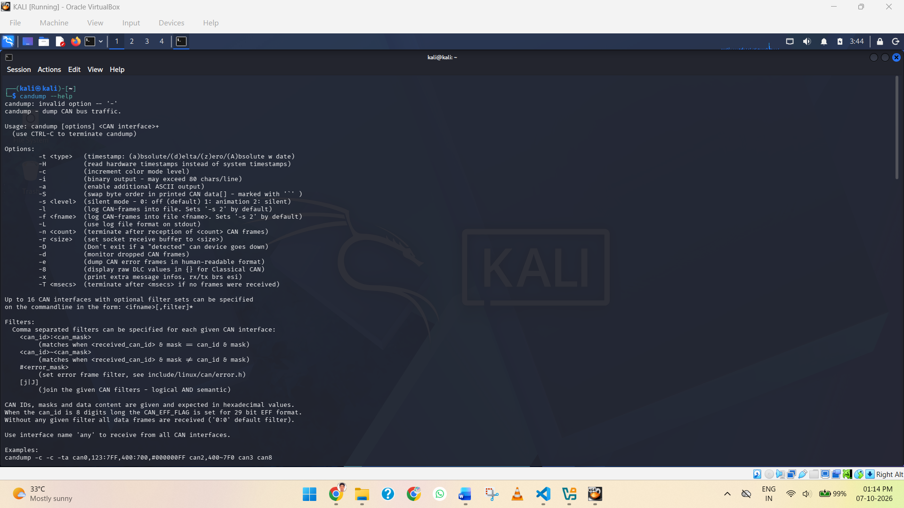
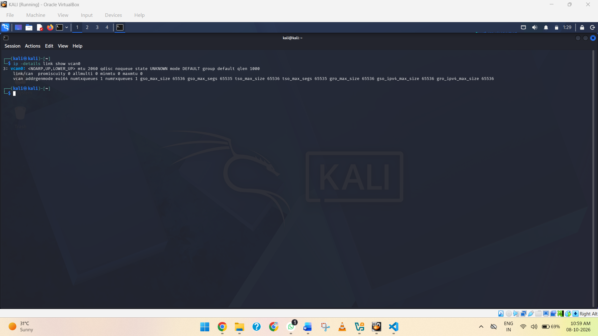

# Phase 1: Linux Environment and Virtual CAN (SocketCAN) Setup

## Overview

This phase describes the implementation of the CAN-Sentinel Member 1 module, focusing on the configuration of a Linux development environment and the establishment of a virtual Controller Area Network (CAN) environment.

The implementation uses **Kali Linux, Oracle VirtualBox, Linux SocketCAN, and the Virtual CAN (`vcan0`) interface**. This environment provides a platform for configuring CAN communication, transmitting and receiving CAN frames, and verifying communication without requiring physical CAN hardware.

The phase begins with configuring the Kali Linux development environment and installing the necessary CAN utilities and compilation tools. It then covers the creation and verification of the `vcan0` virtual CAN interface, followed by testing CAN communication using the available CAN utilities.

These initial configurations establish the foundation for the subsequent ECU simulator development phase, in which C-based programs will simulate vehicle Electronic Control Units (ECUs) and generate CAN traffic.

The following subsections document each implementation stage, including the commands executed, their purpose, verification results, and corresponding screenshots.

## Implementation Steps

The Linux environment and Virtual CAN setup are organized into the following stages:

1. **Configure Kali Linux on VirtualBox** — Establish and verify the Linux development environment.
2. **Install Required Packages** — Install `can-utils`, GCC, and Make for CAN communication and C program development.
3. **Create and Configure the Virtual CAN Interface** — Load the `vcan` kernel module and create the `vcan0` interface.
4. **Verify the Virtual CAN Interface Details** — Confirm the interface configuration and operational state.
5. **Test CAN Communication** — Transmit and receive test CAN frames using `cansend` and `candump`.

Each stage is documented in detail in the following subsections.

## Step 1: Configure Kali Linux on VirtualBox

The CAN-Sentinel Member 1 module is developed using **Kali Linux Rolling** running inside **Oracle VirtualBox**. The virtual machine provides an isolated Linux environment for implementing the **SocketCAN-based virtual CAN network**, developing the **C-based ECU simulators**, generating normal CAN traffic, and performing CAN traffic monitoring.

The virtual machine is configured with sufficient CPU, memory, and storage resources to support CAN network simulation, C compilation, traffic generation, packet monitoring, and integration with the other CAN-Sentinel modules.

### System Configuration

The Kali Linux virtual machine is configured approximately as follows:

* **Operating System:** Kali GNU/Linux Rolling
* **Kali Version:** 2026.3
* **Kernel:** 7.1.5+kali-amd64
* **Architecture:** x86_64
* **Platform:** Oracle VirtualBox
* **CPU:** 2+ cores
* **RAM:** 4 GB or more
* **Storage:** 40 GB or more
* **Network:** NAT
* **Terminal:** Kali Linux Terminal
* **Compiler:** GCC
* **CAN Framework:** Linux SocketCAN


**Screenshot 1:** Kali Linux virtual machine running in Oracle VirtualBox with the configured development environment.

### Step 1.1: Open the Kali Terminal

After starting the Kali Linux virtual machine, open the Kali Linux terminal.

Navigate to:

**Applications → System Tools → Terminal**

The terminal will be used throughout the Member 1 implementation to configure the virtual CAN interface, compile the C-based ECU simulator programs, generate CAN traffic, and perform system-level verification.

### Step 1.2: Verify the Linux Kernel and System Architecture

First, verify the currently running Linux kernel and system architecture:

```bash
uname -a
```

This command displays information about the Linux kernel, hostname, kernel build, and system architecture.

Example output:

```text
Linux kali 7.1.5+kali-amd64 #1 SMP PREEMPT_DYNAMIC Kali 7.1.5-1kali1 (2026-07-29) x86_64 GNU/Linux
```

The output confirms that the system is running the expected Kali Linux kernel on an **x86_64** architecture.

### Step 1.3: Verify the Kali Linux Operating System

Next, verify the installed Kali Linux distribution and version:

```bash
cat /etc/os-release
```

This command displays the operating system identification and release information.

Example output:

```text
PRETTY_NAME="Kali GNU/Linux Rolling"
NAME="Kali GNU/Linux"
VERSION_ID="2026.3"
VERSION="2026.3"
VERSION_CODENAME=kali-rolling
ID=kali
ID_LIKE=debian
```

This confirms that the development environment is based on **Kali GNU/Linux Rolling**.

### Step 1.4: Verify the GCC Compiler

Finally, verify that the GCC compiler is installed:

```bash
gcc --version
```

GCC is required to compile the C-based ECU simulator programs developed for the CAN-Sentinel Member 1 module.

Example output:

```text
gcc (Debian 16.2.0-3) 16.2.0
```

The successful GCC version output confirms that the C compilation environment is available.


**Screenshot 2:** Terminal showing the Linux kernel, Kali Linux operating system, and GCC compiler verification.

### Step 1 Completion

The Kali Linux development environment has been successfully configured and verified. The system is ready for the next stage of the CAN-Sentinel Member 1 implementation, including **SocketCAN configuration, virtual CAN interface creation, and C-based ECU simulator development**.

## Step 2: Install Required Packages

After configuring the Kali Linux virtual machine, install the packages required for the **SocketCAN-based virtual CAN network** and **C-based ECU simulator development**. These packages provide the CAN utilities and development tools required to create, compile, test, and monitor the CAN traffic generated during the CAN-Sentinel Member 1 implementation.

The required packages are installed using the Kali Linux package manager. The installation includes **can-utils** for working with CAN interfaces, **GCC** for compiling C-based ECU simulator programs, and **Make** for supporting automated compilation.

### Step 2.1: Update the Package Repository

First, update the Kali Linux package repository information:

```bash
sudo apt update
```

This command refreshes the local package index and ensures that the latest available package information is used when installing the required tools.

### Step 2.2: Install the Required Packages

Install the required CAN utilities, GCC compiler, and Make build tool:

```bash
sudo apt install -y can-utils gcc make
```

The installed packages provide the following functionality:

* **can-utils** — Provides utilities such as `candump`, `cansend`, and `cangen` for monitoring, transmitting, and generating CAN traffic.
* **GCC** — Compiles the C-based ECU simulator programs developed for the CAN-Sentinel Member 1 module.
* **Make** — Supports automated compilation and management of the ECU simulator build process.

### Step 2.3: Verify the GCC Compiler

After installation, verify that GCC is available:

```bash
gcc --version
```

The installed GCC version was successfully verified:

```text
gcc (Debian 16.2.0-3) 16.2.0
```

The successful version output confirms that the C compiler required for developing the ECU simulator programs is installed and available.



**Screenshot 3:** Terminal showing the installed GCC version and confirming the C compiler is available.

### Step 2.4: Verify the CAN Utilities

Next, verify that the `candump` utility provided by the **can-utils** package is available:

```bash
candump --help
```

On this system, `candump` reports an invalid option for `--help` and subsequently displays its usage information and available options. This confirms that the `candump` utility is installed correctly and can be executed from the terminal.

The `candump` utility will later be used to monitor CAN frames transmitted through the `vcan0` virtual CAN interface.



**Screenshot 4:** Terminal showing the `candump` usage information and available options, confirming that the `can-utils` package is installed.

### Step 2 Completion

The required CAN and development tools have been successfully installed and verified. The Kali Linux environment now contains **can-utils**, **GCC**, and **Make**, providing the necessary tools for CAN communication, C-based ECU simulator development, compilation, and CAN traffic monitoring.

The environment is now ready for the next stage of the CAN-Sentinel Member 1 implementation: **creating and configuring the `vcan0` virtual CAN interface**.

## Step 3: Create and Configure the Virtual CAN Interface

After installing the required CAN utilities and development tools, the next step is to create the **virtual CAN interface** required for the CAN-Sentinel Member 1 implementation.

Linux **SocketCAN** provides the framework for CAN communication, while the **Virtual CAN (`vcan`)** driver allows CAN communication to be simulated without requiring physical CAN hardware. The `vcan0` interface will serve as the virtual CAN bus on which the C-based ECU simulators will later generate and exchange CAN frames.

### Step 3.1: Load the Virtual CAN Kernel Module

First, load the **Virtual CAN (`vcan`) kernel module**:

```bash
sudo modprobe vcan
```

The `modprobe` command loads the `vcan` kernel module into the running Linux kernel. This enables the system to create virtual CAN network interfaces.

### Step 3.2: Create the `vcan0` Interface

Create a virtual CAN interface named `vcan0`:

```bash
sudo ip link add dev vcan0 type vcan
```

This command creates a new virtual CAN network interface using the Linux `vcan` driver.

The interface is named **`vcan0`** and will be used as the virtual CAN bus for the CAN-Sentinel ECU simulation environment.

### Step 3.3: Bring the `vcan0` Interface Up

Enable the newly created virtual CAN interface:

```bash
sudo ip link set up vcan0
```

This command changes the state of the `vcan0` interface to **UP**, allowing it to participate in CAN communication.

### Step 3.4: Verify the Virtual CAN Interface

Finally, verify that the `vcan0` interface has been created and configured successfully:

```bash
ip link show vcan0
```

The verification command produced the following output:

```text
3: vcan0: <NOARP,UP,LOWER_UP> mtu 2060 qdisc noqueue state UNKNOWN mode DEFAULT group default qlen 1000
    link/can
```

The output confirms that:

* The **`vcan` kernel module** was loaded successfully.
* The **`vcan0` virtual CAN interface** was created successfully.
* The interface is **UP** and ready for CAN communication.
* Linux recognizes `vcan0` as a **CAN interface**.
* The virtual CAN bus is ready for subsequent ECU simulation and CAN traffic generation.


**Screenshot 5:** Terminal showing the `vcan0` interface configuration and verification using `ip link show vcan0`.

### Step 3.5: `vcan0` Persistence and Recreation

The `vcan0` virtual CAN interface is created at runtime and is **not persistent by default**. Therefore, the interface will normally disappear when the Kali Linux virtual machine is rebooted. It can also be removed if the interface is manually deleted.

The following command creates the `vcan0` interface:

```bash
sudo ip link add dev vcan0 type vcan
```

This creates the virtual CAN interface only for the current running Linux session. Linux does not automatically recreate the interface after a system reboot.

### Recreate `vcan0` After Reboot

For the CAN-Sentinel development environment, this behavior is not a problem. If the `vcan0` interface is no longer available after restarting the Kali Linux virtual machine, it can be recreated manually using:

```bash
sudo modprobe vcan
sudo ip link add dev vcan0 type vcan
sudo ip link set up vcan0
```

After executing these commands, the `vcan0` interface will be available again for CAN-Sentinel development and testing.

### Optional: Automatic Recreation After Reboot

The `vcan0` interface can also be configured to be **automatically recreated during system startup**. This avoids manually creating the interface after every Kali Linux reboot.

For CAN-Sentinel, this can be implemented using a **systemd service**. The service can load the `vcan` kernel module, create the `vcan0` interface, and bring it up automatically during system boot.

The service can execute the following commands:

```bash
sudo modprobe vcan
sudo ip link add dev vcan0 type vcan
sudo ip link set up vcan0
```

Once the corresponding systemd service has been created, it can be enabled to start automatically during boot:

```bash
sudo systemctl enable vcan0.service
```

After the Kali Linux virtual machine is restarted, the systemd service can automatically recreate and activate the `vcan0` interface.

**Note:** Automatic recreation is optional for the CAN-Sentinel development environment. The interface can also be recreated manually whenever required.

### Step 3 Completion

The **`vcan` kernel module** has been loaded successfully, and the **`vcan0` virtual CAN interface** has been created and brought up.

The SocketCAN virtual CAN environment is now ready for the next stage of the CAN-Sentinel Member 1 implementation: **developing the C-based ECU simulator programs and generating CAN traffic through `vcan0`**.

## Step 4: Verify the Virtual CAN Interface Details

After creating and enabling the `vcan0` virtual CAN interface, its detailed configuration was verified to ensure that the interface is correctly recognized and configured by the Linux SocketCAN framework.

Two verification commands were used. The first command displays detailed configuration information for `vcan0`, while the second specifically identifies interfaces using the Virtual CAN (`vcan`) driver.

### Step 4.1: Display Detailed `vcan0` Configuration

First, display the detailed configuration of the `vcan0` interface:

```bash
ip -details link show vcan0
```

This command provides detailed information about the network interface, including its interface state, CAN link type, queue configuration, and Virtual CAN driver parameters.

The command produced the following output:

```text
3: vcan0: <NOARP,UP,LOWER_UP> mtu 2060 qdisc noqueue state UNKNOWN mode DEFAULT group default qlen 1000
    link/can promiscuity 0 allmulti 0 minmtu 0 maxmtu 0
    vcan addrgenmode eui64 numtxqueues 1 numrxqueues 1 gso_max_size 65536 gso_max_segs 65535 tso_max_size 65535 tso_max_segs 65535 gro_max_size 65536 gso_ipv4_max_size 65536 gro_ipv4_max_size 65536
```

The output shows that the interface is using the **CAN link type** and the **`vcan` driver**. The `UP` state confirms that the interface is enabled and available for CAN communication.



**Screenshot 6:** Detailed `vcan0` interface configuration displayed using `ip -details link show vcan0`.
### Step 4.2: Verify the Virtual CAN Interface Type

Next, verify all interfaces recognized specifically as Virtual CAN interfaces:

```bash
ip link show type vcan
```

The command produced the following output:

```text
3: vcan0: <NOARP,UP,LOWER_UP> mtu 2060 qdisc noqueue state UNKNOWN mode DEFAULT group default qlen 1000
    link/can
```

This confirms that `vcan0` is recognized by Linux as a **Virtual CAN (`vcan`) interface**.


**Screenshot 7:** Virtual CAN interface verification using `ip link show type vcan`.

### Step 4 Completion

The `vcan0` interface has been successfully verified using both detailed interface information and Virtual CAN type filtering.

The verification confirms that:

* **`vcan0` exists** and is active.
* The interface is in the **UP** state.
* Linux recognizes `vcan0` as a **Virtual CAN (`vcan`) interface**.
* The interface is ready for **CAN frame transmission and reception**.
* The SocketCAN virtual CAN environment is correctly configured for the next stage of CAN-Sentinel development.

## Step 5: Test CAN Communication

After creating and verifying the `vcan0` virtual CAN interface, the next step is to test whether the interface can successfully **transmit and receive CAN frames**.

The CAN communication test uses two Kali Linux terminals. One terminal monitors CAN traffic using `candump`, while the second terminal transmits a test CAN frame using `cansend`.

Successful reception of the transmitted frame confirms that the `vcan0` virtual CAN interface is operational and that CAN communication is functioning correctly.

### Step 5.1: Start CAN Traffic Monitoring

Open a Kali Linux terminal and start monitoring CAN traffic on the `vcan0` interface:

```bash
candump vcan0
```

Leave this command running in the first terminal.

The `candump` utility continuously listens for CAN frames received through the specified interface and displays them in the terminal.

### Step 5.2: Transmit a Test CAN Frame

Open a second Kali Linux terminal and transmit a test CAN frame using:

```bash
cansend vcan0 123#1122334455667788
```

The `cansend` utility transmits the specified CAN frame through the `vcan0` interface.

The test frame uses:

* **CAN ID:** `0x123`
* **Data Length:** 8 bytes
* **Data:** `11 22 33 44 55 66 77 88`

The command completed successfully without displaying an error.

### Step 5.3: Verify the Received CAN Frame

The transmitted frame was successfully received in the first terminal running `candump vcan0`.

The received output was:

```text
vcan0  123   [8]  11 22 33 44 55 66 77 88
```

The output confirms that the CAN frame transmitted from the second terminal was received correctly by the `vcan0` interface.


**Screenshot 8:** Terminal 1 showing the received CAN frame using `candump vcan0`.


**Screenshot 9:** Terminal 2 showing the `cansend` command used to transmit the test CAN frame.

### Step 5 Completion

The `vcan0` virtual CAN interface successfully transmitted and received a test CAN frame.

The communication test confirms that:

* The **`vcan0` interface is operational**.
* A CAN frame with **CAN ID `0x123`** was transmitted successfully.
* The frame contained **8 data bytes**.
* The transmitted data `11 22 33 44 55 66 77 88` was received correctly.
* CAN communication through the **SocketCAN virtual CAN interface** was successfully verified.

The `vcan0` interface is now ready for the next stage of the CAN-Sentinel Member 1 implementation, where the **C-based ECU simulator programs** will be developed and used to generate CAN traffic.

# Phase 2: ECU Simulator Development

## Overview

This phase focuses on the initial development and verification of the C-based Electronic Control Unit (ECU) simulator for the CAN-Sentinel project. The simulator represents six vehicle subsystems, each associated with a unique CAN identifier and an initial parameter value.

The implementation is carried out using **Kali Linux, GCC, and the C programming language** within the project development environment established in Phase 1. The existing Linux SocketCAN framework and `vcan0` virtual CAN interface provide the foundation for subsequent CAN frame transmission and communication testing.

The development begins by creating a dedicated directory for the ECU simulator source files and compiled executables. A C source file is then created to define the initial parameters and CAN identifiers of six simulated ECUs. The program is compiled using GCC and executed to verify that the ECU information is displayed correctly in the terminal.

The six simulated ECUs represent the following vehicle subsystems:

1. **Engine RPM ECU** — Represents engine rotational speed.
2. **Speed ECU** — Represents vehicle speed.
3. **Temperature ECU** — Represents engine temperature.
4. **Brake ECU** — Represents brake pressure.
5. **Steering ECU** — Represents steering angle.
6. **Infotainment ECU** — Represents infotainment system status.

At this initial stage, the simulator displays the ECU parameters and their assigned CAN identifiers. Actual CAN frame transmission and dynamic ECU behavior are not yet implemented and will be addressed in subsequent development steps.

The following subsections document the creation of the simulator directory, source code implementation, compilation, execution, and verification, along with the corresponding terminal outputs and screenshots.

## Implementation Steps

The ECU simulator development is organized into the following stages:

* **Step 2.1: Create the ECU Simulator Directory** — Create and verify the directory for the C source files and compiled executables.
* **Step 2.2: Create the Six-ECU Simulator Source File** — Define the six simulated ECUs, their CAN identifiers, and initial parameter values.
* **Step 2.3: Compile and Run the ECU Simulator** — Compile the C source file using GCC and verify the program output.

These steps establish the initial six-ECU simulator implementation and prepare the project for subsequent development of CAN frame transmission through the `vcan0` virtual CAN interface.

## Step 6: Create the ECU Simulator Directory

After successfully testing CAN communication through the `vcan0` virtual CAN interface, the next step is to create a dedicated directory for the **C-based Electronic Control Unit (ECU) simulator programs**.

This directory will organize the source code and compiled executables developed for the CAN-Sentinel Member 1 module. The ECU simulators will later generate CAN frames representing vehicle subsystem data and transmit them through the `vcan0` interface.

### Step 6.1: Create the ECU Simulator Directory

First, create the directory for the ECU simulator programs:

```bash
mkdir -p ~/CAN-Sentinel/ecu-simulator
```

The `mkdir -p` command creates the specified directory and any required parent directories. If the directory already exists, the command does not report an error.

### Step 6.2: Navigate to the Directory

Move into the newly created ECU simulator directory:

```bash
cd ~/CAN-Sentinel/ecu-simulator
```

This command changes the current working directory to the location where the ECU simulator source files and compiled programs will be stored.

### Step 6.3: Verify the Current Working Directory

Verify that the terminal is located in the correct directory:

```bash
pwd
```

The command produced the following output:

```text
/home/kali/CAN-Sentinel/ecu-simulator
```

This confirms that the current working directory is the ECU simulator directory created for the CAN-Sentinel project.

### Step 6.4: Verify the Directory Contents

List all files, including hidden entries, to verify the initial state of the directory:

```bash
ls -la
```

The command produced the following output:

```text
total 8
drwxrwxr-x 2 kali kali 4096 Oct  9 01:39 .
drwxrwxr-x 3 kali kali 4096 Oct  9 01:39 ..
```

The output shows that the directory contains no source files or compiled executables at this stage. The `.` entry represents the current directory, while `..` represents its parent directory.


**Screenshot 10:** Terminal showing the ECU simulator directory creation, working directory verification using `pwd`, and initial directory listing using `ls -la`.

### Step 6 Completion

The `ecu-simulator` directory has been successfully created at:

`/home/kali/CAN-Sentinel/ecu-simulator`

The working directory and its initial contents have been verified. This directory is now ready to store the **C source files and compiled executables** required for ECU simulation and CAN traffic generation in the CAN-Sentinel project.

## Step 7: Create the Six-ECU Simulator Source File

After creating the ECU simulator directory, the next step is to create the initial C source file for the **six-ECU simulator** in the CAN-Sentinel project.

The program defines six vehicle Electronic Control Units (ECUs), each with an assigned CAN identifier and an initial parameter value. These ECUs represent the engine RPM, vehicle speed, engine temperature, brake pressure, steering angle, and infotainment system.

At this stage, the program displays the ECU information in the terminal. CAN frame transmission and dynamic ECU simulation will be implemented in subsequent steps.

### Step 7.1: Navigate to the ECU Simulator Directory

First, navigate to the directory created in Step 6:

```bash
cd ~/CAN-Sentinel/ecu-simulator
```

This ensures that the source file is created in the correct location.

### Step 7.2: Create the C Source File

Open the Nano text editor to create the C source file:

```bash
nano ecu_simulator.c
```

Enter the following initial program:

```c
#include <stdio.h>
#include <unistd.h>

int main(void)
{
    int rpm = 1500;
    int speed = 60;
    int temperature = 90;
    int brake_pressure = 50;
    int steering_angle = 0;
    int infotainment_status = 1;

    printf("CAN-Sentinel ECU Simulator Started\n\n");

    printf("Engine RPM ECU (CAN ID: 0x100)\n");
    printf("Engine RPM: %d\n\n", rpm);

    printf("Speed ECU (CAN ID: 0x200)\n");
    printf("Vehicle Speed: %d km/h\n\n", speed);

    printf("Temperature ECU (CAN ID: 0x300)\n");
    printf("Engine Temperature: %d C\n\n", temperature);

    printf("Brake ECU (CAN ID: 0x400)\n");
    printf("Brake Pressure: %d\n\n", brake_pressure);

    printf("Steering ECU (CAN ID: 0x500)\n");
    printf("Steering Angle: %d degrees\n\n", steering_angle);

    printf("Infotainment ECU (CAN ID: 0x600)\n");
    printf("System Status: %d\n", infotainment_status);

    return 0;
}
```

The program includes the standard input/output header for terminal output and the `unistd.h` header for POSIX functions that may be used in later development.

The initial ECU parameters and assigned CAN IDs are summarized below:

| ECU              | CAN ID  | Parameter          | Initial Value |
| ---------------- | ------- | ------------------ | ------------- |
| Engine RPM ECU   | `0x100` | Engine RPM         | 1500 RPM      |
| Speed ECU        | `0x200` | Vehicle Speed      | 60 km/h       |
| Temperature ECU  | `0x300` | Engine Temperature | 90 °C         |
| Brake ECU        | `0x400` | Brake Pressure     | 50            |
| Steering ECU     | `0x500` | Steering Angle     | 0 degrees     |
| Infotainment ECU | `0x600` | System Status      | 1             |

To save the file and exit Nano:

1. Press **Ctrl + O** to save the file.
2. Press **Enter** to confirm the filename.
3. Press **Ctrl + X** to exit the editor.

### Step 7.3: Verify the Source File

After saving the program, verify that the source file exists:

```bash
ls -l
```

The command produced the following output:

```text
total 4
-rw-rw-r-- 1 kali kali 887 Oct  9 01:50 ecu_simulator.c
```

This confirms that `ecu_simulator.c` was created in the ECU simulator directory.

### Step 7.4: Display and Verify the Source Code

Display the saved source code in the terminal:

```bash
cat ecu_simulator.c
```

The displayed source code was verified against the initial six-ECU program entered in Step 7. It contains the six ECU parameter variables, their assigned CAN IDs, and the corresponding `printf()` statements.

This verification ensures that the source file was saved and is ready for compilation in a subsequent step.


**Screenshot 11:** Terminal showing the `ecu_simulator.c` file listing and its saved source code.

### Step 7 Completion

The initial `ecu_simulator.c` source file has been created and verified successfully.

The program defines the initial parameters and CAN IDs for all six ECUs in the CAN-Sentinel project.

**Note:** This version only displays ECU information in the terminal. It does not yet transmit CAN frames through `vcan0`. CAN frame transmission and dynamic ECU simulation will be implemented in subsequent steps.

## Step 8: Compile and Run the ECU Simulator

After creating and verifying the `ecu_simulator.c` source file, the next step is to compile the program using **GCC** and verify that it executes successfully.

The compiler is invoked with the `-Wall` and `-Wextra` flags to enable additional compiler warnings. This helps identify potential issues in the source code during development. After compilation, the generated executable is verified and run to confirm that the initial parameters for all six ECUs are displayed correctly.

### Step 8.1: Navigate to the ECU Simulator Directory

First, navigate to the directory containing the C source file:

```bash
cd ~/CAN-Sentinel/ecu-simulator
```

This ensures that the compilation command is executed from the correct project directory.

### Step 8.2: Compile the C Source File

Compile the ECU simulator using GCC:

```bash
gcc -Wall -Wextra -o ecu_simulator ecu_simulator.c
```

The command uses the following options:

* **`-Wall`** — Enables a broad set of common compiler warnings.
* **`-Wextra`** — Enables additional compiler warnings.
* **`-o ecu_simulator`** — Specifies the name of the generated executable.
* **`ecu_simulator.c`** — Specifies the C source file to compile.

The compilation completed without displaying any warnings or errors, indicating that the source code compiled successfully.

### Step 8.3: Verify the Compiled Executable

After compilation, verify that the executable was created:

```bash
ls -l
```

The command produced the following output:

```text
total 20
-rwxrwxr-x 1 kali kali 16008 Oct  9 01:54 ecu_simulator
-rw-rw-r-- 1 kali kali   887 Oct  9 01:50 ecu_simulator.c
```

The output confirms that both `ecu_simulator.c` and the compiled `ecu_simulator` executable are present in the directory.

The executable permissions shown for `ecu_simulator` indicate that the program can be run directly from the terminal.

### Step 8.4: Run the ECU Simulator

Execute the compiled program:

```bash
./ecu_simulator
```

The program produced the following output:

```text
CAN-Sentinel ECU Simulator Started

Engine RPM ECU (CAN ID: 0x100)
Engine RPM: 1500

Speed ECU (CAN ID: 0x200)
Vehicle Speed: 60 km/h

Temperature ECU (CAN ID: 0x300)
Engine Temperature: 90 C

Brake ECU (CAN ID: 0x400)
Brake Pressure: 50

Steering ECU (CAN ID: 0x500)
Steering Angle: 0 degrees

Infotainment ECU (CAN ID: 0x600)
System Status: 1
```

The output confirms that the program starts successfully and displays the initial parameters associated with all six ECUs:

* **Engine RPM ECU:** CAN ID `0x100`, initial RPM of 1500.
* **Speed ECU:** CAN ID `0x200`, vehicle speed of 60 km/h.
* **Temperature ECU:** CAN ID `0x300`, engine temperature of 90 °C.
* **Brake ECU:** CAN ID `0x400`, brake pressure of 50.
* **Steering ECU:** CAN ID `0x500`, steering angle of 0 degrees.
* **Infotainment ECU:** CAN ID `0x600`, system status of 1.


**Screenshot 12:** Terminal showing the GCC compilation command, executable verification using `ls -l`, and successful execution of the six-ECU simulator.

### Step 8 Completion

The `ecu_simulator.c` source file has been **compiled successfully using GCC**, and the resulting executable has been verified and run without errors.

The program correctly displays the initial parameters and assigned CAN IDs for all six ECUs, confirming that the initial simulator implementation is functional.

**Note:** This step verifies compilation and program execution only. The current version displays ECU information in the terminal but does not yet transmit CAN frames through `vcan0`. CAN frame transmission will be implemented and tested in a subsequent step.

## Step 9: Verify SocketCAN and Back Up the ECU Simulator

Before modifying the existing ECU simulator to support CAN communication, the virtual CAN interface and required Linux SocketCAN header files were verified. A backup of the working Step 8 source code was then created to preserve the original implementation.

These preparations ensure that the environment is ready for the next stage of development, where the ECU simulator will be updated to transmit CAN frames through the `vcan0` interface.

### Step 9.1: Verify `vcan0` and SocketCAN Headers

First, verify that the virtual CAN interface exists and is active.

Run the following command:

```bash
ip link show vcan0
```

**Output:**

```text
3: vcan0: <NOARP,UP,LOWER_UP> mtu 2060 qdisc noqueue state UNKNOWN mode DEFAULT group default qlen 1000
    link/can
```

The output confirms that the `vcan0` interface exists and is up. It is configured as a virtual CAN network interface and is available for local CAN communication testing.

Next, verify that the Linux SocketCAN header files required for CAN communication are available.

```bash
ls /usr/include/linux/can.h /usr/include/linux/can/raw.h
```

**Output:**

```text
/usr/include/linux/can.h
/usr/include/linux/can/raw.h
```

Both header files are present:

- **`can.h`** — Provides core CAN data structures, constants, and definitions.
- **`can/raw.h`** — Provides definitions for raw CAN sockets used to send and receive CAN frames.

These checks confirm that the virtual CAN interface and the required SocketCAN header files are available for implementing CAN communication in the ECU simulator.


**Screenshot 13:** Terminal showing the active `vcan0` interface and the availability of the required SocketCAN header files.

### Step 9.2: Back Up the Existing ECU Simulator

Before modifying the source code, create a backup of the working Step 8 implementation. This preserves the original six-ECU simulator and allows it to be restored if necessary.

Navigate to the ECU simulator directory:

```bash
cd ~/CAN-Sentinel/ecu-simulator
```

Create a backup of the existing source file:

```bash
cp ecu_simulator.c ecu_simulator_step8_backup.c
```

Verify that the original source file, backup, and compiled executable are present:

```bash
ls -l
```

**Output:**

```text
total 24
-rwxrwxr-x 1 kali kali 16008 Oct  9 01:54 ecu_simulator
-rw-rw-r-- 1 kali kali   887 Oct  9 01:50 ecu_simulator.c
-rw-rw-r-- 1 kali kali   887 Oct 10 02:12 ecu_simulator_step8_backup.c
```

The output confirms that `ecu_simulator_step8_backup.c` was created successfully. Both the original source file and its backup have a size of 887 bytes, consistent with the original Step 8 implementation.

The existing compiled executable, `ecu_simulator`, is also present in the directory. The backup preserves the original source code independently of any subsequent changes made to `ecu_simulator.c`.


**Screenshot 14:** Terminal showing the original ECU simulator source file, the successfully created backup, and the compiled executable in the directory listing.

### Step 9 Completion

The SocketCAN environment has been verified, and the original ECU simulator source code has been backed up successfully.

The following preparations are complete:

- The `vcan0` virtual CAN interface exists and is up.
- The required Linux SocketCAN header files are available.
- The original `ecu_simulator.c` source file has been preserved as `ecu_simulator_step8_backup.c`.
- The existing compiled `ecu_simulator` executable is present.

The environment is now ready for the next stage: updating `ecu_simulator.c` to initialize a SocketCAN socket, bind it to `vcan0`, and transmit CAN frames for all six ECUs.

**Note:** This step verifies the environment and preserves the existing source code. It does not yet implement or verify CAN frame transmission.
